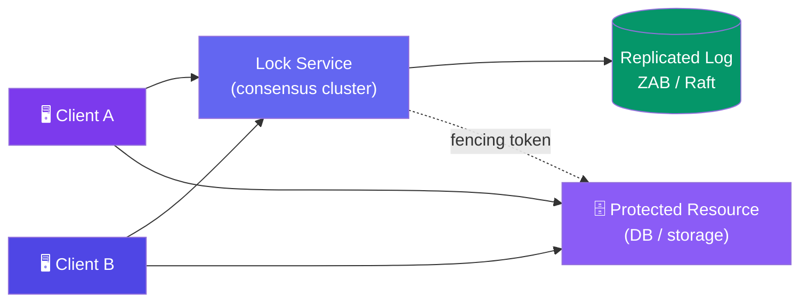
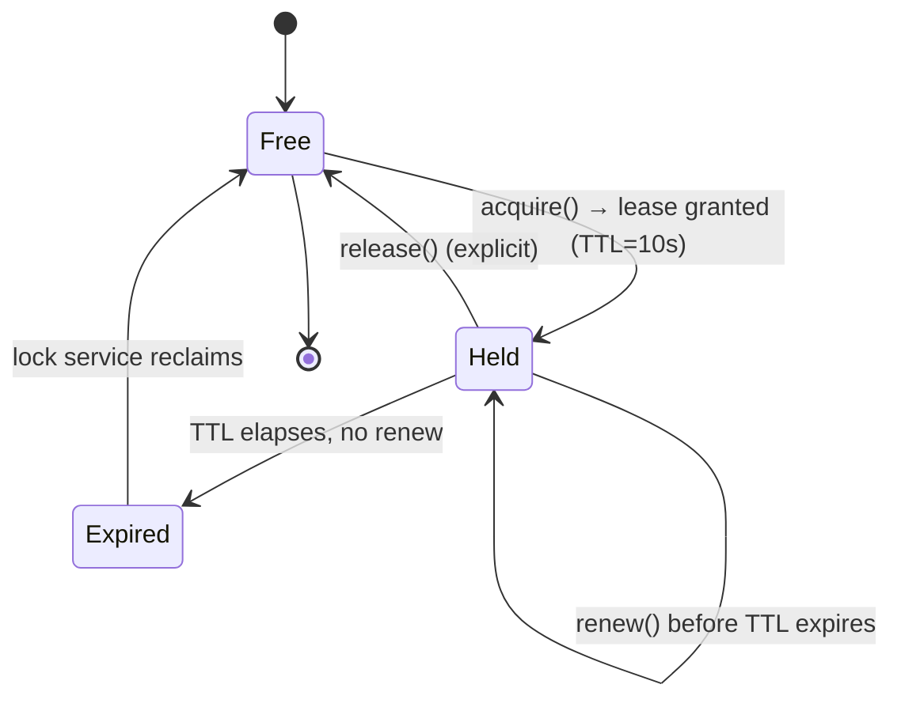
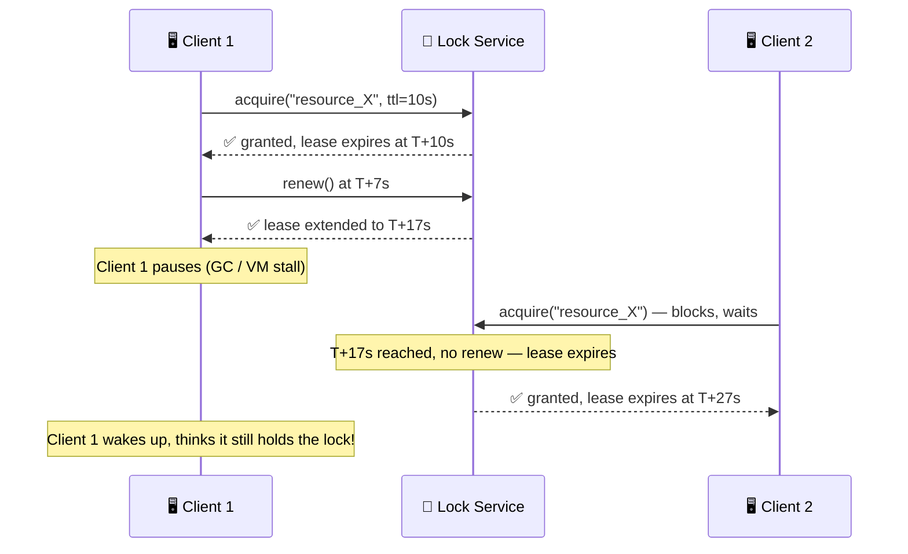

# Case Study: Design a Distributed Lock Service

> A distributed lock gives mutual exclusion to processes running on different machines — it's the primitive underneath leader election (e.g. a job scheduler) and resource-holding (e.g. a ticket-booking seat hold) elsewhere in this section.

---

## Requirements

**Functional:**
- Multiple processes on different machines can request exclusive access to a shared resource
- `acquire(resource)`, `renew(lease)`, `release(lease)` API
- Lock is automatically freed if the holder crashes or disconnects

**Non-functional:**
- **Safe** — at most one holder at any instant, even across network partitions, GC pauses, or crashes
- **Live** — the lock eventually becomes available again if the holder dies (no permanent deadlock)
- **Fault-tolerant** — the lock service itself survives the loss of a minority of its nodes
- Low-ish latency acquire (10s of ms is fine — this isn't a hot-path counter like a rate limiter)

---

## High-Level Design



The lock service only decides *who currently holds the lock*. It cannot, by itself, stop a client from writing to the resource after its lock has expired — that's what the fencing token (below) is for.

---

## Deep Dive: Leases Instead of Permanent Locks

If a lock is held forever until explicitly released, a crashed holder that never calls `release()` deadlocks every other client permanently. The fix: every lock is granted with a **TTL (lease)**. The holder must periodically `renew()` it; if it stops renewing (crash, network partition, process pause), the lease expires and the lock self-heals.





A lease alone only bounds *how long* a stale holder can believe it's safe — it does not stop that stale holder from acting after it wakes up. That's the split-brain hazard fencing tokens solve.

---

## Deep Dive: The Fencing Token Problem

**Failure scenario:** Client 1 acquires the lock, then pauses (long GC, hypervisor stall, slow disk). Its lease expires. Client 2 acquires the lock and starts writing to the shared storage. Client 1 wakes up — still believing it holds the lock — and also writes. Both clients now write concurrently: **split-brain**, silent data corruption.

A lease can't prevent this because the pause happens *outside* the lock service's control. The fix is to make the **downstream resource** reject stale writes, using a **monotonically increasing fencing token** issued by the lock service on every `acquire()`.

```
Client 1: acquire() → token 33
Client 2: acquire() → token 34   (after token 33's lease expired)

Storage service rule: reject any write with token < last_accepted_token
```

```js
// Storage service — enforces fencing, not the lock service
let lastToken = 0;

function write(data, fencingToken) {
  if (fencingToken < lastToken) {
    throw new Error("Stale token — write rejected");
  }
  lastToken = fencingToken;
  applyWrite(data);
}

// Client 1 (token 33) wakes up late and retries its write
write(staleData, 33);  // lastToken is already 34 → rejected ✅

// Client 2 (token 34) already wrote successfully
write(freshData, 34);  // accepted, lastToken = 34
```

The lock service only *issues* the token — it cannot enforce it. Every downstream resource that cares about correctness **must** check the token itself. If the resource ignores the token, fencing buys nothing.

---

## Deep Dive: Fault-Tolerating the Lock Service Itself

The lock service can't be a single node — that just moves the SPOF instead of removing it. Production lock services (ZooKeeper, Chubby, etcd) run as a small **consensus cluster** (5 nodes is typical) using ZAB or Raft to replicate "who holds which lock" across all nodes:

- Writes (acquire/release) are only committed once a **majority** of nodes agree
- The cluster tolerates the loss of a minority of nodes (2 of 5 down → still available)
- A leader node handles requests; if it dies, the remaining nodes elect a new one and resume from the replicated log

**Ephemeral nodes** (ZooKeeper's term) tie a lock to the client's live session/connection rather than to an explicit `release()` call: if the client's TCP session drops (crash, network partition) and doesn't reconnect within a heartbeat timeout, the ensemble deletes the lock node automatically and the next waiter is granted the lock. This is the ZooKeeper-flavored alternative to a manual TTL — the deep mechanics of ZAB/Raft itself are a separate topic.

---

## Deep Dive: Choosing an Implementation

| Approach | How it works | Correctness | Latency | Failure mode |
|----------|--------------|-------------|---------|---------------|
| **Single-node Redis** | `SET key value NX PX ttl` | Weak — Redis node is a single point of failure | Lowest | Redis dies → all locks lost instantly |
| **Redlock (multi-Redis)** | Acquire the same key on N independent Redis instances, win with a majority | Contested — clock-drift and GC-pause arguments (Kleppmann vs. antirez) make it unsafe for correctness-critical use without fencing | Low-medium | Tolerates minority of instance failures, but timing assumptions are fragile |
| **ZooKeeper / etcd** | Consensus (ZAB/Raft) + ephemeral nodes/leases | Safest — replicated, linearizable lock state, no clock-drift assumption | Higher (needs quorum round-trip) | Tolerates minority node loss, safe under partitions |

Rule of thumb: use Redis locks for best-effort, low-stakes coordination (e.g. deduping a cron job). Use ZooKeeper/etcd + fencing tokens when correctness actually matters (e.g. a payment or inventory write).

---

## Bottlenecks & Trade-offs

| Bottleneck | Solution |
|-----------|----------|
| **Lock service becomes a hard dependency for every caller** | Run it as a small, dedicated, highly-available cluster; make client SDKs fail fast and degrade gracefully rather than hang |
| **TTL too short → premature expiry under GC/scheduling pauses** | Size TTL well above p99 pause time; use fencing tokens so a false expiry is *safe*, not just rare |
| **TTL too long → slow failover when a holder actually crashes** | Prefer session/heartbeat-based ephemeral locks over a fixed long TTL where possible |
| **Thundering herd on release** | Queue waiters server-side (ZooKeeper sequential znodes) instead of having every waiter poll/retry |
| **Consensus round-trip adds latency** | Acceptable trade-off — this is a correctness primitive, not a hot-path lookup; don't lock on every request, lock on ownership decisions |

---

## Follow-up Questions

**Q: Why isn't a simple `SETNX` on a single Redis instance enough for correctness-critical use cases?**
It's a single point of failure — if that Redis node dies (or even just fails over to a replica that hasn't caught up), two clients can believe they hold the lock simultaneously. It also gives no fencing mechanism, so even a "correct" acquire doesn't stop a paused client from writing late.

**Q: How do fencing tokens actually get enforced — doesn't the lock service still control everything?**
No — the lock service only hands out an increasing number. Enforcement happens at the resource being protected (storage service, database, API): it must track the last-accepted token and reject any write carrying a smaller one. If the resource doesn't check the token, fencing does nothing.

**Q: How would you use this lock service to implement leader election for a job scheduler?**
Every scheduler instance tries to `acquire("scheduler-leader")`. The winner runs as leader and keeps renewing (or holds an ephemeral node tied to its session); losers watch the lock and retry when it's freed. If the leader crashes, its lease/session expires and a waiter is promoted — no manual failover.

**Q: What happens during a network partition — does the lock stay safe?**
Yes, as long as the consensus cluster requires a majority to commit. A minority-side client that thinks it still holds the lock cannot get its lease renewed (it can't reach a quorum), so the lease expires and the majority side can safely reassign it — fencing tokens catch any late write from the stalled minority client.

**Q: Why do Redlock's critics say it's unsafe?**
The argument (Kleppmann) is that Redlock relies on synchronized clocks and bounded processing/network delays to keep leases valid across independent Redis instances — assumptions that don't hold under GC pauses or clock drift. Without fencing tokens enforced downstream, a stale holder can still write after its lease should have expired.

**Q: Could you build this without a full consensus protocol?**
You could approximate it (Redlock does), but you'd be trading safety guarantees for simplicity. Anything that needs a real safety proof under partitions should sit on top of an established consensus system rather than reinventing quorum logic.

---

## In Simple Words

- A distributed lock needs a lease (TTL), not a lock held forever — a dead holder self-heals after the TTL.
- A lease alone isn't safe: a paused client can wake up and write after its lease expired. Fencing tokens fix this by making the *resource* reject stale writes.
- The lock service itself must be a small consensus cluster (ZAB/Raft), not a single node — otherwise you've just relocated the single point of failure.
- Redis locks are fine for best-effort coordination; use ZooKeeper/etcd + fencing tokens when correctness actually matters.
