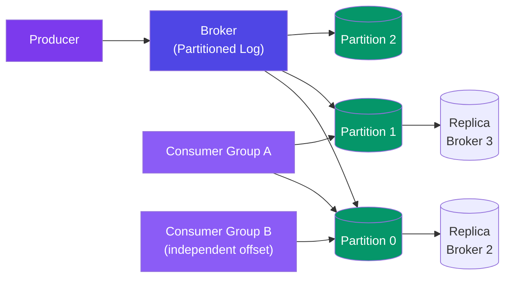
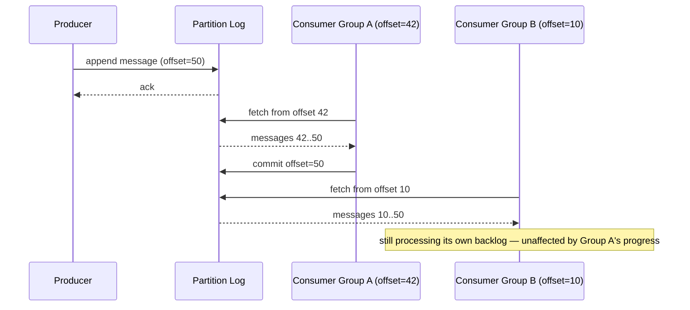

# Case Study: Design a Distributed Message Queue (Kafka)

> This case study is a different layer of the stack than [Design a Notification System](/system-design/11-case-studies/design-notification-system/), which is a *user-facing delivery* system (push/email/SMS to end users, built on top of some queue). A distributed message queue is the general-purpose **infrastructure primitive** underneath — a durable, ordered, replicated log that many independent services publish to and consume from, with no concept of "user," "channel," or "delivery receipt" at all.

---

## Requirements

**Functional:**
- Producers append messages to a named topic
- Consumers read messages from a topic, tracking their own position (offset)
- Multiple independent consumer groups can each read the same topic at their own pace
- Messages persist durably even after being consumed — replay is possible

**Non-functional:**
- Sustain very high write throughput (millions of messages/sec) with low latency
- No message loss even if a broker node dies
- Ordering guarantee *within* a partition, not required globally across a topic
- Storage grows for as long as retention policy dictates, not just until consumed

---

## High-Level Design



---

## Deep Dive: The Partitioned Commit Log

A topic isn't one big ordered stream — it's split into **partitions**, each an independent, strictly-ordered, append-only log. This is what makes horizontal scaling possible: ordering is only guaranteed *within* a partition, which is a deliberate relaxation that lets partitions be spread across many brokers and consumed in parallel.

```
Topic: "order-events" (3 partitions)

Partition 0: [msg0, msg3, msg6, msg9, ...]   <- ordered within this partition
Partition 1: [msg1, msg4, msg7, msg10, ...]  <- ordered within this partition
Partition 2: [msg2, msg5, msg8, msg11, ...]  <- ordered within this partition

Producer picks a partition per message, typically via hash(key) % numPartitions
so all messages for the same key (e.g. same order_id) land in the same partition
and are therefore seen in order relative to each other.
```

```javascript
// Producer-side partition selection — same key always maps to the same partition
function selectPartition(key, numPartitions) {
  const hash = hashString(key);
  return hash % numPartitions;
}

// All events for order_id "O123" land in the same partition, in send order
producer.send("order-events", { key: "O123", value: orderCreatedEvent });
producer.send("order-events", { key: "O123", value: orderShippedEvent });
```

This is the trade-off at the heart of the design: give up total-topic ordering to get partition-level parallelism — a consumer of partition 0 never blocks on partition 1's throughput, and adding partitions is how the system scales writes and reads horizontally.

---

## Deep Dive: Consumer Groups & Offset Tracking

Unlike a traditional queue where a consumed message is removed, Kafka-style logs keep messages around (per retention policy) and let each **consumer group** track its own read position (offset) independently. Two different services can consume the exact same topic at completely different paces without interfering with each other.



```javascript
// Consumer — offset tracking is the consumer's own responsibility, not the broker's
async function consumeLoop(topic, partition, groupId) {
  let offset = await fetchCommittedOffset(groupId, topic, partition);

  while (true) {
    const messages = await broker.fetch(topic, partition, offset);
    for (const msg of messages) {
      await processMessage(msg);
      offset = msg.offset + 1;
    }
    await commitOffset(groupId, topic, partition, offset); // checkpoint progress
  }
}
```

Within a single consumer group, partitions are divided among the group's consumer instances (each partition consumed by exactly one instance at a time) — that's how one group parallelizes its own consumption across multiple machines while still processing each partition in order.

---

## Deep Dive: Durability via Replication & Zero-Copy

**Replication (ISR — In-Sync Replicas):** each partition is replicated across multiple brokers; a write is only acknowledged once it's been written to a quorum of in-sync replicas, so a single broker failure doesn't lose data — a replica already has it and can be promoted to leader.

**Zero-copy (`sendfile`):** serving a consumer fetch means moving bytes from disk to the network socket. A naive implementation copies data from kernel space to user space and back (disk → kernel buffer → application buffer → kernel socket buffer → network). The OS's `sendfile` syscall skips the user-space round trip entirely — the kernel copies disk data directly to the socket.

```
Naive read+send:          disk -> kernel buffer -> user buffer -> kernel socket buffer -> NIC
sendfile (zero-copy):      disk -> kernel buffer -----------------------------------------> NIC
                                                    (no user-space copy at all)
```

Combined with sequential disk I/O (append-only writes, sequential reads for consumers reading forward), this is why a log-structured broker can sustain far higher throughput than a naive request-response service touching the same disks — it avoids both random I/O seeks and unnecessary memory copies.

---

## Bottlenecks & Trade-offs

| Bottleneck | Solution |
|-----------|----------|
| **Single-stream ordering would cap throughput to one broker/disk** | Partition the topic — ordering relaxed to per-partition, parallelism gained across brokers |
| **Broker crash losing unacknowledged data** | Replication with an ISR quorum — a write only acks after being durable on multiple replicas |
| **CPU/memory overhead of copying bytes through user space on every fetch** | `sendfile` zero-copy — kernel moves bytes disk-to-socket directly |
| **A slow consumer group blocking a fast one** | Independent offset tracking per consumer group — no shared read pointer to contend on |
| **Consumer instance crash mid-processing within a group** | Offsets are only committed after successful processing; a restarted consumer resumes from the last committed offset, at worst reprocessing a small uncommitted batch |

---

## Follow-up Questions

**Q: If a message key hashes to partition 0, and later a partition is added to the topic, does that break ordering for that key?**
It can — adding partitions changes the modulo used for hashing, so a producer restarted after a partition-count change may route the same key to a different partition than before, breaking the "same key, same partition" guarantee going forward. This is why partition counts are chosen deliberately upfront and increased cautiously, not treated as a casual runtime knob.

**Q: What actually happens if a consumer crashes right after processing a message but before committing its offset?**
On restart, it resumes from the last *committed* offset, which is now behind where it actually got to — so it reprocesses that last uncommitted batch. This is Kafka's standard "at-least-once" delivery semantic: the consumer's own processing logic must be idempotent if exactly-once behavior is required, because the broker only guarantees the message will be delivered again, not that it won't be delivered twice.

**Q: Why can two independent teams both consume the same topic without coordinating with each other?**
Because offset tracking is per consumer group, not global to the topic — the broker doesn't remove or mark messages as "consumed" for everyone, it just serves whatever range of the log a given group's offset requests. Team A being far ahead or behind has zero effect on what Team B's consumer group sees.

**Q: How does replication avoid data loss without doubling write latency for every message?**
The ISR quorum size is a tunable trade-off, not fixed at "all replicas" — acknowledging after a minority-tolerant quorum (not literally every replica) balances durability against latency, similar to the quorum trade-off in [Design a Distributed Key-Value Store](/system-design/11-case-studies/design-distributed-key-value-store/).

**Q: Why is sequential disk I/O such a big deal for a message queue specifically, versus a general-purpose database?**
Because a log's access pattern is inherently sequential by design — appends go to the end, and most consumers read forward from where they left off — so the broker never needs the random-access I/O a general database's arbitrary-key lookups require, letting it lean entirely into what spinning or even flash disks do fastest: long sequential reads/writes.

---

## In Simple Words

- Ordering is relaxed to per-partition, not per-topic — that's the trade that makes horizontal scaling across brokers possible at all.
- Consumer groups each track their own offset independently — the same message can be read by many unrelated consumers at their own pace, unlike a traditional "remove on consume" queue.
- Durability comes from ISR replication (quorum-acknowledged writes), not from a single broker's disk.
- Zero-copy (`sendfile`) plus sequential I/O is why a log-structured broker sustains far higher throughput than a naive request-response service touching the same disks.
