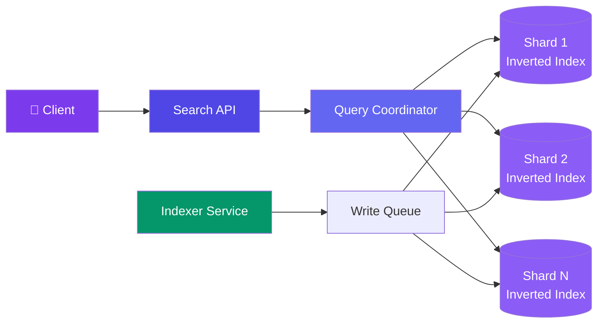
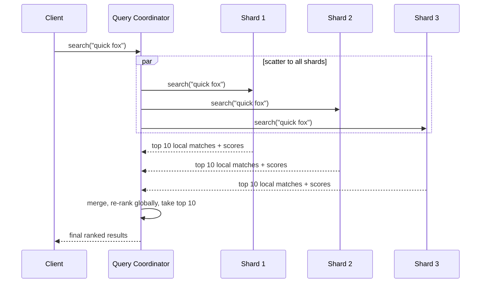

# Case Study: Design a Distributed Search Engine

> Not "search over a users list" (that's a DB index lookup) — full-text search over unstructured documents, ranked by relevance. Think Elasticsearch/Solr, or the search box behind an e-commerce catalog or a docs site.

---

## Requirements

**Functional:**
- Index a document (JSON with text fields); it becomes searchable within seconds
- `GET /search?q=...` returns matching documents ranked by relevance, not just presence
- Support phrase queries, filters (e.g. `category:electronics`), and pagination
- Delete/update a document; it's removed/refreshed from search results

**Non-functional:**
- Index 10K+ documents/sec sustained
- Search query p99 < 100ms
- Index survives node failure with no data loss
- Scale to billions of documents — no single node holds the full index

---

## Estimation

| Metric | Value |
|--------|-------|
| Documents | 1B |
| Avg document size | 2 KB → 2 TB raw text |
| Inverted index size (with term stats) | ~30-50% of raw text → **~700GB-1TB** |
| Writes/sec | 10,000 docs/sec |
| Search QPS | 50,000 |

---

## Data Model: The Inverted Index

A forward index maps `doc_id → text`. Search needs the opposite: `term → list of doc_ids containing it`. That's the **inverted index** — the core data structure of every full-text search engine.

```
Document 1: "the quick brown fox"
Document 2: "the lazy dog sleeps"
Document 3: "quick fox jumps"

Inverted index:
  "the"   → [1, 2]
  "quick" → [1, 3]
  "brown" → [1]
  "fox"   → [1, 3]
  "lazy"  → [2]
  "dog"   → [2]
  "sleeps"→ [2]
  "jumps" → [3]
```

Each posting list also stores **term frequency** (how often the term appears in that doc) and **position** (for phrase queries), not just the doc_id — relevance ranking and "exact phrase" matching both need this.

```javascript
// Simplified posting list entry
{
  term: "fox",
  postings: [
    { docId: 1, termFreq: 1, positions: [3] },
    { docId: 3, termFreq: 1, positions: [1] },
  ]
}
```

---

## High-Level Design



---

## Deep Dive: Sharding the Index

A single node can't hold a billion-document inverted index in memory. Documents are partitioned across shards (typically by `hash(doc_id) % num_shards`), each shard holding a complete inverted index over *its own* subset of documents — not a partition of the vocabulary.



This is the **scatter-gather** pattern: every query fans out to every shard (each shard independently has documents matching any term), and the coordinator merges partial results. Because each shard scores its own local matches independently, per-shard term statistics (like document frequency) are approximations of the global statistic unless the coordinator does a global stats round-trip first — a real accuracy/latency trade-off, not a free scaling win.

---

## Deep Dive: Relevance Ranking (BM25)

"Contains the word" isn't enough — results must be ranked by relevance. **BM25** (used by Elasticsearch/Lucene) scores a document for a query based on term frequency, inverse document frequency, and document length normalization:

```
score(D, Q) = Σ IDF(term) × [ tf(term, D) × (k1 + 1) ]
                            ─────────────────────────────────
                            [ tf(term, D) + k1 × (1 - b + b × |D|/avgDL) ]

IDF(term) = log( (N - n(term) + 0.5) / (n(term) + 0.5) + 1 )
  N        = total documents
  n(term)  = documents containing the term
  tf       = term frequency in this document
  |D|      = this document's length
  avgDL    = average document length across the index
  k1, b    = tuning constants (typical: k1=1.2, b=0.75)
```

```javascript
function bm25Score(term, doc, index, k1 = 1.2, b = 0.75) {
  const N = index.totalDocs;
  const n = index.docFreq(term);           // docs containing this term
  const idf = Math.log((N - n + 0.5) / (n + 0.5) + 1);

  const tf = doc.termFreq(term);
  const norm = 1 - b + b * (doc.length / index.avgDocLength);

  return idf * (tf * (k1 + 1)) / (tf + k1 * norm);
}
```

Intuition: a term that's rare across the whole index (high IDF — e.g. "quixotic") is a much stronger relevance signal than a term that's everywhere (low IDF — e.g. "the"). Length normalization (`b`) stops long documents from winning purely by containing every term somewhere.

---

## Bottlenecks & Trade-offs

| Bottleneck | Solution |
|-----------|----------|
| **Scatter-gather means every query touches every shard** | Bound shard count sensibly; a query's latency is the slowest shard's latency — tail latency matters more than average |
| **Real-time indexing vs. query throughput contention** | Buffer writes into in-memory segments, periodically merge into larger on-disk segments (Lucene-style segment merging) instead of updating one shared structure per write |
| **Deletes are expensive in an append-only index structure** | Soft-delete (tombstone bit) at write time, physically purge during background segment merges |
| **Global term statistics (IDF) differ from per-shard estimates** | Accept per-shard approximation for low-latency queries, or pay for a global-stats round-trip when ranking accuracy matters more than speed |
| **Hot shard from a skewed document distribution** | Rebalance shards by size/load, not just document count, and consider routing by a smarter key than plain hash if access patterns are skewed |

---

## Follow-up Questions

**Q: Why can't a single node just hold the whole inverted index if we throw enough RAM at it?**
Even ignoring memory limits, single-node search throughput is capped by that node's CPU for scoring and I/O for reading posting lists — sharding isn't just about fitting data, it's about parallelizing the scoring work itself across many nodes for a single query.

**Q: If per-shard IDF is only an approximation of the true global IDF, doesn't that make ranking wrong?**
It makes ranking *approximately* right, which in practice is good enough for most use cases as long as documents are randomly distributed across shards (not clustered by content) — a document isn't systematically favored or penalized because its shard happens to have slightly different term statistics than the global average.

**Q: How do you handle a document update (not just a fresh insert) in an append-heavy index structure?**
Treat an update as a delete-then-reinsert: tombstone the old version so it's excluded from scoring/results, write the new version as a fresh document in the current in-memory segment, and let the background merge process physically reclaim the tombstoned space later.

**Q: What happens to a search query if one shard is slow or temporarily unavailable?**
The coordinator can apply a timeout per shard and return partial results (marking the response as partial) rather than blocking the whole query on the slowest or dead shard — replicating each shard (so a replica can serve if the primary is down) is the actual fix for availability, the timeout is just damage control.

**Q: How would phrase search ("quick fox" as an exact phrase, not just both words present) work against the posting list structure shown?**
Because each posting stores term *positions* within the document, a phrase query intersects the posting lists for "quick" and "fox" and additionally checks that "fox"'s position is exactly one greater than "quick"'s position in the same document — position data is what turns "both words present" into "these words are adjacent."

---

## In Simple Words

- Full-text search is built on an inverted index — `term → documents containing it`, not the forward `doc → text` mapping a normal DB uses.
- Billions of documents means sharding by document, with every query scattered to every shard and results merged — not partitioning the vocabulary.
- BM25 ranks by how rare and how frequent a term is in a document, normalized by document length — "contains the word" isn't ranking.
- Writes go into small in-memory segments merged into larger ones in the background, so indexing throughput and query latency don't fight over the same structure.
