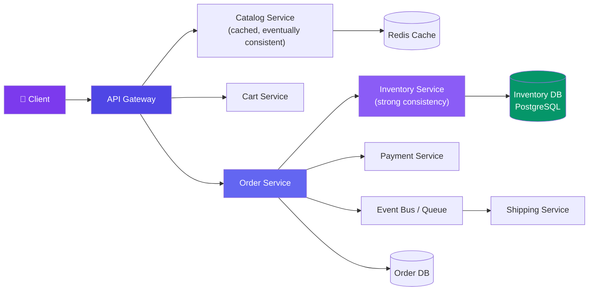
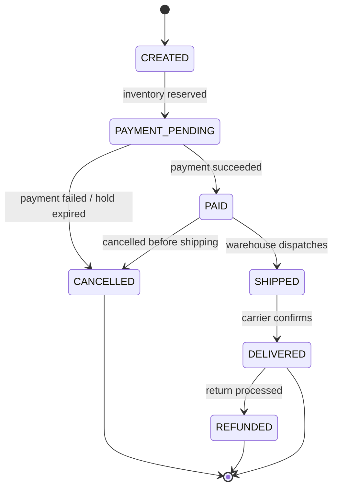
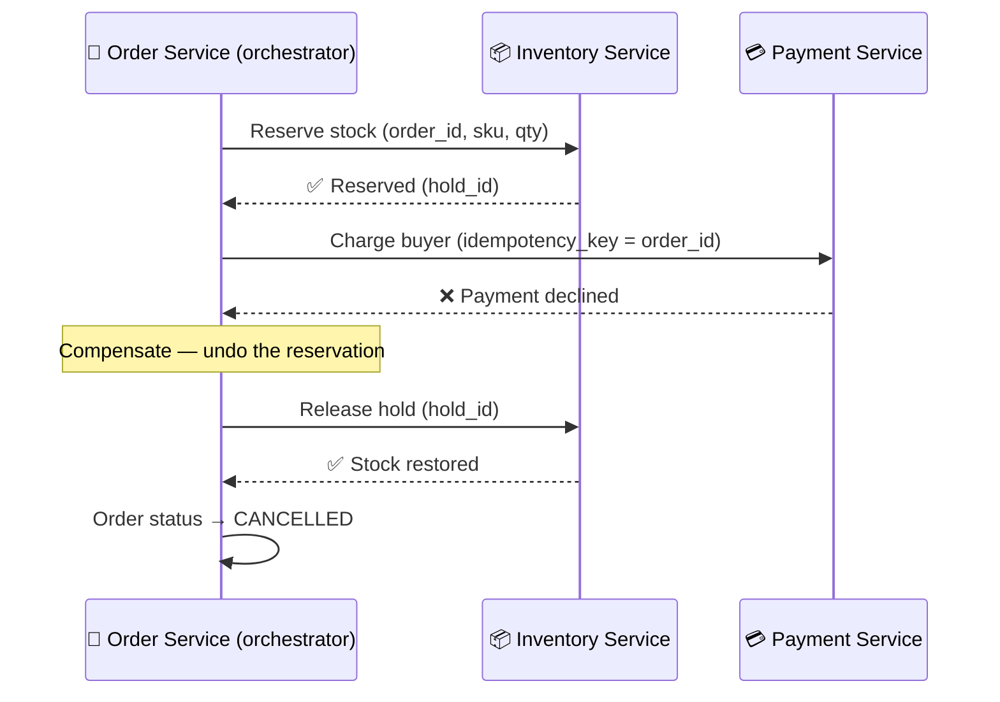

# Case Study: Design an E-commerce Order System (Amazon)

> An order system turns "add to cart" into a shipped package — without ever selling an item you don't have.

---

## Requirements

**Functional:**
- Browse product catalog, add items to cart
- Checkout: reserve inventory, place order
- Track order status (created → shipped → delivered)
- Cancel an order, return a delivered item

**Non-functional:**
- **Never oversell** — inventory count can never go negative, even under concurrent checkouts
- Handle flash-sale spikes (Black Friday: 100x normal traffic on a handful of SKUs)
- Catalog browsing can be **eventually consistent** (stale price/stock badge is fine)
- Inventory **decrement at checkout must be strongly consistent** (no lost updates)
- Payment processing is delegated to a separate Payment Service (see *Design a Payment System*) — this doc focuses on order + inventory only

---

## Estimation

| Metric | Calculation |
|--------|-------------|
| Daily active shoppers | 10M |
| Orders/day | 2M → **~23 orders/sec** average |
| Flash-sale peak | 50x average → **~1,150 orders/sec** on hot SKUs |
| Catalog reads | 10M × 20 page views = 200M/day → **~2,300 QPS** |
| Read:write ratio | ~100:1 (browsing vs. checkout) |

---

## API Design

```json
POST /cart/items
{ "product_id": "SKU-123", "qty": 2 }
→ 200 { "cart_id": "c_9x", "items": [...] }

POST /checkout
{ "cart_id": "c_9x", "address_id": "a_1" }
→ 201 { "order_id": "o_456", "status": "PAYMENT_PENDING", "hold_expires_at": "..." }

GET /orders/{order_id}
→ 200 { "order_id": "o_456", "status": "SHIPPED", "tracking": "..." }

POST /orders/{order_id}/cancel
→ 200 { "status": "CANCELLED" }
```

---

## Data Model

```sql
CREATE TABLE inventory (
  product_id VARCHAR(20) PRIMARY KEY,
  available_qty INT NOT NULL CHECK (available_qty >= 0),
  reserved_qty INT NOT NULL DEFAULT 0,
  version INT NOT NULL DEFAULT 0        -- optimistic lock
);

CREATE TABLE orders (
  id BIGINT PRIMARY KEY,
  user_id BIGINT NOT NULL,
  status VARCHAR(20) NOT NULL,          -- CREATED, PAYMENT_PENDING, PAID, SHIPPED, DELIVERED, CANCELLED, REFUNDED
  total_cents BIGINT NOT NULL,
  created_at TIMESTAMP DEFAULT NOW()
);

CREATE TABLE order_items (
  order_id BIGINT NOT NULL,
  product_id VARCHAR(20) NOT NULL,
  qty INT NOT NULL,
  price_cents BIGINT NOT NULL,
  FOREIGN KEY (order_id) REFERENCES orders(id)
);

-- Short-lived reservation, released by TTL if checkout doesn't complete
CREATE TABLE inventory_holds (
  id BIGINT PRIMARY KEY,
  order_id BIGINT NOT NULL,
  product_id VARCHAR(20) NOT NULL,
  qty INT NOT NULL,
  expires_at TIMESTAMP NOT NULL
);
```

---

## High-Level Design



---

## Deep Dive: When to Reserve Inventory

| Strategy | How it works | Pros | Cons |
|----------|--------------|------|------|
| **Decrement at checkout (atomic)** | `UPDATE inventory SET available_qty = available_qty - 1 WHERE product_id = ? AND available_qty > 0` | Simple, no cleanup job, no negative stock | Cart can show items that vanish right at checkout |
| **Reserve at "add to cart" (TTL hold)** | Decrement `available_qty` the moment it's added to cart, release after N minutes if not checked out | Cart contents feel "guaranteed" | Carts abandoned at scale lock up inventory for real buyers; hard to size TTL |
| **Reserve at checkout-start (short TTL hold)** | Move qty from `available_qty` → `reserved_qty` when checkout begins; release back if payment isn't confirmed in ~10 min | Balances fairness with liveness; short blast radius | Requires a reaper job to expire holds; still a race at reservation time |

**Our choice:** reserve at checkout-start with a short TTL. Reservation itself is still a single atomic statement:

```sql
UPDATE inventory
SET available_qty = available_qty - 1,
    reserved_qty  = reserved_qty + 1,
    version = version + 1
WHERE product_id = 'SKU-123'
  AND available_qty > 0;
-- 0 rows affected → out of stock, fail checkout immediately
```

This is atomic at the row level (no `SELECT` then `UPDATE` race), so `available_qty` never goes negative. A background reaper releases expired holds: `available_qty += reserved_qty, reserved_qty -= qty WHERE hold expired`.

---

## Deep Dive: Order Lifecycle State Machine



Each transition is an event published to the bus so Inventory, Shipping, and Notification services can react independently instead of the Order Service calling each one synchronously.

---

## Deep Dive: Saga Pattern for Distributed Checkout

Checkout spans three services with no shared database — a single ACID transaction is impossible. We use an **orchestrated saga**: the Order Service drives each step and issues a compensating action if a later step fails.



**Orchestration vs. choreography:**
- **Orchestration** (shown above): Order Service is the brain, calls each service, decides on compensation. Easier to trace and debug — pick this for checkout.
- **Choreography**: each service reacts to events from the previous one (no central brain). Less coupling, but the failure/compensation path is scattered across services and harder to reason about.

---

## Bottlenecks & Trade-offs

| Bottleneck | Solution |
|-----------|----------|
| **Hot single-row inventory counter (flash sale)** | Shard the counter (e.g. 10 sub-rows summed on read) or use an in-memory conflict-free counter (Redis `DECR` / CRDT) in front of the DB of record |
| **Flash-sale traffic spike** | Queue checkout requests, serve a virtual waiting room, pre-warm cache, autoscale stateless services ahead of the event |
| **Saga compensation complexity** | Keep every step idempotent, log saga state transitions, alert + manual reconciliation queue for compensations that fail |
| **Abandoned checkout holds** | Short TTL (5-10 min) + reaper job to release stock promptly |
| **Catalog vs inventory consistency mismatch** | Catalog stays eventually consistent (cache); only the checkout path reads the strongly consistent inventory DB |

---

## Follow-up Questions

**Q: How do you handle a hot single-row inventory counter under massive concurrent decrement load?**
Shard the row into N sub-counters (e.g. `inventory_shard_0..9`), decrement a random shard, and sum across shards to check availability — this spreads lock contention. Alternatively, front the DB with an atomic Redis `DECR` for the fast path and asynchronously reconcile to Postgres as the source of truth.

**Q: What happens if the compensating transaction itself fails (e.g. releasing the inventory hold fails)?**
Compensations must be retried with backoff and be idempotent (releasing an already-released hold is a no-op). If retries exhaust, push the saga into a dead-letter/reconciliation queue for manual or automated cleanup rather than silently losing the inventory.

**Q: How do you support "buy now" vs "add to cart then checkout" consistency differences?**
"Buy now" reserves inventory and starts the saga immediately — a single fast atomic decrement. "Add to cart then checkout" keeps the cart eventually consistent (no reservation) and only performs the atomic reservation at the moment checkout begins, so browsing/cart operations never take a lock on inventory.

**Q: Why not just lock the row with `SELECT ... FOR UPDATE` for every checkout?**
It works but holds a row lock for the duration of the transaction, serializing all checkouts on that SKU — brutal under flash-sale load. The single atomic `UPDATE ... WHERE qty > 0` achieves the same correctness without holding a lock across a round trip.

**Q: How do you prevent double-clicking "Place Order" from creating two orders?**
Idempotency key on the checkout request (client-generated, e.g. cart_id + timestamp bucket), same pattern as the Payment Service — the Order Service returns the existing order if it sees a repeated key.

**Q: How would you scale catalog browsing separately from checkout?**
Catalog reads are cached aggressively (CDN + Redis) and served from read replicas since staleness is acceptable. Checkout always reads/writes the primary inventory DB, so it's isolated on separate infrastructure from the high-QPS browsing path.

---

## In Simple Words

- Inventory must never go negative — use one atomic `UPDATE ... WHERE qty > 0`, not read-then-write.
- Reserve stock at checkout-start with a short TTL — long enough to complete payment, short enough not to starve other buyers.
- The order lifecycle is a state machine; every transition is an event, not a direct synchronous call.
- Checkout across Order/Inventory/Payment needs a saga with compensating actions — orchestration is easier to debug than choreography.
