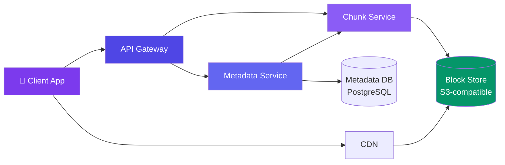

# Case Study: Design File Storage

> Cloud file storage like Dropbox or Google Drive lets users store files in the cloud and sync across devices.

---

## Requirements

**Functional:**
- Upload and download files
- Sync files across devices
- File versioning (history)
- Share files with other users
- Conflict resolution

**Non-functional:**
- Support 500M users
- Upload latency < 5 seconds for small files
- Chunk large files for resumable uploads
- 99.999% durability

---

## High-Level Design



---

## Deep Dive: File Upload Flow (Chunking)

Large files are split into **chunks** (4 MB each) for resumable uploads:

```javascript
// Client side
async function uploadFile(file) {
  const CHUNK_SIZE = 4 * 1024 * 1024; // 4 MB
  const totalChunks = Math.ceil(file.size / CHUNK_SIZE);
  const uploadId = await api.initiateUpload(file.name, file.size);

  for (let i = 0; i < totalChunks; i++) {
    const start = i * CHUNK_SIZE;
    const chunk = file.slice(start, start + CHUNK_SIZE);
    const hash = await computeSHA256(chunk);

    // Upload chunk — retry on failure
    let success = false;
    while (!success) {
      try {
        await api.uploadChunk(uploadId, i, chunk, hash);
        success = true;
      } catch (e) { /* retry */ }
    }
  }

  // Complete upload — server assembles file from chunks
  return api.completeUpload(uploadId);
}
```

---

## Deep Dive: De-duplication (Content-Addressable Storage)

When two users upload the same file, we only store it once:

```javascript
// On upload complete
function storeFile(userId, fileHash, chunks) {
  // Check if this hash already exists
  if (blockStore.exists(fileHash)) {
    // De-dup! Just add user → hash reference
    metadataDB.linkFile(userId, fileHash, file.name);
    return { saved: true, deduped: true };
  }

  // New file — store chunks
  for (const { index, data, hash } of chunks) {
    blockStore.put(`blocks/${fileHash}/${index}`, data);
  }
  metadataDB.createFile(userId, fileHash, file.name, chunks.length);
  return { saved: true, deduped: false };
}
```

**Deduplication saves massive storage** — a popular photo shared by 1000 users stores one copy.

---

## Deep Dive: Conflict Resolution

When a file is modified on two devices simultaneously:

```
Device A edits "report.docx" at 14:00
Device B edits "report.docx" at 14:01
```

**Strategy 1: Last Writer Wins (simplest)**
- Compare modification timestamps
- Later timestamp wins
- Earlier version saved as "conflicted copy"

**Strategy 2: Versioned**
- Both versions saved
- `report.docx`, `report (Alice's conflicted copy).docx`
- User manually resolves

---

## Data Model

```sql
CREATE TABLE files (
  id BIGINT PRIMARY KEY,
  user_id BIGINT NOT NULL,
  name VARCHAR(255) NOT NULL,
  path TEXT NOT NULL,
  file_hash VARCHAR(64) NOT NULL, -- SHA-256 of content
  size BIGINT,
  version INT DEFAULT 1,
  is_deleted BOOLEAN DEFAULT FALSE,
  created_at TIMESTAMP,
  updated_at TIMESTAMP,
  UNIQUE KEY (user_id, path, name)
);

CREATE TABLE file_versions (
  id BIGINT PRIMARY KEY,
  file_id BIGINT,
  file_hash VARCHAR(64),
  version INT,
  created_at TIMESTAMP
);
```

---

## Bottlenecks & Trade-offs

| Bottleneck | Solution |
|-----------|----------|
| **Storage costs** | Deduplication + cold storage for old versions |
| **Upload speed** | Chunked resumable uploads, parallel chunk uploads |
| **Sync latency** | Delta sync (only upload changed parts) + WebSocket for notifications |
| **Conflict resolution** | Last-writer-wins + conflicted copy for safety |
| **File sharing** | Link permissions in metadata DB, don't copy files |

---

## Follow-up Questions

**Q: If the app crashes mid-upload of a multi-GB file, does the client restart from chunk 0?**
No — the client should call a status endpoint with the `uploadId` to ask which chunk indices the server already has, then resume from the first missing chunk instead of re-uploading everything. This needs the server to persist per-chunk upload state (not just the final assembled file) keyed by `uploadId`.

**Q: A recipient already downloaded a file you shared with them — can you truly revoke their access?**
Not to the copy they already downloaded — you can only prevent *future* access by removing the permission row in the metadata DB and invalidating the share link. If that's not good enough (e.g., leaked confidential doc), the only real mitigation is link expiry and audit logging up front, not after-the-fact revocation.

**Q: Content-addressable storage dedupes identical files, but what about storage overhead from millions of tiny files?**
Each block-store object (e.g., an S3 PUT) has fixed overhead, so many small files waste both storage and request cost. Pack small chunks together into larger container objects (similar to Git packfiles) and keep an index mapping file → offset within the pack, unpacking only on read.

**Q: What happens when a user deletes a file — is it gone immediately?**
No, use soft delete: flip `is_deleted` and keep the blocks/versions around for a retention window (e.g., 30 days) so the user can restore from trash. A background purge job only removes the underlying blocks after retention expires and no other user reference (dedup link) remains.

**Q: For a 10 GB file, is a flat 4 MB chunk size still fine, and how do you avoid re-uploading shared content across large files?**
The chunk size itself scales fine (just more chunks), but you can also dedupe at the chunk level, not just whole-file level — if two large files share long identical byte ranges (e.g., a re-exported video), matching chunk hashes let you skip uploading those chunks entirely, not just skip the whole file.

---

## In Simple Words

- File storage = upload chunks → content-addressable store → deduplicate → sync across devices.
- Deduplication saves huge amounts of storage — one file, thousands of users.
- Chunked uploads with resume handle unreliable connections.
- Delta sync only sends changes, not the full file.
