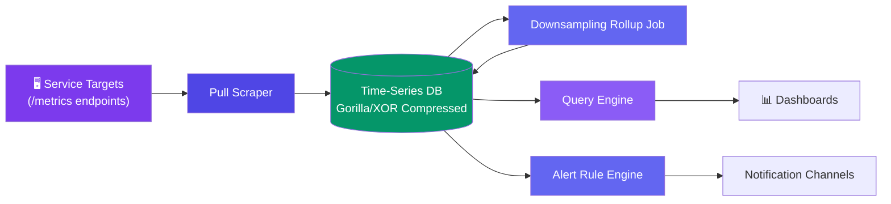
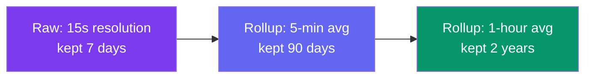

# Case Study: Design a Metrics & Monitoring System (Prometheus)

> This case study is unrelated in core technique to [Design a Distributed Cache](/system-design/11-case-studies/design-distributed-cache/) despite both storing key-addressable data in memory — a cache serves point lookups of the *latest* value, while a monitoring system's entire purpose is storing and querying **time-ordered history** at massive write volume, compressed well enough to keep months of resolution affordable.

---

## Requirements

**Functional:**
- Every service exposes a `/metrics` endpoint; the system scrapes it on an interval
- Query a metric over an arbitrary time range (e.g. `cpu_usage{service="api"}` last 6 hours)
- Define alerting rules that fire when a metric crosses a threshold for a sustained period
- Long-term storage with automatic downsampling — high resolution recent, coarse resolution old

**Non-functional:**
- Ingest millions of time-series data points per second across a large fleet
- Storage must not grow unbounded — retention needs compression, not just deletion
- Alerting must evaluate rules within seconds of a threshold breach, not minutes
- Query latency for a dashboard panel under ~200ms even over weeks of data

---

## High-Level Design



---

## Deep Dive: Pull-Based Scraping vs. Push

Two ways metrics can get into the system: services **push** their metrics to a collector, or a central scraper **pulls** from each service on an interval. Prometheus deliberately pulls.

| Concern | Push model | Pull model (Prometheus) |
|---------|-----------|--------------------------|
| Target discovery | Targets must know where to push | Scraper owns a target list — easy to add health-check-style liveness (a target that can't be scraped is visibly down) |
| Accidental DDoS of the collector | A bug causing a push storm can overwhelm the collector | Scrape rate is centrally controlled — can't be accidentally amplified by a misbehaving service |
| Debugging | Harder to manually check what a service is reporting | `curl` the `/metrics` endpoint directly — the exact same data the scraper sees |

```javascript
// Scraper — polls every target on a fixed interval, records failures as their own signal
async function scrapeLoop(targets, intervalMs = 15000) {
  for (const target of targets) {
    try {
      const body = await fetch(`http://${target.host}/metrics`).then((r) => r.text());
      const samples = parsePrometheusFormat(body);
      tsdb.write(target.id, samples, Date.now());
    } catch (e) {
      // A failed scrape IS a metric — "target unreachable" is itself alertable
      tsdb.write(target.id, [{ name: "up", value: 0 }], Date.now());
    }
  }
}
```

The failed-scrape-is-a-signal property is a direct consequence of pulling: the scraper's own vantage point ("can I reach this target") becomes free monitoring data, which a push model doesn't get for free.

---

## Deep Dive: Time-Series Compression (Gorilla/XOR Encoding)

Storing every raw `(timestamp, value)` pair at 15-second intervals across millions of series is enormous. Consecutive samples of the same metric usually change only slightly — Gorilla-style encoding exploits that by storing **deltas**, not raw values, using XOR on the bit patterns of consecutive floats.

```javascript
// Simplified Gorilla-style value compression
function compressValue(prevBits, currentBits) {
  const xor = prevBits ^ currentBits; // BigInt XOR of the two float64 bit patterns

  if (xor === 0n) {
    return { controlBit: 0 }; // identical to previous — 1 bit stored
  }
  // Otherwise store only the changed bit range (leading/trailing zero counts + meaningful bits)
  const meaningfulBits = extractChangedRange(xor);
  return { controlBit: 1, ...meaningfulBits };
}
```

Timestamps compress similarly — since scrapes happen on a near-fixed interval, storing the **delta-of-deltas** between consecutive timestamps is usually zero (constant interval), collapsing to a single bit per sample in the common case. Together, this is what lets Prometheus-style systems hold weeks of high-resolution data in a fraction of the raw footprint.

---

## Deep Dive: Downsampling & Rollups

Keeping 15-second resolution for a year is both unnecessary (nobody zooms into second-level detail on a graph from 8 months ago) and expensive. A background rollup job aggregates old data into coarser resolutions, and queries automatically pick the right resolution tier for the requested time range.



```javascript
// Query engine picks resolution tier based on requested time range
function pickResolutionTier(rangeMs) {
  const DAY = 86_400_000;
  if (rangeMs <= 7 * DAY) return "raw";
  if (rangeMs <= 90 * DAY) return "5min";
  return "1hour";
}
```

A 6-month dashboard query never touches raw 15-second data — it reads the pre-aggregated hourly rollup, which is both far smaller and exactly the resolution a wide time-range chart can actually render meaningfully anyway.

---

## Bottlenecks & Trade-offs

| Bottleneck | Solution |
|-----------|----------|
| **Millions of raw samples/sec would be unaffordable to store forever** | Gorilla/XOR compression for recent data + downsampling rollups for old data |
| **Scraping thousands of targets on one interval** | Shard targets across multiple scraper instances, each owning a subset |
| **Alert evaluation lag during a real incident** | Alert rules evaluate against the live ingest path, not the rollup tiers — sacrificing long-range query efficiency isn't acceptable for alerting latency |
| **A single slow/hanging target blocking the scrape loop** | Per-target scrape timeout; a hung target just reports as `up=0`, doesn't stall the rest of the fleet |
| **High-cardinality labels exploding series count** | Cardinality limits/guardrails on label values (e.g., reject a `user_id`-valued label) — unbounded cardinality breaks both compression and query performance |

---

## Follow-up Questions

**Q: Why does a failed scrape matter as much as a successful one?**
Because the scraper's vantage point is itself meaningful signal — a target that stops responding to scrapes is very likely down or overloaded, and recording that as `up=0` means "service is unreachable" becomes a normal, alertable time series instead of a silent gap in the data.

**Q: If old data is downsampled to hourly averages, doesn't that hide short spikes that happened months ago?**
Yes, and that's an accepted, deliberate trade-off — an hour-average rollup can't show a 30-second CPU spike from three months ago, but very few investigations need that; the raw high-resolution tier is kept exactly as long as those investigations are realistically still happening (days, not months).

**Q: How does XOR-based compression handle a genuinely volatile metric that changes wildly every sample?**
It degrades gracefully rather than failing — a large XOR delta just means more bits are stored for that sample (closer to storing the raw value), so a noisy metric compresses less well but never worse than the uncompressed baseline; the win is specific to metrics that are mostly stable between samples, which is the common case.

**Q: What stops a service from accidentally creating millions of time series with a badly-designed label (e.g., putting a user ID in a label)?**
Cardinality guardrails at ingest — reject or drop samples whose label combinations would create pathologically many distinct series, since compression, indexing, and query performance all assume a roughly bounded, human-designed set of label values, not one series per user.

**Q: Why evaluate alert rules against raw/recent data instead of against the already-aggregated rollup tiers?**
Alerting needs to detect a threshold breach within seconds of it happening — a 5-minute or hourly rollup tier is, by construction, already smoothed and delayed, which would make an alert fire minutes late exactly when fast detection matters most (an active incident).

---

## In Simple Words

- Pulling scrape targets (instead of having them push) turns "can I reach this target" into free, first-class monitoring data — a hung service is itself a signal.
- Gorilla/XOR compression exploits that consecutive samples barely change, collapsing most of a time series to a few bits per point instead of a full float64 timestamp+value pair.
- Old data gets downsampled into coarser rollup tiers — queries over wide time ranges never touch raw high-resolution data, because they can't usefully render it anyway.
- Alerting deliberately reads the live/raw path, not the rollups, because detection speed during an incident matters more than storage efficiency there.
