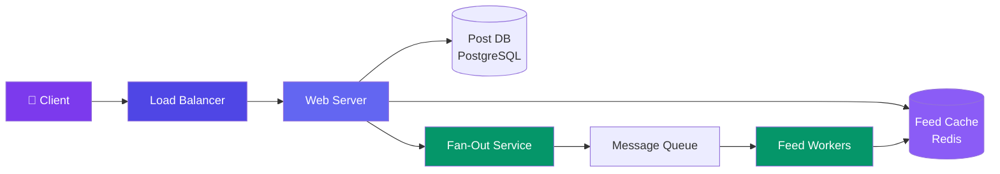

# Case Study: Design a News Feed

> A news feed shows users the latest posts from people they follow. Think Twitter, Instagram, Facebook.

---

## Requirements

**Functional:**
- User can create a post (text, image, video)
- User sees a feed of posts from people they follow
- Feed is sorted by recency/relevance
- User can like, comment, share posts

**Non-functional:**
- Feed loads in <500ms
- Support 100M DAU
- Handle write spikes (celebrity posts)

---

## Estimation

| Metric | Value |
|--------|-------|
| DAU | 100M |
| Posts/user/day | 0.5 (50M posts/day, ~600 QPS) |
| Feed reads/user/day | 10 (1,000M reads/day, ~11,500 QPS) |
| Storage (5 years) | 50M posts × 1KB = 50 GB/day → **~90 TB** |
| Images | 50M × 200KB = 10 TB/day → CDN |

---

## API Design

```json
POST /post
{ "text": "Hello world!", "media_ids": ["img_123"] }
→ { "post_id": "post_456", "created_at": "..." }

GET /feed?limit=20
→ { "posts": [ { "post_id": "...", "author": "...", "text": "..." }, ... ] }
```

---

## High-Level Design



---

## Deep Dive: Fan-Out

**Two approaches for building feeds:**

| Approach | How It Works | Pros | Cons |
|----------|-------------|------|------|
| **Push (Fan-out on write)** | When Alice posts, pre-compute feed for all followers | ✅ Feed read is O(1) | ❌ Writes are expensive for celebs |
| **Pull (Fan-out on read)** | When Bob reads feed, query all followed users' posts | ✅ Writes are O(1) | ❌ Reads are expensive |

**Our approach: Hybrid**

- **Regular users (fewer than 5K followers):** Push — pre-compute feed on write.
- **Celebrities (>5K followers):** Pull — merge celebrity posts into feed on read.

```javascript
function fanOut(post, authorId) {
  const followerCount = getFollowerCount(authorId);

  if (followerCount < 5000) {
    // Push: add post to all followers' feed caches
    const followers = getFollowers(authorId);
    for (const followerId of followers) {
      redis.lpush(`feed:${followerId}`, post.id);
      redis.ltrim(`feed:${followerId}`, 0, 500); // keep latest 500
    }
  } else {
    // Celebrity: store post, merge on read
    redis.lpush(`celebrity_posts:${authorId}`, post.id);
  }
}
```

---

## Deep Dive: Feed Ranking

After fetching candidate posts, rank them:

```
score = recency_score × 0.5 + affinity_score × 0.3 + engagement_score × 0.2
```

- **Recency:** time since post (newer = higher)
- **Affinity:** how often user interacts with this author
- **Engagement:** likes + comments + shares on the post

---

## Bottlenecks & Trade-offs

| Bottleneck | Solution |
|-----------|----------|
| **Celebrity post fan-out** | Pull model for celebrities — merge on read |
| **Feed load time** | Pre-compute + cache, then paginate |
| **Storage growth** | Archive old posts to cold storage (S3) |
| **Real-time updates** | WebSocket push for new posts in feed |

---

## In Simple Words

- News feed = blend of posts from people you follow, sorted by relevance.
- Push fan-out is fast for reads but expensive for celebrity posts.
- Hybrid approach: push for regular users, pull + merge for celebrities.
