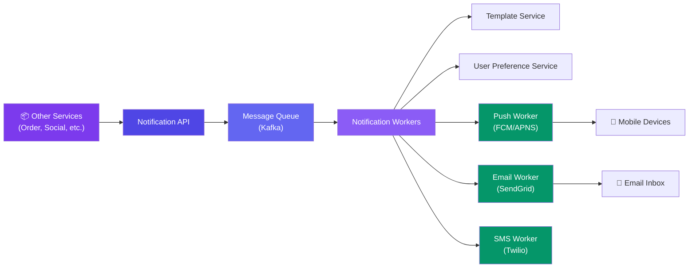

# Case Study: Design a Notification System

> A notification system sends alerts to users via push (mobile), email, SMS, or in-app.

---

## Requirements

**Functional:**
- Send notification to a user
- Support multiple channels: push, email, SMS
- Batch notifications (don't send 50 emails at once — batch and send digest)
- User can opt-out of channels

**Non-functional:**
- Deliver within 10 seconds for push, 5 minutes for email
- Handle 10M notifications/day
- At-least-once delivery (no missed notifications)

---

## High-Level Design



---

## Deep Dive: Notification Flow

```javascript
// 1. Service sends notification request
POST /notify
{
  "user_id": 123,
  "title": "Your order has shipped!",
  "body": "Order #456 has been shipped. Track it here.",
  "channels": ["push", "email"],
  "category": "order_shipped"
}

// 2. Worker processes
async function processNotification(notification) {
  // Check user preferences — did they opt out?
  const prefs = await getPreferences(notification.user_id);

  for (const channel of notification.channels) {
    if (!prefs[channel].enabled) continue; // user opted out

    switch (channel) {
      case 'push': await sendPush(notification); break;
      case 'email': await sendEmail(notification); break;
      case 'sms': await sendSMS(notification); break;
    }
  }
}
```

---

## Deep Dive: Batching & Rate Limiting

**Why batch?** Sending 50 emails individually is 50× the overhead of sending one email with 50 recipients in BCC.

**Batching strategy:**
1. Collect notifications for the same user within a time window (e.g., 5 minutes)
2. Merge into a single notification/digest
3. Send once

**Rate limiting:** External services (FCM, SendGrid, Twilio) have rate limits. Each worker has a configurable rate limiter per channel.

---

## Data Model

```sql
CREATE TABLE notifications (
  id BIGINT PRIMARY KEY AUTO_INCREMENT,
  user_id BIGINT NOT NULL,
  title VARCHAR(200),
  body TEXT,
  channel VARCHAR(20),        -- push, email, sms
  status VARCHAR(20),         -- pending, sent, failed, read
  category VARCHAR(50),       -- order_shipped, friend_request, etc.
  created_at TIMESTAMP DEFAULT NOW(),
  sent_at TIMESTAMP,
  INDEX idx_user_status (user_id, status)
);

CREATE TABLE user_preferences (
  user_id BIGINT PRIMARY KEY,
  push_enabled BOOLEAN DEFAULT TRUE,
  email_enabled BOOLEAN DEFAULT TRUE,
  sms_enabled BOOLEAN DEFAULT FALSE,
  daily_digest BOOLEAN DEFAULT FALSE
);
```

---

## Bottlenecks & Trade-offs

| Bottleneck | Solution |
|-----------|----------|
| **Rate limits on push/email providers** | Queue with retry, backpressure handling |
| **User opting out** | Check preferences before sending |
| **Notification overload** | Batch within time window, use digest emails |
| **Delivery failure** | Retry with exponential backoff, dead letter queue |
| **Multi-language** | Template service with locale-based rendering |

---

## Follow-up Questions

**Q: How do you avoid a notification storm when a post gets 1M likes in an hour?**
Don't fan out one notification per like — aggregate them server-side into a rolling digest ("You and 999,999 others' post got new likes") and only push an update when the count crosses meaningful thresholds or on a fixed interval, not per event.

**Q: A user disabled push for months and just re-enabled it — do they get a flood of backlog notifications?**
No — notifications should carry a TTL/relevance window at creation time. On re-enable, only recent and still-relevant notifications (e.g., last 24-48h, not "order shipped" from 3 months ago) get delivered, and low-priority categories are dropped entirely rather than replayed.

**Q: If a user has push, email, and SMS all enabled, how do you decide which channel(s) to actually use?**
Prioritize by urgency and cost: push first (cheap, fast) for time-sensitive alerts, fall back to email/SMS only if push delivery fails or isn't acknowledged within a window, and reserve SMS for high-priority categories only since it's the most expensive channel per message.

**Q: What happens if a downstream provider (FCM, SendGrid, Twilio) is down for an extended period?**
The worker's rate limiter/circuit breaker trips and messages queue up in Kafka rather than being dropped; combined with at-least-once delivery, they replay once the provider recovers. If the outage is long, consider failing over to an alternate channel for that category.

**Q: How do you guarantee at-least-once delivery without duplicate notifications when a worker crashes mid-send?**
Track delivery status per (notification_id, channel) in the DB and use idempotency keys when calling the provider API, so a retried send after a crash either gets deduped by the provider or is checked against the "sent" status before resending.

---

## In Simple Words

- Notification system = receive event → queue → render template → deliver via push/email/SMS.
- Always check user preferences before sending — don't spam users who opted out.
- Batch notifications to avoid overwhelming users and external providers.
