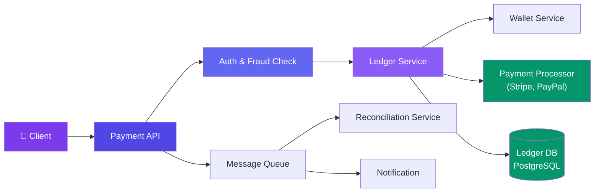
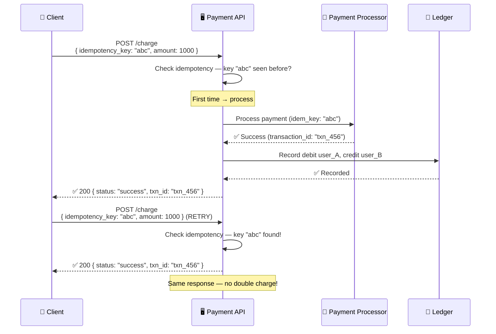

# Case Study: Design a Payment System

> A payment system processes financial transactions — the most critical system where correctness is everything.

---

## Requirements

**Functional:**
- Process a payment from buyer to seller
- Handle multiple payment methods (credit card, wallet, bank transfer)
- Generate receipts
- Support refunds and chargebacks

**Non-functional:**
- **Exactly-once processing** — no double charges!
- Idempotent retries
- Audit trail of all transactions
- 99.999% uptime during business hours

---

## High-Level Design



---

## Deep Dive: Payment Flow with Idempotency



---

## Deep Dive: Double-Entry Ledger

Every transaction is recorded as two entries (debit + credit):

```
Transaction: User A pays $10 to User B

Entry 1: User_A | DEBIT  | $10 | Wallet
Entry 2: User_B | CREDIT | $10 | Wallet

Sum of all entries = 0  (always!)
```

**Why double-entry?** You can detect errors: if `sum(debits) ≠ sum(credits)`, something is wrong.

---

## Deep Dive: Reconciliation

```javascript
// Daily reconciliation job
async function reconcile() {
  // 1. Get all payments from ledger for today
  const payments = await ledger.getPayments(Date.range('today'));

  // 2. Get all settlements from payment processor
  const settlements = await psp.getSettlements(Date.range('today'));

  // 3. Match them
  for (const payment of payments) {
    const match = settlements.find(s => s.id === payment.psp_transaction_id);

    if (!match) {
      // Payment processor didn't settle this!
      await alertTeam(`Unreconciled payment: ${payment.id}`);
    }

    if (match.amount !== payment.amount) {
      // Amount mismatch!
      await alertTeam(`Amount mismatch: ${payment.id}`);
    }
  }
}
```

**Reconciliation catches:**
- Payments that succeeded in the ledger but failed at the processor
- Processor settled a payment that the ledger doesn't know about
- Amount mismatches (currency conversion, fees)

---

## Data Model

```sql
-- Immutable audit log
CREATE TABLE transactions (
  id BIGINT PRIMARY KEY,
  idempotency_key VARCHAR(64) UNIQUE NOT NULL,
  user_id BIGINT NOT NULL,
  amount_cents BIGINT NOT NULL,
  currency VARCHAR(3) DEFAULT 'USD',
  status VARCHAR(20),       -- pending, succeeded, failed, refunded
  psp_transaction_id VARCHAR(64),
  created_at TIMESTAMP DEFAULT NOW()
);

-- Double-entry ledger
CREATE TABLE ledger_entries (
  id BIGINT PRIMARY KEY,
  transaction_id BIGINT NOT NULL,
  account_id BIGINT NOT NULL,
  entry_type VARCHAR(10),   -- DEBIT, CREDIT
  amount_cents BIGINT NOT NULL,
  currency VARCHAR(3),
  FOREIGN KEY (transaction_id) REFERENCES transactions(id)
);
```

---

## Bottlenecks & Trade-offs

| Bottleneck | Solution |
|-----------|----------|
| **Exactly-once processing** | Idempotency keys + idempotent PSP handling |
| **PSP failures** | Retry with exponential backoff, circuit breaker |
| **Fraud** | Fraud detection service before processing |
| **Reconciliation** | Daily automated reconciliation with alerts |
| **Concurrent writes to balance** | Optimistic locking (version column) or row-level locks |

---

## In Simple Words

- Payment system = the most correctness-critical system. No double charges allowed!
- Idempotency keys prevent double charges from retries.
- Double-entry ledger ensures every debit has a matching credit.
- Daily reconciliation catches mismatches between your records and the payment processor.
