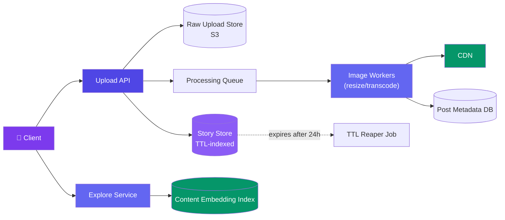
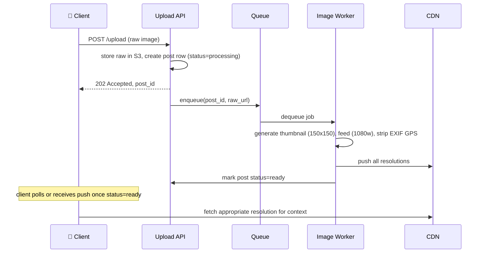
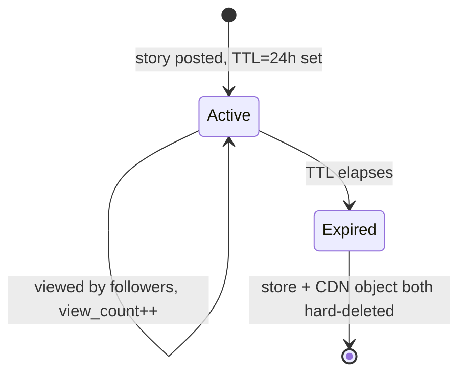

# Case Study: Design Instagram

> This case study assumes the base upload/CDN pattern from [Design File Storage](/system-design/11-case-studies/design-file-storage/) and the follow-based feed from [Design a News Feed](/system-design/11-case-studies/design-news-feed/). What's specific here: an async multi-resolution image pipeline, **ephemeral** Stories with TTL-based storage (not permanent posts), and a **Discover/Explore** feed ranked by content similarity rather than the social graph.

---

## Requirements

**Functional:**
- Upload a photo/video post; it appears on the user's profile and followers' feeds
- Post a **Story** — visible to followers for 24 hours, then automatically gone
- `GET /explore` — a discovery feed of posts from accounts the user doesn't follow, ranked by relevance
- Like, comment, view Stories (with view-count/who-viewed for the poster)

**Non-functional:**
- Every uploaded image is available in multiple resolutions (thumbnail, feed, full) within seconds of upload
- Stories genuinely disappear at TTL expiry — not just hidden client-side
- Explore feed personalizes without needing the user to follow anyone
- 500M DAU, ~100M photos/day uploaded

---

## High-Level Design



---

## Deep Dive: Async Image Processing Pipeline

A raw upload is not directly served — it's queued for async processing into the resolutions the client actually needs (thumbnail for grid view, medium for feed, original for full-screen zoom). The client gets an immediate "upload accepted" response and polls/subscribes for readiness rather than blocking on processing.



```javascript
// Image worker — one job per uploaded photo
async function processImage(job) {
  const raw = await s3.get(job.rawUrl);

  const variants = await Promise.all([
    resize(raw, { width: 150, height: 150, name: "thumbnail" }),
    resize(raw, { width: 1080, name: "feed" }),
    stripExif(raw, { name: "original" }), // strip GPS/location metadata for privacy
  ]);

  await Promise.all(variants.map(v => cdn.upload(v)));
  await db.updatePostStatus(job.postId, "ready");
}
```

Stripping EXIF GPS data is a deliberate privacy step at this stage — not optional, not client-side — since the original file the user uploaded may contain exact location metadata they didn't intend to share.

---

## Deep Dive: Ephemeral Stories (TTL Storage)

Stories are architecturally different from posts: they **must** actually disappear, not just be filtered out of a query. That means storage itself needs a TTL primitive, not an `is_expired` flag checked by the read path (a flag-only approach still leaves the media sitting in storage and reachable by direct CDN URL forever).

```sql
CREATE TABLE stories (
  id BIGINT PRIMARY KEY,
  user_id BIGINT NOT NULL,
  media_url TEXT NOT NULL,
  created_at TIMESTAMP NOT NULL,
  expires_at TIMESTAMP NOT NULL,   -- created_at + 24h
  view_count INT DEFAULT 0
);
-- Backing store: a TTL-native store (Redis with EXPIRE, or DynamoDB TTL attribute)
-- rather than a plain relational table with no enforced deletion.
```

- **Metadata** lives in a TTL-native store (Redis key with `EXPIRE 86400`, or DynamoDB's native TTL attribute) so the row is *actually deleted* by the store itself, not by a best-effort cron.
- **Media** is uploaded with a short-lived signed CDN URL and a lifecycle rule on the storage bucket that hard-deletes the object after 24h — so even someone who saved the direct URL loses access once the object is gone.
- **Viewer list** (who viewed the story) is a separate small append-only set per story, deleted alongside the story itself.



---

## Deep Dive: Explore/Discovery Feed (Content Embeddings)

The home feed (from the news-feed case study) only shows accounts you follow. Explore needs to surface **relevant content from accounts you've never followed** — it can't use the social graph at all, so it ranks by **content similarity** instead.

Each post gets an embedding vector (from an image/content model) computed at upload time; a user's taste vector is the aggregate of embeddings of content they've engaged with recently. Explore candidates are posts whose embeddings are nearest-neighbors to the user's taste vector.

```javascript
// Simplified: candidate generation for one user's Explore feed
async function getExploreCandidates(userId) {
  const tasteVector = await getUserTasteEmbedding(userId); // avg of liked/viewed posts' embeddings
  const candidates = await embeddingIndex.nearestNeighbors(tasteVector, {
    k: 500,
    excludeAuthors: await getFollowedAccounts(userId), // don't just re-surface the home feed
  });
  return rankByEngagementPrediction(candidates, userId);
}
```

| Feed | Ranking basis | Candidate source |
|------|---------------|-------------------|
| **Home feed** | Recency + affinity + engagement (social graph) | Accounts you follow |
| **Explore feed** | Embedding similarity to your taste vector | Nearest-neighbor search over ALL public posts |

The embedding index (an ANN structure like HNSW or IVF) is what makes "nearest neighbor over billions of posts" tractable — a linear scan per user request is a non-starter at this scale.

---

## Bottlenecks & Trade-offs

| Bottleneck | Solution |
|-----------|----------|
| **Processing latency before a post is viewable** | Serve the thumbnail resolution first as soon as it's ready, don't block the whole post on the largest variant finishing |
| **Story storage growing unbounded if TTL deletion silently fails** | Use a store with a native, engine-enforced TTL (Redis `EXPIRE`, DynamoDB TTL) rather than relying solely on an application-level reaper job |
| **Explore feed staleness — taste vector lags behind recent behavior** | Recompute the taste vector incrementally on each engagement event, not via a nightly batch job |
| **ANN index rebuild cost as new posts are uploaded continuously** | Use an index structure that supports incremental inserts (HNSW) rather than requiring a full rebuild |
| **EXIF/location leakage from raw uploads** | Strip metadata at the processing-worker stage, before any variant is CDN-served, not client-side only |

---

## Follow-up Questions

**Q: If Stories used a simple `is_expired` boolean checked at read time instead of a TTL-native store, what actually breaks?**
The read path would correctly hide expired stories from the app, but the media object itself keeps sitting in storage indefinitely and remains reachable by anyone who saved the direct CDN URL before it expired — the guarantee "this disappears after 24h" wouldn't actually hold at the storage layer, only at the query layer.

**Q: Why compute image variants asynchronously instead of resizing on-the-fly per request?**
On-the-fly resize per request repeats the same CPU work for every viewer of a popular post; precomputing once at upload time and caching each variant on the CDN means millions of subsequent reads are just a CDN hit, not a resize operation.

**Q: How does the Explore feed avoid recommending the same viral post to everyone regardless of individual taste?**
Ranking is nearest-neighbor against each user's own taste vector, not a single global popularity score — two users with different engagement histories get different nearest-neighbor sets even from the same candidate pool, and a diversity/de-duplication pass on top prevents one viral post from dominating every user's results.

**Q: What happens if a user views their own Story after posting — does that count in the view count shown to them?**
No — the viewer-list write path should exclude the poster's own user_id, since "view count" and "who viewed" are meant to describe the audience, not the author checking their own post.

**Q: A user reports a Story containing policy-violating content minutes before its 24h TTL would expire naturally — how do you handle takedown?**
Moderation removal is a separate, faster path than the TTL expiry — an explicit delete on both the metadata store and CDN object, independent of the TTL reaper, since waiting for natural expiry isn't acceptable for an active moderation case.

---

## In Simple Words

- Upload response comes back immediately; multi-resolution processing (thumbnail/feed/original + EXIF stripping) happens async on a worker queue.
- Stories need storage that *actually* deletes on TTL expiry (Redis/DynamoDB TTL), not just a filter flag the read path checks — otherwise "disappears after 24h" is a lie at the storage layer.
- Explore/Discovery is fundamentally different from the home feed: it ranks by content-embedding similarity to a user's taste vector, not by the social graph, and needs an ANN index to stay fast at billions of posts.
- Stripping GPS/EXIF metadata happens server-side at processing time — a privacy step that can't be left to the client.
