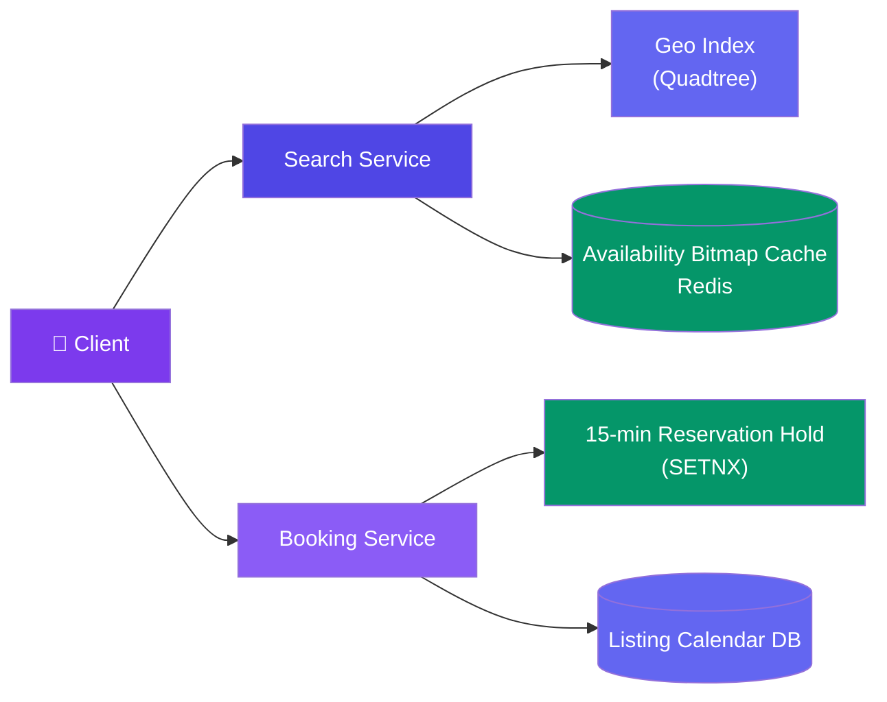
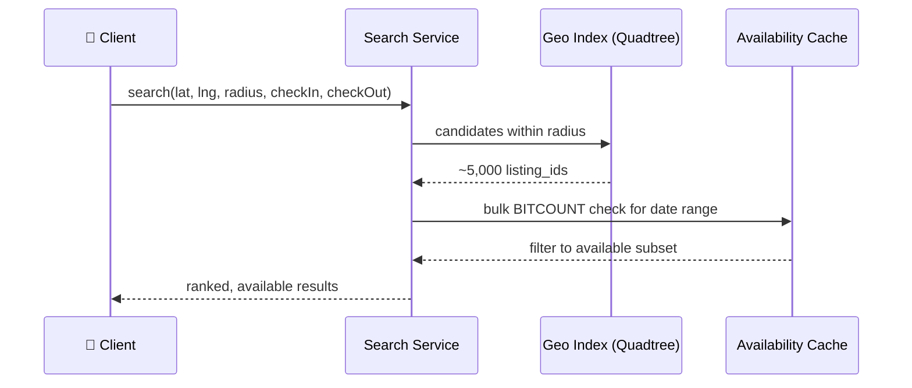

# Case Study: Design Property & Hotel Booking (Airbnb)

> This case study assumes the hold-lock mechanics from [Design a Ticket Booking System](/system-design/11-case-studies/design-ticket-booking-system/), which handles a single event's fixed seat map under flash-sale concurrency. Airbnb's problem is shaped differently: millions of independent listings, each with its own **365-day calendar** of availability, searched by an arbitrary **date range** and **location** rather than reserved by seat number.

---

## Requirements

**Functional:**
- Search listings by location + check-in/check-out date range + guest count
- View a listing's live availability calendar
- Reserve a date range; it becomes unavailable to other searchers immediately
- Host can block/unblock dates and adjust nightly pricing

**Non-functional:**
- Availability search must never show a listing as bookable for dates it can't actually cover
- Search latency low even across millions of listings and arbitrary date ranges
- Reservation holds must expire automatically if payment isn't completed
- 10M+ active listings, 100K+ searches/sec at peak

---

## High-Level Design



---

## Deep Dive: 365-Day Availability Bitmaps

A listing's availability is naturally a per-day boolean — available or not — for the next 365 days. Storing this as a **bitmap** (one bit per day) makes both point-checks and range-checks extremely cheap, instead of querying a `bookings` table with date-range overlap logic per listing.

```
Listing #4521 availability bitmap (365 bits, 1 = available):
Day:   1  2  3  4  5  6  7  8  9  10 ...
Bit:   1  1  1  0  0  0  1  1  1  1  ...
                 ^-------^
             blocked (booked or host-blocked)
```

```javascript
// Redis bitmap ops — check a date range in one round trip
async function isRangeAvailable(listingId, startDay, endDay) {
  const key = `avail:${listingId}`;
  // BITCOUNT over the byte range covering [startDay, endDay]
  const setBits = await redis.bitcount(key, byteOffset(startDay), byteOffset(endDay));
  const totalDays = endDay - startDay + 1;
  return setBits === totalDays; // every day in range must be a 1
}

async function reserveRange(listingId, startDay, endDay) {
  const key = `avail:${listingId}`;
  for (let day = startDay; day <= endDay; day++) {
    await redis.setbit(key, day, 0); // mark unavailable
  }
}
```

A `BITCOUNT` over a date range is a single fast operation regardless of range length, which is exactly the query shape search needs — "is this listing free for these 5 nights" — without scanning a bookings table per listing per search result.

---

## Deep Dive: Geo + Date-Range Search

Search combines two independent filters — "near this location" and "free for this date range" — that need to intersect efficiently across millions of listings. Geospatial filtering narrows the candidate set first (cheaper), then availability bitmaps filter that smaller set.



Filtering by geography first (quadtree narrows millions to thousands) before checking availability (bitmap check on the smaller candidate set) avoids running a per-listing date-range check against the entire catalog on every search — the same "cheap filter first" principle as [Design a Proximity Service](/system-design/11-case-studies/design-proximity-service/), composed here with an availability filter on top.

---

## Deep Dive: Reservation Hold vs. Seat Lock

A ticket booking hold locks one seat for ~10-15 minutes while checkout completes. Airbnb's hold is conceptually similar but locks a **date range on one listing**, and because listings are far less contended than a single flash-sale event's seat map (thousands of buyers, one seat map), the concurrency profile is much gentler — but the correctness requirement is identical: never let two guests hold overlapping dates on the same listing.

```javascript
// SETNX-based hold — reuses the ticket-booking pattern, scoped to a date range key
async function holdDateRange(listingId, startDay, endDay, userId) {
  const holdKey = `hold:${listingId}:${startDay}-${endDay}`;
  const acquired = await redis.set(holdKey, userId, { NX: true, EX: 900 }); // 15-min TTL

  if (!acquired) return { success: false, reason: "dates_no_longer_available" };

  await reserveRange(listingId, startDay, endDay); // flip bitmap bits
  return { success: true, holdExpiresAt: Date.now() + 900_000 };
}
```

If checkout doesn't complete before the TTL, the hold key expires — but the availability bitmap bits flipped in `reserveRange` must also be rolled back by an expiry listener, otherwise the listing stays incorrectly blocked forever after an abandoned checkout.

---

## Bottlenecks & Trade-offs

| Bottleneck | Solution |
|-----------|----------|
| **Per-listing date-range availability checks at search scale** | Bitmap representation makes a range check a single `BITCOUNT`, not a bookings-table scan |
| **Combining geo filter and availability filter efficiently** | Geo-narrow first (quadtree), then availability-filter the much smaller candidate set |
| **Abandoned checkout leaving a listing falsely blocked** | TTL-expiring hold key paired with an expiry listener that rolls back the bitmap bits it flipped |
| **Host updating pricing/availability concurrently with an in-progress search** | Search results reflect a point-in-time snapshot; final availability is re-validated at hold time, not trusted from search results |
| **Popular destination causing search hot-spotting on one geo cell** | Same quadtree rebalancing concern as any geospatial index — subdivide dense cells further |

---

## Follow-up Questions

**Q: Why not just query a `bookings` table with date-range overlap SQL (`start <= ? AND end >= ?`) instead of a bitmap?**
That query pattern doesn't use an index efficiently for overlap conditions and gets expensive at scale — checking millions of listings' overlap logic per search doesn't parallelize as cheaply as a `BITCOUNT`, which is a single fast bitwise operation regardless of how many listings are checked in bulk.

**Q: What happens if a host manually blocks a date that's currently inside an active guest hold?**
The host-facing UI should show that range as "pending guest action" rather than allowing an immediate host block — a hold in progress represents a real, time-bounded claim, and silently overriding it would let a host bump out a guest who's mid-checkout.

**Q: How does this design avoid the double-booking bug where two guests both pass the availability check for the same dates?**
The `SETNX`-based hold is the actual mutual-exclusion point, not the availability check — two concurrent requests both reading "available" is expected under high concurrency, but only one `SET ... NX` on the hold key can succeed, and that's what actually reserves the range.

**Q: Why does search filter by geography before availability instead of the other way around?**
Geographic filtering (quadtree range query) is proportional to how dense that area is, typically narrowing millions of listings to a few thousand cheaply; running an availability bitmap check against the *entire* catalog first would waste work checking listings that would've been geographically excluded anyway.

**Q: A host changes their listing's nightly price mid-search — does that break anything?**
No — pricing isn't part of the availability bitmap or the hold mechanism, so a price change is just read fresh at checkout time; the only correctness-critical state is the availability bit and the hold key, and both are re-validated at hold time regardless of what a stale search result showed.

---

## In Simple Words

- Availability is a per-day bit, not a bookings-table row — a date-range check becomes one fast `BITCOUNT`, not an overlap query scanned per listing.
- Search narrows by geography first (cheap), then checks availability only on that smaller candidate set — cheap filter before expensive filter.
- The reservation hold reuses the same `SETNX`-with-TTL pattern as flash-sale ticket booking, just scoped to a date range instead of a seat — and still needs an expiry listener to roll back the bitmap on an abandoned checkout.
- Search results are a snapshot; the hold step is where availability is actually, authoritatively re-checked.
