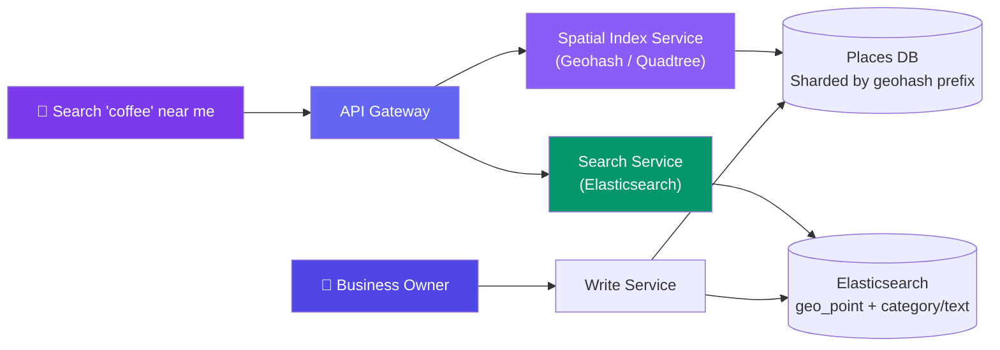
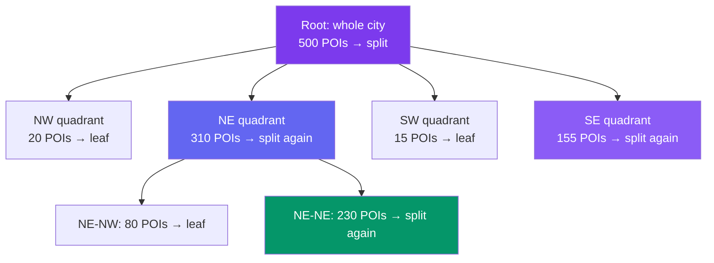

# Case Study: Design a Proximity / Nearby Places Service

> Given a location and radius, return nearby businesses (restaurants, gyms, ATMs) filtered by category and sorted by distance/rating. Unlike ride-sharing, the points barely move.

---

## Requirements

**Functional:**
- Given `(lat, lng, radius, category)`, return matching places within radius
- Sort results by distance, rating, or a blended relevance score
- Support category/text filters ("pizza", "24-hour gym")
- Business owners can add/update a place (name, category, hours, location)

**Non-functional:**
- Read-heavy: 100:1 read/write ratio (millions of searches vs. rare business edits)
- 100M+ POIs worldwide
- Query latency <200ms at p99
- Data is **mostly static** — a business relocates maybe once a year, not every 3 seconds

**Key difference from ride-sharing:** we're indexing a huge, mostly-immutable dataset for fast spatial *reads*, not streaming a small set of constantly-moving points. That changes which data structure wins — no need for Redis GEOADD's write-optimized moving-point model.

---

## Estimation

| Metric | Value |
|--------|-------|
| Total POIs | 100M |
| Avg place size (name, category, lat/lng, rating, metadata) | ~500 bytes |
| Raw storage | 100M × 500B ≈ **50 GB** (fits in a sharded index, even in RAM per shard) |
| Searches/day | 500M |
| QPS (avg) | 500M / 86,400 ≈ **~5,800 QPS** (peak 5-10×) |
| Writes/day (new/updated places) | ~500K → **~6 writes/sec** |

Read:write ratio confirms this is an indexing/caching problem, not a write-throughput problem.

---

## High-Level Design



---

## Deep Dive: Geohashing

Geohash encodes `(lat, lng)` into a base32 string by recursively bisecting latitude/longitude ranges and interleaving bits. Crucially, **places that share a longer common prefix are spatially close** — this turns a 2D range query into a 1D string-prefix query, which is trivial to shard and index (e.g., B-tree, sorted set, or DB index on the geohash column).

```javascript
// Simplified geohash encoding
const BASE32 = "0123456789bcdefghjkmnpqrstuvwxyz";

function encodeGeohash(lat, lng, precision = 7) {
  let latRange = [-90, 90];
  let lngRange = [-180, 180];
  let isEven = true;
  let bit = 0, ch = 0, geohash = "";

  while (geohash.length < precision) {
    const range = isEven ? lngRange : latRange;
    const val = isEven ? lng : lat;
    const mid = (range[0] + range[1]) / 2;

    bit = bit << 1;
    if (val > mid) { bit |= 1; range[0] = mid; } else { range[1] = mid; }

    isEven = !isEven;
    if (++ch === 5) {
      geohash += BASE32[bit];
      bit = 0; ch = 0;
    }
  }
  return geohash;
}

encodeGeohash(37.7749, -122.4194, 7); // "9q8yyk0" → San Francisco
```

**Query:** find the geohash prefix covering the search radius, then `WHERE geohash LIKE '9q8yy%'`.

**The boundary problem:** two points 10 meters apart can fall into *different* geohash cells if they straddle a cell edge (e.g., one is `9q8yyk0`, the neighbor is `9q8yyk1` next door, or even a totally different prefix across a bigger boundary). The fix: always search the target cell **plus its 8 neighboring cells** (N, S, E, W, and 4 diagonals), union the results, then filter by exact distance.

| Precision (chars) | Cell size (approx) |
|---|---|
| 4 | ~39 km × 19.5 km |
| 5 | ~4.9 km × 4.9 km |
| 6 | ~1.2 km × 0.6 km |
| 7 | ~152 m × 152 m |
| 8 | ~38 m × 19 m |

Pick precision so the cell is roughly the size of your typical search radius (e.g., precision 6-7 for "restaurants within 2km").

---

## Deep Dive: Quadtree — Handling Uneven Density

Geohash cells are **fixed-size** — a precision-7 cell in Manhattan has thousands of POIs, while the same cell in rural Montana has zero. Fixed grids waste index nodes on empty rural cells and overload dense urban ones.

A **quadtree** fixes this by recursively splitting a region into 4 quadrants *only when a quadrant holds more than N points* (e.g., N=100). Dense areas get many small leaf nodes; sparse areas stay as one large leaf.

```
                    World
                 /   |   |   \
               NW    NE   SW   SE
              (empty)     (empty)
              /  |  |  \
           NW1 NE1 SW1 SE1     <- keeps splitting only where dense
           (Manhattan block,
            still >100 POIs,
            splits again)
```



**Query:** walk down from root, discarding quadrants that don't intersect the search radius, until you hit leaf nodes — then scan those leaves for exact distance.

**Why it beats fixed geohash cells for POI data:** POI density varies by orders of magnitude between a city center and open countryside. A quadtree's node count scales with actual data density, so query cost (leaf nodes touched) stays roughly uniform regardless of where you search — geohash gives you either too-coarse cells (miss nearby results, need wide neighbor search) or too-many-tiny-cells (index bloat) depending on the fixed precision you chose upfront.

---

## Deep Dive: Geohash vs. Quadtree vs. Bounding-Box Range Query

| Approach | How it works | Best for | Weakness |
|---|---|---|---|
| **Lat/lng bounding box** | `WHERE lat BETWEEN.. AND lng BETWEEN..` on a plain B-tree index | Small datasets, quick prototypes | No true radius (rectangle ≠ circle), poor index selectivity at scale, distorts near poles |
| **Geohash** | String-prefix match on precomputed geohash column | Sharding a distributed DB by location, simple range queries, works with any standard DB index | Fixed cell size — bad for uneven density; must search neighbor cells for boundary correctness |
| **Quadtree** | In-memory/service-side recursive spatial tree, adaptive node size | Read-heavy services with highly uneven density (exactly this use case) | More complex to shard/persist; usually held in memory per region, rebuilt/rebalanced periodically |

**Our choice:** geohash for sharding the underlying database (cheap, works with normal indexes) + an in-memory quadtree (or R-tree) per shard/region for the actual nearest-neighbor query serving layer. This is what most production systems (Uber's original H3, Google S2, Yelp) converge on — a coarse hash for storage partitioning, a finer adaptive structure for query-time precision.

---

## Deep Dive: Ranking Results

A pure "nearest first" sort is wrong — a 4.9-star restaurant 800m away usually beats a 2-star one 300m away. Combine signals:

```javascript
function rankPlaces(places, userLat, userLng) {
  return places
    .map(p => ({
      ...p,
      distanceKm: haversine(userLat, userLng, p.lat, p.lng),
    }))
    .map(p => ({
      ...p,
      score:
        (1 / (1 + p.distanceKm)) * 0.5 +   // closer = higher, decays with distance
        (p.rating / 5) * 0.35 +             // quality signal
        (p.relevanceToQuery) * 0.15,        // text-match / category-match score
    }))
    .sort((a, b) => b.score - a.score);
}
```

**Combining spatial + text/category search:** the spatial index (geohash/quadtree) narrows 100M POIs down to a candidate set of a few hundred within the radius. That candidate set is then handed to **Elasticsearch** (which also supports native `geo_point` + `geo_distance` queries) to apply category filters, text relevance ("open now", "vegan"), and business boosting — Elasticsearch merges the geo filter and text/category scoring in a single query so you don't need two round-trips.

---

## Bottlenecks & Trade-offs

| Bottleneck | Solution |
|-----------|----------|
| **Dense urban hotspots** (Manhattan, Tokyo) get disproportionate query load | Quadtree naturally creates more, smaller leaves there; add read replicas/caching per hot region |
| **Precision vs. recall in geohash cell size** | Too coarse → too many candidates to filter; too fine → must query many neighbor cells to avoid missing edge results. Tune precision to typical search radius, always include 8 neighbors |
| **Index rebuild cost when POIs are added** | Writes are rare (100:1 read/write) — append to DB immediately, rebuild/rebalance the in-memory quadtree asynchronously every few minutes rather than on every write |
| **Cross-shard queries near geohash shard boundaries** | Query adjacent shards too when the search radius crosses a shard's geohash prefix boundary |
| **Popular category searches ("restaurants") return huge candidate sets** | Cap radius expansion, paginate, cache top results per (geohash cell, category) pair |

---

## Follow-up Questions

**Q: How would you extend this if POIs started moving occasionally (e.g., food trucks)?**
Split the index: static POIs stay in the geohash/quadtree structure rebuilt periodically, while mobile entities go into a separate write-optimized layer like Redis GEOADD (the ride-sharing approach) with short TTLs, merged at query time.

**Q: How do you handle "search near me" while on a road trip crossing geohash cell boundaries?**
Always query the current cell plus its 8 neighbors (or re-derive the geohash on every location update and re-run the neighbor search) — never trust a single cell match near an edge; this is exactly the boundary problem the neighbor-cell trick solves.

**Q: How would this differ if you needed sub-second updates like the ride-sharing case study?**
You'd trade the read-optimized quadtree/geohash-on-disk design for Redis's in-memory geo-commands (GEOADD/GEORADIUS), accepting higher write throughput costs and looser durability guarantees in exchange for near-real-time position freshness — the ride-sharing doc's approach, not this one.

**Q: Why not just use a SQL bounding-box query with lat/lng indexes for everything?**
It works at small scale, but a rectangle isn't a circle (over-fetches corners), index selectivity degrades as data grows, and it can't cheaply express "nearest 20 sorted by distance" — geohash/quadtree structures are purpose-built for that.

**Q: How do you keep ratings and review counts fresh in the ranking without re-indexing constantly?**
Store rating/review-count as a separately updatable field in Elasticsearch (frequent small updates) decoupled from the spatial index (rare full rebuilds) — ranking signals and location indexing don't need the same update cadence.

**Q: How would you shard the database across data centers globally?**
Shard by geohash prefix at a coarse level (e.g., first 2-3 characters), routing each region's traffic to the nearest data center — this keeps most queries local and only cross-region for searches near international boundaries.

---

## In Simple Words

- This is a **read-heavy, mostly-static** spatial search problem — the opposite of ride-sharing's constantly-moving driver tracking.
- Geohash turns 2D location into a sortable string prefix — great for sharding and simple range queries, but cells are fixed-size and need neighbor-cell lookups at boundaries.
- Quadtrees adapt to real-world density (packed cities vs. empty countryside) — most production systems use geohash for storage sharding and a quadtree/R-tree for the actual query layer.
- Final ranking blends distance + rating + text relevance, with Elasticsearch handling the category/text side after the spatial index narrows the candidate set.
