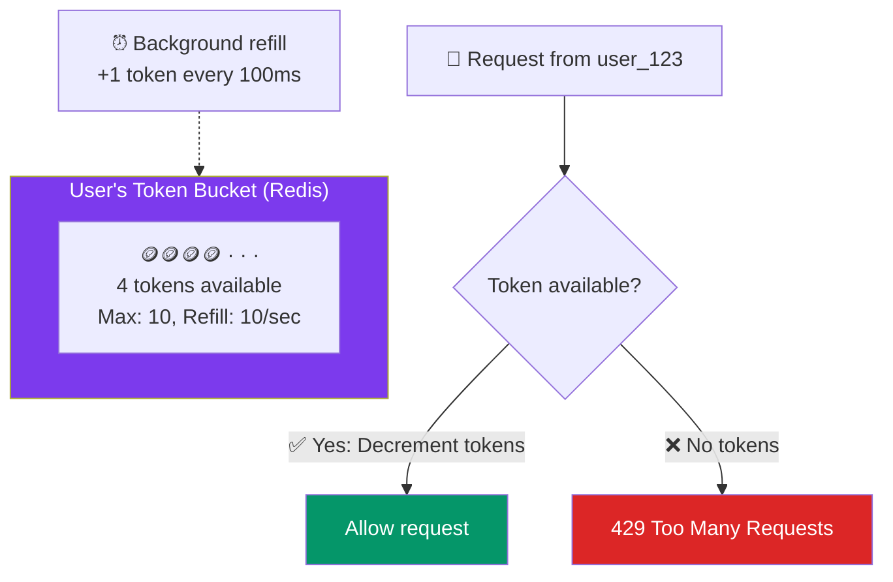
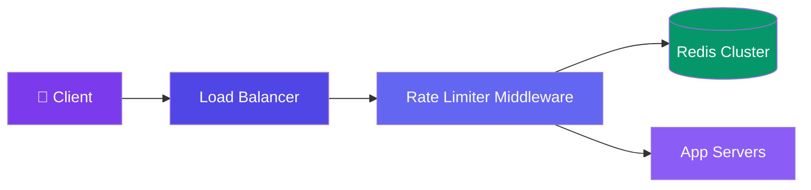

# Case Study: Design a Rate Limiter

> A rate limiter controls how many requests a client can make in a time window. It's essential for protecting APIs.

---

## Requirements

**Functional:**
- Limit requests per user/IP per time window
- Configurable limits per API endpoint
- Return 429 when limit exceeded

**Non-functional:**
- Low latency (adds <1ms to request processing)
- Distributed — works across multiple servers
- Highly available (rate limiter failure shouldn't block requests)

---

## Estimation

| Metric | Value |
|--------|-------|
| API QPS | 100,000 |
| Number of users | 10M |
| Rate limit entries in memory | 10M (one per active user) |
| Memory per entry | ~100 bytes (user_id + counter + timestamp) |
| Total memory | 10M × 100 = **1 GB** (fits in Redis) |

---

## Algorithm: Token Bucket



---

## High-Level Design



---

## Deep Dive: Redis Lua Script for Atomicity

```lua
-- token_bucket.lua
-- KEYS[1] = user rate limit key
-- ARGV[1] = max tokens
-- ARGV[2] = refill rate (tokens/sec)
-- ARGV[3] = request cost (usually 1)

local bucket = redis.call('HMGET', KEYS[1], 'tokens', 'last_refill')
local tokens = tonumber(bucket[1]) or ARGV[1]
local last_refill = tonumber(bucket[2]) or 0

-- Refill based on elapsed time
local now = tonumber(redis.call('TIME')[1])
local elapsed = math.max(0, now - last_refill)
tokens = math.min(tonumber(ARGV[1]), tokens + elapsed * tonumber(ARGV[2]))
tokens = tokens - tonumber(ARGV[3])

if tokens >= 0 then
    redis.call('HMSET', KEYS[1], 'tokens', tokens, 'last_refill', now)
    return 1  -- allowed
else
    return 0  -- rate limited
end
```

---

## Bottlenecks & Trade-offs

| Concern | Mitigation |
|---------|------------|
| **Redis is SPOF** | Redis Cluster for HA, local fallback if Redis is down |
| **Consistency across replicas** | Use Redis with strong consistency or accept slight drift |
| **Rate limit headers** | Include `X-RateLimit-Remaining` and `Retry-After` headers |
| **Distributed window edges** | Sliding window log is more accurate than fixed window |

---

## Follow-up Questions

**Q: How do you rate-limit consistently across multiple data centers when clocks drift?**
Don't rely on wall-clock comparisons across regions for the shared counter — use Redis's own `TIME` command (as the Lua script already does) so refill math is computed relative to a single authoritative clock per Redis node, and route a given user consistently to one region's Redis (or replicate with last-write-wins and accept some slack) rather than trying to synchronize NTP-perfect clocks across data centers.

**Q: The rate limiter middleware depends on Redis — how do you avoid it becoming a single point of failure for the whole API?**
Fail open with a local, in-process fallback limiter (e.g., a coarser per-instance token bucket) when Redis is unreachable, so a Redis outage degrades rate-limiting accuracy instead of blocking all traffic. Pair this with Redis Cluster/replicas for HA so the fallback is rarely needed.

**Q: How would you support per-user AND per-IP limits at the same time?**
Run two independent bucket checks per request — one keyed by `user_id`, one by `ip` — and reject if either is exhausted. This needs two Lua script calls (or one script checking both keys atomically) so a single expensive request only costs one round trip, and it catches both a compromised account and a single IP hitting many accounts.

**Q: What happens when the background refill causes a thundering herd right at the top of each window (fixed window problem)?**
Token bucket already avoids the classic fixed-window edge burst since tokens refill continuously rather than resetting at a boundary, but if refill is batched (e.g., a cron every 100ms) many buckets can still refill in lockstep — smooth refill by computing elapsed-time-based refill per request (as the Lua script does) instead of a scheduled batch job.

**Q: If requests come through a CDN or corporate NAT, how do you get the real client identity for IP-based limiting?**
Trust `X-Forwarded-For` only from your own edge/CDN layer (never from the raw client), and prefer rate-limiting by an authenticated user/API-key when available since shared IPs behind NAT or a CDN would otherwise unfairly throttle many distinct users together.

---

## In Simple Words

- Rate limiter = configurable "stop" sign per user/IP. Token bucket is the most common algorithm.
- Use Redis as the shared counter store for distributed rate limiting.
- Always return informative headers (limit, remaining, retry-after) so clients know what to do.
