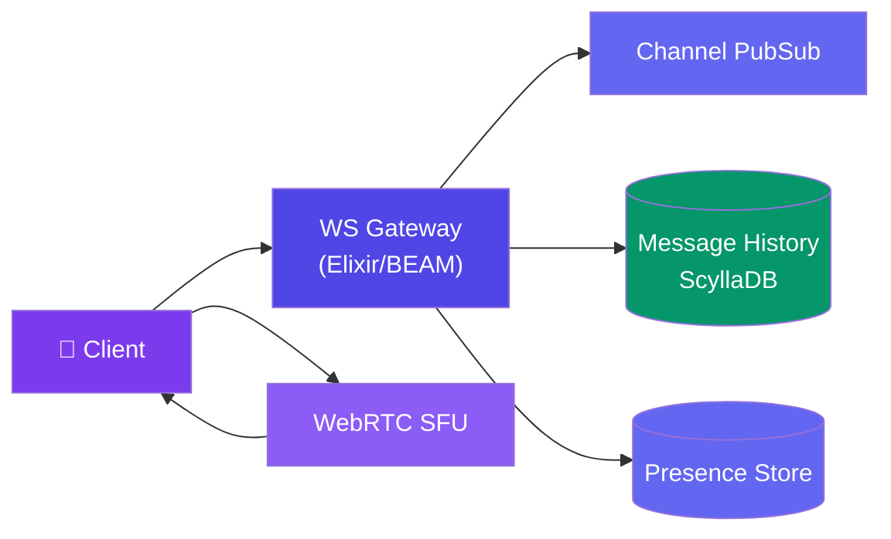
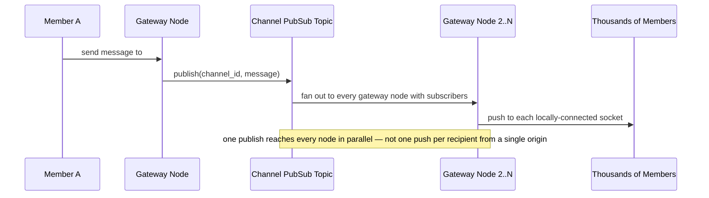
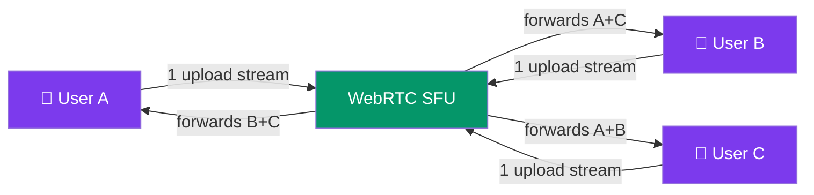

# Case Study: Design Real-Time Chat & Voice (Discord/Slack)

> This case study assumes the WebSocket/presence fundamentals from [Design Chat App (WhatsApp)](/system-design/11-case-studies/design-chat-system/), which is built around 1:1 and small-group delivery. Discord's core problem is different in kind, not just scale: a single text channel can have **thousands of concurrent members** who all need the same message broadcast at once, and voice channels need real-time audio mixing — neither is just "WhatsApp but bigger."

---

## Requirements

**Functional:**
- Post a message in a server (guild) channel; every online member sees it in real time
- Join a voice channel; hear a live mixed audio stream of everyone else speaking
- Presence (online/idle/offline) per user, visible across every mutual server
- Message history persisted and paginated per channel

**Non-functional:**
- A single channel must broadcast to tens of thousands of concurrent connections without linear fan-out cost per message
- Voice latency low enough for natural conversation (~150ms round-trip budget)
- Gateway must hold millions of concurrent long-lived connections efficiently
- Message history reads scale independently of write/broadcast load

---

## High-Level Design



---

## Deep Dive: Broadcasting to a Large Guild Channel

A naive chat fan-out (loop over recipients, push to each socket) is fine for a group DM with a dozen people. It falls over for a channel with 50,000 members — a single message would mean 50,000 individual pushes from one process.



Discord's gateway is built on Elixir/BEAM specifically because the actor model gives cheap, isolated per-connection processes — millions of lightweight processes, each just forwarding messages from a topic it's subscribed to, rather than one thread/socket-loop per connection competing for the same resources.

```elixir
# Conceptual: each connected member is a lightweight process subscribed to their channels
def handle_info({:broadcast, channel_id, message}, socket) do
  if channel_id in socket.assigns.subscribed_channels do
    push(socket, "new_message", message)
  end
  {:noreply, socket}
end
```

The publish is O(1) from the sender's perspective — it's the pub/sub layer's job to fan out to every subscribed node, and each node's job to fan out only to its own locally-connected sockets, splitting the fan-out cost across the cluster instead of one origin node.

---

## Deep Dive: Voice Channels via WebRTC SFU

Voice can't reuse the text broadcast path — audio needs a continuous low-latency media stream, not discrete message pushes. A **peer-to-peer mesh** (everyone sends audio directly to everyone) doesn't scale past a handful of participants — each client's upload bandwidth would need to support N-1 simultaneous streams. Discord instead routes through a **Selective Forwarding Unit (SFU)**: each client uploads audio once, and the SFU forwards it to every other participant.



| Approach | Client upload cost | Server compute cost | Scales to |
|----------|--------------------|--------------------|-----------|
| **Full mesh (P2P)** | O(N-1) streams per client | None (no server relay) | ~4-5 participants |
| **SFU** | O(1) — one upload stream | Moderate (forward, no mixing) | Hundreds per channel |
| **MCU (mixed)** | O(1) | High — server decodes/mixes/re-encodes audio | Fewer channels per server, but simplest client |

Discord's SFU choice trades server relay cost for keeping client upload bandwidth constant regardless of channel size — the right trade-off since client upstream bandwidth (not server compute) is the tighter constraint on mobile/home connections.

---

## Bottlenecks & Trade-offs

| Bottleneck | Solution |
|-----------|----------|
| **Broadcasting to tens of thousands of channel members from one origin** | Cluster-wide pub/sub topic per channel; each node fans out only to its own local connections |
| **Millions of concurrent long-lived socket connections** | Actor-model runtime (BEAM) — cheap, isolated per-connection processes instead of OS-thread-per-connection |
| **Voice bandwidth blowing up with participant count** | SFU model — one upload stream per client regardless of channel size, server only forwards |
| **Message history reads competing with live broadcast load** | Separate, horizontally-scaled history store (ScyllaDB) partitioned by channel — reads never touch the hot broadcast path |
| **A single hot channel overloading one gateway node** | Distribute a channel's subscribers across multiple gateway nodes; pub/sub fan-out already assumes multi-node delivery |

---

## Follow-up Questions

**Q: Why doesn't the WhatsApp-style chat-system design (from that case study) scale to a 50,000-member Discord channel?**
That design's fan-out assumes recipient counts in the tens (a group chat), so a per-recipient push loop is fine. At Discord's scale, fan-out has to be split across the cluster via pub/sub — one publish reaches every gateway node holding subscribers, and each node handles only its own local pushes — rather than one node iterating over tens of thousands of sockets itself.

**Q: Why choose an SFU over just running a full mesh for small voice channels and falling back to SFU for large ones?**
Running two different architectures adds real operational complexity (two code paths, two failure modes) for a threshold that's hard to pick correctly upfront — an SFU costs a bit more server-side relay compute even for a 3-person call, but keeps one predictable, always-correct architecture rather than a fragile scale-dependent switch.

**Q: How does presence (online/idle/offline) stay consistent across many servers a user is a member of?**
Presence is tracked once per user connection at the gateway, not per-server — when a user's socket connects/disconnects or goes idle, that single state change is published to every server (guild) that user belongs to, rather than each guild independently tracking that user's status.

**Q: What happens to in-flight voice audio if a client's SFU node fails?**
The client reconnects and renegotiates a WebRTC session against a healthy SFU node — a brief audio gap during reconnection is expected and acceptable, unlike a dropped text message which must eventually be delivered; voice explicitly trades guaranteed delivery for low latency.

**Q: How is message history paginated efficiently for a channel with millions of historical messages?**
Cursor-based pagination keyed by message ID/timestamp (not offset), since ScyllaDB's partition-by-channel layout means a cursor query is a direct range scan within one partition — an offset-based "page 500" query would require scanning and discarding everything before it.

---

## In Simple Words

- The core problem isn't "chat but bigger" — it's broadcasting one message to tens of thousands of concurrent members, which needs cluster-wide pub/sub, not a per-recipient push loop.
- An actor-model runtime (BEAM/Elixir) makes millions of cheap, isolated per-connection processes practical — the gateway's real scaling unit.
- Voice uses an SFU so each client uploads audio once regardless of channel size — the server relays, it doesn't mix, trading some server compute for constant client bandwidth.
- Message history lives in a separate, channel-partitioned store so reads never compete with the live broadcast path.
