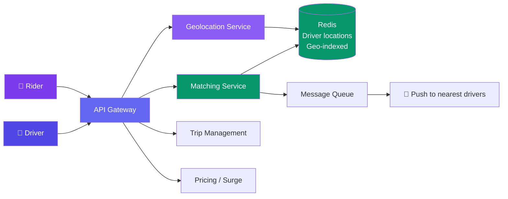
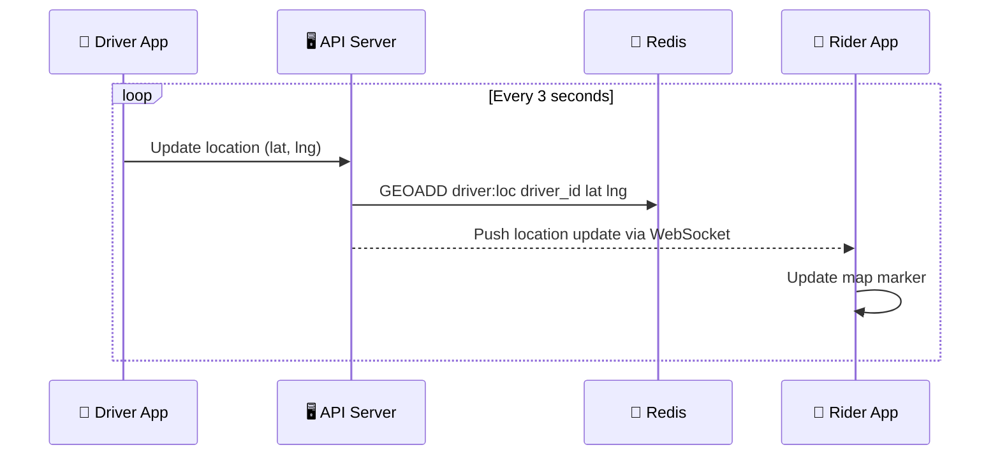

# Case Study: Design Ride-Sharing

> A ride-sharing system like Uber connects riders with nearby drivers in real-time.

---

## Requirements

**Functional:**
- Rider requests a ride
- Find nearby drivers and match
- Real-time location tracking
- Fare calculation
- Ride completion and payment

**Non-functional:**
- Location updates every 3 seconds
- Match a driver within 100ms
- Support 10M daily rides
- Handle spikes (New Year's Eve → 10× normal)

---

## High-Level Design



---

## Deep Dive: Finding Nearby Drivers

Redis has built-in **geospatial indexing**:

```
GEOADD drivers:locations 13.4050 52.5200 "driver_123"  # Berlin
GEOADD drivers:locations -73.9352 40.7306 "driver_456"   # NYC

GEORADIUS drivers:locations 13.4000 52.5200 5 km
→ ["driver_123", ...]  # Drivers within 5km
```

**Why Redis?** Sub-millisecond queries, built-in geo commands, handles 100K+ location updates/second.

---

## Deep Dive: Matching Algorithm

1. Rider requests ride → query Redis for nearest drivers
2. Return top N candidate drivers
3. Push notification to candidate drivers (they have ~15 seconds to accept)
4. First driver to accept gets the ride
5. Notify rejected drivers ("ride no longer available")

**Surge pricing:** When demand > supply in an area, multiply fares by 1.5×, 2×, etc. to incentivize more drivers to move into that area.

---

## Deep Dive: Real-Time Tracking



---

## Bottlenecks & Trade-offs

| Bottleneck | Solution |
|-----------|----------|
| **Location write volume** | 10M drivers × 3s = 3.3M writes/sec → Redis Cluster |
| **Matching latency** | Geo-indexed Redis + nearest-driver algorithm |
| **Driver glut** | Too many drivers nearby → only notify top 10 |
| **Fraud** | Verify ride started from match location |

---

## In Simple Words

- Uber = real-time location tracking + fast nearest-driver matching + payment.
- Redis geo-indexing is the key to finding nearby drivers in milliseconds.
- Surge pricing balances supply and demand — more money → more drivers.
