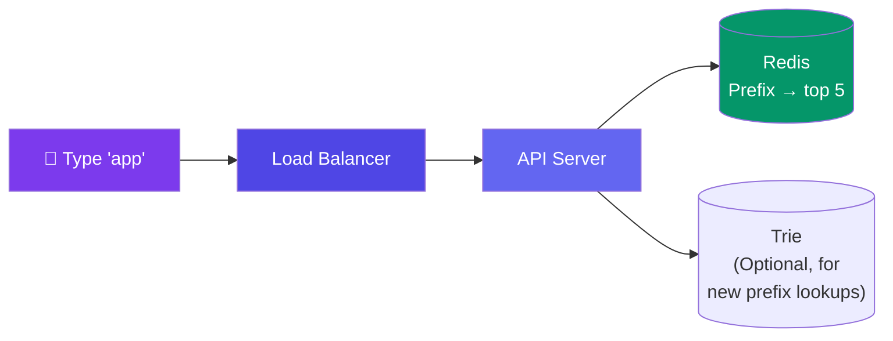

# Case Study: Design Search Autocomplete

> Autocomplete provides search suggestions as the user types — like Google's "Did you mean...?" or search bar suggestions.

---

## Requirements

**Functional:**
- As user types, show top 5 query suggestions
- Suggestions update as user types more characters
- Popular queries ranked higher
- (Optional) Personalized suggestions

**Non-functional:**
- Response in <100ms (every keystroke!)
- Support 100M DAU
- Handle 100K QPS

---

## Estimation

| Metric | Value |
|--------|-------|
| DAU | 100M |
| Searches/user/day | 5 |
| Characters typed per search | 10 (each triggers a request) |
| QPS | 100M × 5 × 10 / 86,400 ≈ **58K QPS** |
| Storage (top 5M queries) | 5M × (query 50B + freq 8B) ≈ **300 MB** |

Fits in memory! This is a cache-friendly problem.

---

## High-Level Design



---

## Deep Dive: Data Structure

**Approach 1: Trie (Prefix Tree)**

A trie stores all query prefixes. Each node contains the top 10 suggestions under that prefix.

```
               root
            /   |   \
          a     b     c
         / \    |     |
        ap  ar  ba    ca
        |   |   |     |
       app art  bat   cat
       ↓   ↓    ↓     ↓
     ["app", "apple", "application", ...]
```

**Time:** O(L) to find prefix, O(1) to return top K.

**Approach 2: Precomputed Prefix Map (Simpler)**

Precompute all prefixes and store in Redis:

```json
{
  "a": ["apple", "amazon", "airbnb", ...],
  "ap": ["apple", "application", "app", ...],
  "app": ["apple", "application", "app", ...],
  "appl": ["apple", "application", ...],
  ...
}
```

**Our choice:** Precomputed prefix map with Redis. Simpler, faster for reads.

---

## Deep Dive: Building the Prefix Map

```javascript
// Offline job — runs daily
function buildPrefixMap() {
  const queries = getTopQueries(5_000_000); // Top 5M queries by frequency
  const prefixMap = {};

  for (const { query, freq } of queries) {
    // Generate all prefixes of this query
    for (let i = 1; i <= query.length; i++) {
      const prefix = query.substring(0, i);
      if (!prefixMap[prefix]) prefixMap[prefix] = [];

      prefixMap[prefix].push({ query, freq });
    }
  }

  // Sort each prefix's suggestions by frequency, keep top 5
  for (const prefix in prefixMap) {
    prefixMap[prefix].sort((a, b) => b.freq - a.freq);
    prefixMap[prefix] = prefixMap[prefix].slice(0, 5);
  }

  // Load into Redis
  for (const [prefix, suggestions] of Object.entries(prefixMap)) {
    redis.set(`autocomplete:${prefix}`, JSON.stringify(suggestions));
    redis.expire(`autocomplete:${prefix}`, 86400); // TTL = 1 day
  }
}
```

---

## Bottlenecks & Trade-offs

| Bottleneck | Solution |
|-----------|----------|
| **Memory for all prefixes** | Only store top 5M queries, 300MB total |
| **Stale suggestions** | Rebuild prefix map daily (offline job) |
| **Personalization** | Store personalized suggestions per user (more storage) |
| **Spelling correction** | Use Levenshtein distance or a BK-tree for "Did you mean?" |

---

## Follow-up Questions

**Q: The prefix map only rebuilds daily — how do you surface a suddenly trending query within minutes?**
Run a separate real-time counter (sliding-window count-min sketch or a Kafka stream aggregating query logs) alongside the daily batch job. At read time, merge the top result from the real-time layer with the precomputed Redis suggestions so a spiking query can jump into the top 5 before the next rebuild.

**Q: How would you personalize suggestions per user without adding latency to every keystroke?**
Keep the base Redis lookup as the fast path, then rerank or splice in personalized results asynchronously (e.g., from a small per-user recent-search cache) client-side or in a lightweight second call that doesn't block rendering the generic suggestions. Avoid computing personalization from scratch per request — precompute per-user-segment rather than per-user.

**Q: How do you keep offensive or inappropriate suggestions out of autocomplete?**
Filter candidate queries against a blocklist/profanity classifier during the offline `buildPrefixMap` job, before they're written to Redis, and additionally check any real-time-injected trending queries against the same filter so a bad query can't sneak in through the fast path.

**Q: A prefix map holding only the top 5M queries — what happens on a prefix that has no cached entry (long-tail query)?**
Return an empty or generic result from Redis (cache miss), and optionally fall back to the trie approach or an on-demand DB/search-index prefix query for rare prefixes, accepting higher latency for the long tail since it's not worth precomputing.

**Q: At 58K+ QPS, is a single Redis instance holding the whole prefix map enough?**
No — shard the prefix map across multiple Redis nodes (e.g., hash the prefix to pick a shard) behind the cache router, the same way the distributed-cache case study spreads keys with consistent hashing.

---

## In Simple Words

- Autocomplete = as user types, show top 5 suggestions for that prefix.
- Precompute all prefix → suggestions mappings offline, store in Redis.
- Reads are O(1) (direct Redis lookup). Update daily.
