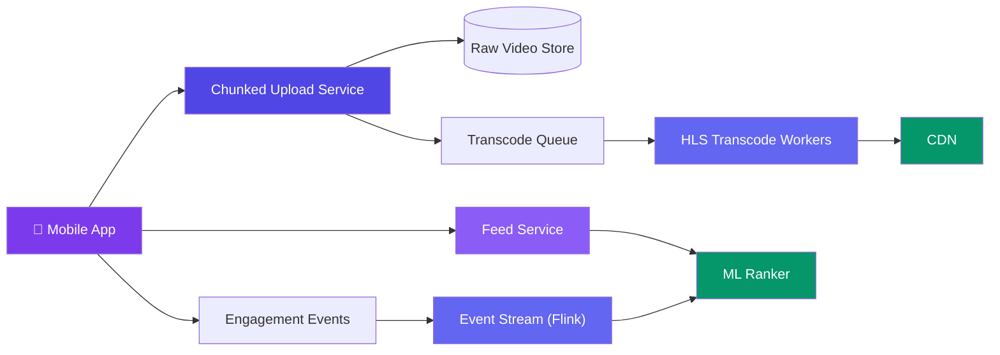
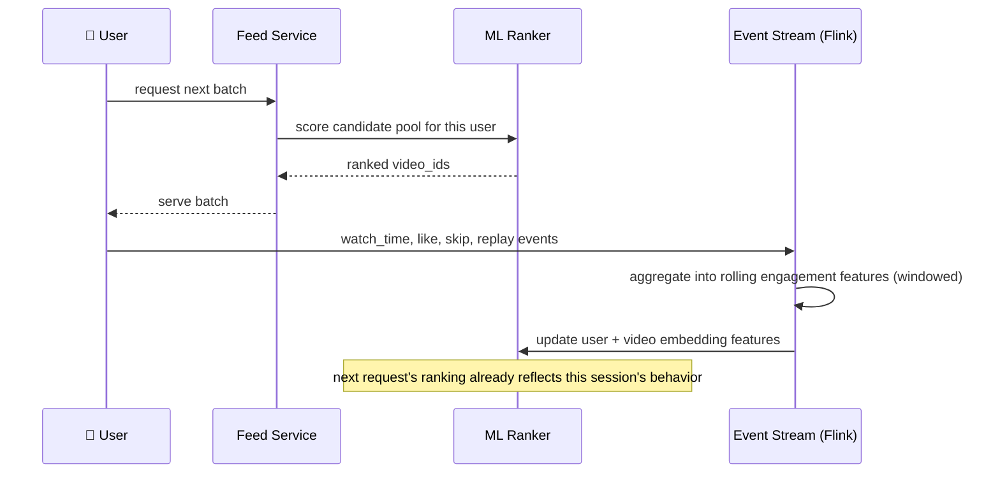

# Case Study: Design a Short-Video Platform (TikTok/Reels)

> This case study assumes the transcoding/CDN fundamentals from [Design Video Streaming](/system-design/11-case-studies/design-video-streaming/), which covers long-form, subscription/channel-based VOD (YouTube/Netflix). TikTok is a different shape of problem: short (15-90s) vertical clips, uploaded from spotty mobile networks, served through an endless **algorithmic** feed with no subscription graph at all — the ranking model, not the follow graph, decides what you see next.

---

## Requirements

**Functional:**
- Upload a short video from a mobile app, resilient to network drops mid-upload
- Serve an infinite "For You" feed — no explicit follow required to see content
- Like, comment, share, and re-watch signals all feed back into ranking
- Duet/stitch (reference another video) and trending sounds/hashtags

**Non-functional:**
- Upload must survive flaky mobile networks — resumable, not all-or-nothing
- Feed latency < 200ms per fetched batch, feels instant on swipe
- Ranking model must incorporate engagement signals within seconds, not hours
- 1B+ daily video views, 10M+ uploads/day

---

## High-Level Design



---

## Deep Dive: Parallel Chunked Upload for Mobile Networks

A single large upload request over a flaky mobile connection fails often, and restarting from byte zero wastes data and battery. The client splits the video into small chunks and uploads several **in parallel**, retrying only the chunks that fail.

```javascript
// Client side — parallel chunked upload with per-chunk retry
async function uploadVideo(file) {
  const CHUNK_SIZE = 1 * 1024 * 1024; // 1 MB, small enough to retry cheaply
  const chunks = splitIntoChunks(file, CHUNK_SIZE);
  const uploadId = await api.initiateUpload(file.name, file.size);

  const CONCURRENCY = 4;
  await runWithConcurrencyLimit(chunks, CONCURRENCY, async (chunk, index) => {
    let attempts = 0;
    while (attempts < 5) {
      try {
        await api.uploadChunk(uploadId, index, chunk);
        return;
      } catch {
        attempts++;
        await sleep(2 ** attempts * 200); // exponential backoff
      }
    }
    throw new Error(`Chunk ${index} failed after retries`);
  });

  return api.completeUpload(uploadId);
}
```

Unlike a single-stream resumable upload, parallelism here also matters for speed on high-latency mobile links — several chunks in flight hide per-request round-trip latency instead of paying it serially, chunk after chunk.

---

## Deep Dive: Real-Time Ranking Feed (No Follow Graph Required)

TikTok's "For You" feed has no cold-start problem in the traditional sense — a brand-new user with zero follows still gets a full feed immediately, because ranking doesn't depend on a social graph at all. It depends on a constantly-updating **engagement model**.



```javascript
// Simplified ranking signal aggregation — Flink-style windowed job
function processEngagementEvent(event, state) {
  const { userId, videoId, watchTimeMs, videoLengthMs, action } = event;

  const completionRate = watchTimeMs / videoLengthMs;
  state.updateUserVector(userId, videoId, {
    completionRate,
    liked: action === "like",
    replayed: action === "replay",
  });

  // A rewatch or high completion is a much stronger signal than a view
  state.updateVideoScore(videoId, completionRate > 0.9 ? 3 : completionRate);
}
```

The key property: ranking features update from **this session's** taps, not yesterday's batch job — a user who skips three cooking videos in a row sees fewer cooking videos on their very next swipe, not tomorrow.

---

## Deep Dive: HLS Transcoding for Vertical, Short-Form Video

Unlike long-form VOD (which needs many resolutions for a 2-hour movie), short clips are cheap to transcode but must be ready **fast** — a creator expects their video watchable within seconds of upload, not minutes.

| Concern | Long-form VOD (YouTube/Netflix) | Short-form (TikTok) |
|---------|----------------------------------|----------------------|
| Transcode urgency | Minutes are acceptable | Must feel near-instant (seconds) |
| Resolution ladder | Many rungs (240p-4K) for varied playback contexts | Few rungs — mobile-first, vertical aspect ratio |
| Compute cost per video | High (long duration) | Low per video, but volume is massive (10M+/day) |
| Priority scheme | FIFO is fine | New creator uploads should jump ahead of re-transcodes/backfills |

```javascript
// Transcode queue — priority lane for first-time uploads vs reprocessing jobs
function enqueueTranscode(job) {
  const priority = job.type === "first_upload" ? "high" : "low";
  queue.push(priority, job);
}
```

Because per-video compute is cheap but volume is huge, the bottleneck shifts from "how fast is one transcode" (VOD's problem) to "how many transcode workers can we run in parallel cheaply" — favoring a large, elastic worker fleet over deeply optimized single-job latency.

---

## Bottlenecks & Trade-offs

| Bottleneck | Solution |
|-----------|----------|
| **Flaky mobile uploads** | Small parallel chunks with independent retry, not one large resumable stream |
| **Ranking must react within a session, not a nightly batch** | Streaming aggregation (Flink) updates feature state continuously, not via offline ETL |
| **Massive daily upload volume overwhelming transcode capacity** | Elastic worker fleet + priority lane for first-time uploads over backfills |
| **Feed monotony from over-optimizing for pure engagement** | Inject diversity/exploration candidates (new creators, off-profile content) into the ranked pool, not just top-score results |
| **Viral video causing a CDN hot-spot** | Same fix as any CDN-fronted hot object: edge caching + replication, independent of the ranking pipeline |

---

## Follow-up Questions

**Q: How is TikTok's feed fundamentally different from a follow-based feed like the one in the News Feed case study?**
A follow-based feed's candidate pool is "posts from people you follow," ranked by recency/affinity. TikTok's candidate pool is effectively the entire video corpus, ranked purely by predicted engagement for this user — there's no follow graph gating what's eligible to show, which is exactly why a brand-new account still gets a full feed on day one.

**Q: What stops the ranker from trapping a user in an engagement-maximizing filter bubble?**
Pure engagement-score ranking would converge to whatever content that user's history shows highest completion/replay rate for — mitigated by deliberately reserving a slice of each batch for exploration candidates (new/under-served content) so the feature-update loop keeps getting fresh signal instead of only reinforcing existing preferences.

**Q: A chunk upload fails on chunk 15 of 40 — does the whole upload restart?**
No — only chunk 15 retries with backoff; the other 39 chunks (already acknowledged by the server) are untouched. This is the entire point of small independent chunks over one resumable stream: a single bad chunk costs a few hundred KB of retry, not the whole file.

**Q: How do trending sounds/hashtags get detected and surfaced?**
Conceptually the same heavy-hitters counting problem as Twitter's trending topics (see [Design Twitter/X](/system-design/11-case-studies/design-twitter-timeline/)) — a sliding-window approximate counter over sound/hashtag usage across new uploads, ranked by a combination of raw frequency and unique-creator diversity to resist spam inflation.

**Q: Why prioritize first-time uploads over reprocessing jobs in the transcode queue?**
A creator waiting on their first upload to go live is a much more time-sensitive, visible wait than an internal backfill/reprocess job (e.g., re-encoding for a new codec) that has no user actively watching a spinner — starving the visible path to run invisible batch work would be a bad trade.

---

## In Simple Words

- Short-form video's upload problem is reliability on bad networks — small parallel chunks with independent retry, not one big resumable stream.
- The feed has no follow graph at all; ranking is purely engagement-driven and updates within the same session via streaming aggregation, not nightly batch jobs.
- Per-video transcoding is cheap but volume is massive — the real scaling lever is worker fleet elasticity and prioritizing visible (first-upload) jobs over invisible backfills.
- Trending topics reuse the same heavy-hitters counting technique as real-time trending on any high-volume platform.
