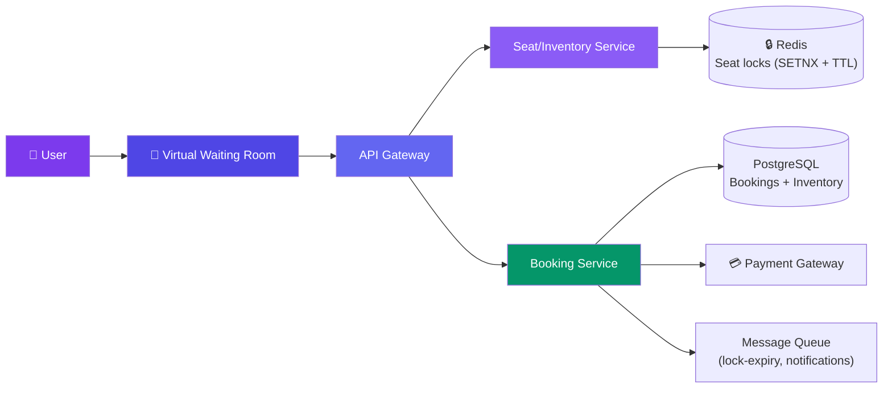
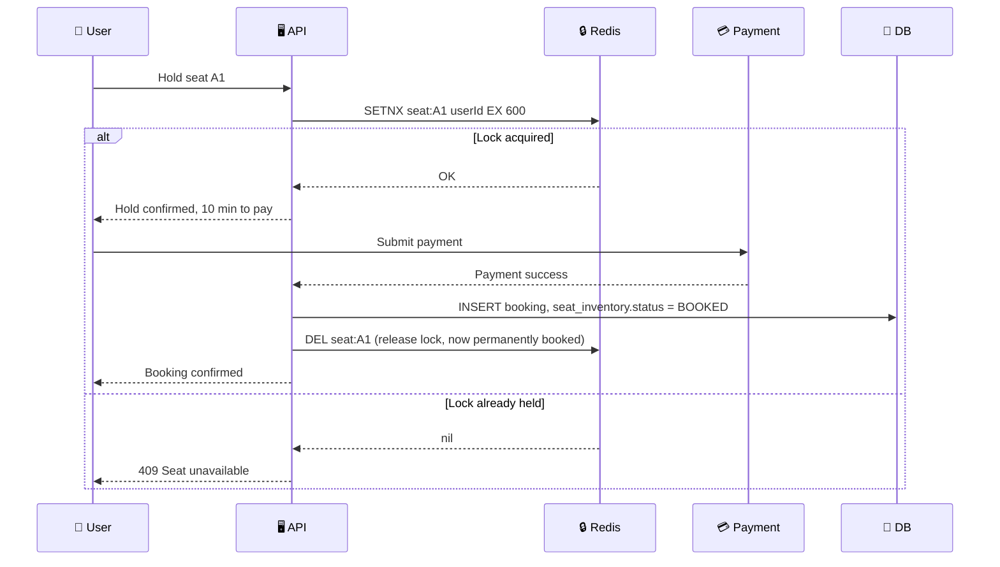

# Case Study: Design a Ticket Booking System

> A ticket booking system like BookMyShow or Ticketmaster sells finite, exact-identity seats to millions of concurrent users without ever selling the same seat twice.

---

## Requirements

**Functional:**
- Browse shows/events and view a seat map
- Hold a seat temporarily while the user checks out
- Pay for held seats
- Confirm booking after payment succeeds
- Cancel a booking / issue a refund

**Non-functional:**
- **Zero double-booking** — the same seat must never be sold to two people, ever
- Survive flash-sale spikes — a popular concert on-sale can see 100× normal traffic in seconds
- Low-latency seat map reads (seat map must feel "live" even under load)
- Strong consistency on the booking path; eventual consistency is fine for browse/search

---

## Estimation

| Metric | Calculation |
|--------|-------------|
| Popular event | 50,000 seats, on-sale to 2M waiting users |
| Peak request rate | 2M requests in ~10s ≈ **200,000 QPS** at the gate |
| Seat-map reads (steady state) | 10,000 events × 500 views/day ≈ **60 QPS** avg, bursty to 10,000+ QPS |
| Seat lock TTL | 5–10 minutes per hold |
| Booking writes | 50,000 seats / event → small compared to read/lock traffic |

---

## API Design

```json
GET /events/{eventId}/seatmap
→ { "seats": [{ "id": "A1", "status": "AVAILABLE" }, { "id": "A2", "status": "LOCKED" }] }

POST /bookings/hold  { "eventId": "evt_123", "seatIds": ["A1", "A2"], "userId": "u_1" }
→ { "holdId": "hold_abc", "expiresAt": "2026-07-29T10:15:00Z" }

POST /bookings/confirm  { "holdId": "hold_abc", "paymentToken": "tok_xyz" }
→ { "bookingId": "bkg_789", "status": "CONFIRMED" }

POST /bookings/{bookingId}/cancel
→ { "status": "CANCELLED", "refundId": "rfd_456" }
```

---

## Data Model

```sql
-- seats(id, venue_id, section, row_label, seat_number) holds static seat metadata

-- One row per (showtime, seat) — this is the inventory unit, not the seat itself
CREATE TABLE seat_inventory (
  showtime_id BIGINT NOT NULL,
  seat_id BIGINT NOT NULL,
  status ENUM('AVAILABLE','LOCKED','BOOKED') NOT NULL DEFAULT 'AVAILABLE',
  version INT NOT NULL DEFAULT 0,        -- optimistic-lock guard
  locked_by VARCHAR(64),
  locked_until TIMESTAMP,
  PRIMARY KEY (showtime_id, seat_id)
);

CREATE TABLE bookings (
  id BIGINT PRIMARY KEY AUTO_INCREMENT,
  showtime_id BIGINT NOT NULL,
  user_id BIGINT NOT NULL,
  status ENUM('HELD','CONFIRMED','CANCELLED') NOT NULL,
  created_at TIMESTAMP DEFAULT NOW()
);

CREATE TABLE booking_seats (
  booking_id BIGINT NOT NULL,
  showtime_id BIGINT NOT NULL,
  seat_id BIGINT NOT NULL,
  PRIMARY KEY (booking_id, seat_id)
);

CREATE INDEX idx_inventory_status ON seat_inventory(showtime_id, status);
```

**Storage:** PostgreSQL/MySQL for bookings (ACID). Redis for the seat-lock layer — the fast path that actually decides "is this seat free right now."

---

## High-Level Design



---

## Deep Dive: Preventing Double-Booking

| Approach | How it works | Verdict |
|----------|--------------|---------|
| **Pessimistic short-TTL lock (Redis `SETNX`)** | `SET seat:A1 userId NX EX 600` — only succeeds if no lock exists | ✅ Standard answer — fast, self-expiring, no orphaned locks |
| **Optimistic locking (version column)** | Read seat + version, `UPDATE ... WHERE version = X`, retry on conflict | Works, but under flash-sale contention causes massive retry storms on the same row |
| **DB row-level lock (`SELECT ... FOR UPDATE`)** | Lock the DB row for the transaction duration | Correct but serializes on the DB connection pool — collapses under 100× spike |

**Why it wins:** contention moves off the database onto an in-memory store built for this exact op, and the TTL guarantees an abandoned seat auto-releases — no cron job needed to clean up stuck holds.



If payment fails or the TTL expires first, Redis auto-deletes the key and the seat silently becomes lockable again — no explicit "release" call needed on the failure path.

---

## Deep Dive: Flash-Sale / Thundering Herd

100,000+ users hitting "buy" in the same second will melt a naive backend. Two layers of defense:

**1. Virtual waiting room** — on-sale traffic first hits a lightweight queueing service, not the booking API. Users get a position/ETA and a short-lived queue token (JWT) once admitted; admission is throttled to match downstream capacity (e.g., 500 users/sec). Only a valid queue token unlocks `POST /bookings/hold`.

**2. Per-event rate limiting** — a token bucket per `eventId` at the gateway caps hold/confirm requests per second, so one event's spike can't starve others sharing the same infra. Seat-map reads are served from a Redis-backed replica / CDN edge cache (TTL ~1-2s) so browsing never competes with the write path.

```js
async function admitToQueue(eventId, userId) {
  const admitted = await redis.eval(SLIDING_WINDOW_SCRIPT, [`admit:${eventId}`], [MAX_PER_SEC]);
  if (!admitted) return { status: "WAIT", etaSeconds: estimateWait(eventId) };
  return { status: "ADMITTED", token: signQueueToken(userId, eventId) };
}
```

---

## Deep Dive: Seat Inventory Data Model

The key trick: **never lock or scan the whole show to check one seat.**

- Inventory is keyed by `(showtime_id, seat_id)` — a composite primary key, not a foreign-key scan over a `seats` table
- Checking "is A1 free for showtime 42" is a single point lookup on that key — O(1), no table/row range lock
- Redis mirrors this exactly: key `lock:{showtime_id}:{seat_id}` → one atomic operation per seat, independent of every other seat in the venue
- Bulk holds (multiple seats in one request) still lock **each seat individually** — no mutex over the whole showtime

This lets one showtime with 50,000 seats support 50,000 independent, concurrent lock attempts instead of one giant serialized queue.

---

## Bottlenecks & Trade-offs

| Bottleneck | Solution |
|-----------|----------|
| **Thundering herd at on-sale time** | Virtual waiting room + per-event admission rate limiting |
| **Redis as single point of failure for locks** | Redis Cluster with replication; TTL bounds the blast radius of a lost lock |
| **Users hoarding seats without paying** | Short TTL (5-10 min) + cap holds per user per event |
| **Payment latency stalls the lock** | Lock held independently of payment; timeout releases via TTL, not a blocking wait |
| **Seat map staleness under cache** | Short TTL (1-2s) cache + WebSocket push when seats lock/unlock |

---

## Follow-up Questions

**Q: What happens if payment fails after the seat lock expires?**
The Redis key already auto-deleted on TTL. The booking service checks "is my lock still mine" before confirming — if it's gone, reject the payment result and refund, rather than confirming a seat that may now belong to someone else.

**Q: How do you handle a user holding a seat for 10 minutes without paying?**
That's the TTL working as intended — the lock self-expires and the seat becomes bookable again. Cap concurrent holds per user (e.g., max 8 seats) to discourage hoarding.

**Q: How do you scale to a global on-sale event across timezones?**
Shard the waiting room and lock service by `eventId`/region so a US on-sale doesn't compete with a UK one on the same Redis cluster. Keep each event's inventory authoritative in one region to avoid cross-region lock races.

**Q: Why not just use a DB transaction with `SELECT FOR UPDATE` for the whole flow?**
Correct in isolation, but it ties up a DB connection for the entire hold duration (minutes), and connection pools are tiny compared to Redis's throughput — flash-sale QPS exhausts the pool in seconds.

**Q: What if two requests for the same seat arrive at the exact same millisecond?**
`SETNX` is atomic (Redis is single-threaded per command), so exactly one request wins — no race window, no extra mutex needed.

---

## In Simple Words

- The one rule that can't break: a seat sold twice is a failed system — everything is designed around a fast, atomic, self-expiring lock.
- Flash sales are a traffic-shaping problem before they're a booking problem — queue people before they ever touch the seat lock.
- Keep the "is this seat free" check to one key, one seat, one operation — never lock or scan the whole show.
- Redis TTL locks + async payment confirmation beat long-held DB transactions every time under real flash-sale load.
