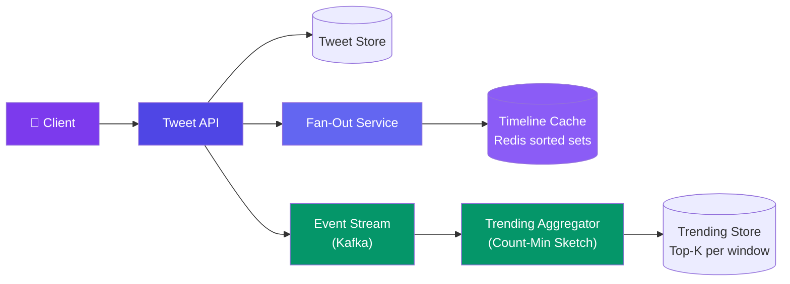
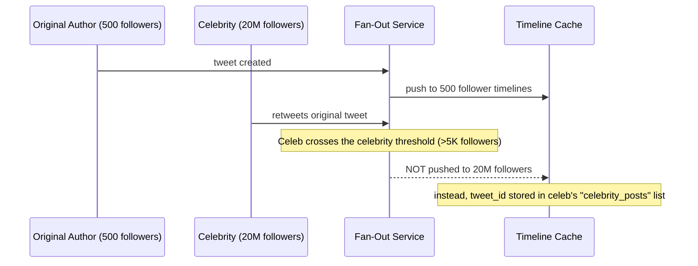
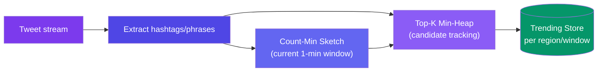

# Case Study: Design Twitter/X

> This case study assumes the base push/pull hybrid feed from [Design a News Feed](/system-design/11-case-studies/design-news-feed/) and focuses on what's *specific* to Twitter: retweets multiplying fan-out cost, and real-time trending topics — a heavy-hitters counting problem the news-feed case study doesn't cover.

---

## Requirements

**Functional:**
- Post a tweet (280 chars + media), retweet, quote-tweet, reply
- Timeline shows tweets from followed accounts, newest first
- `GET /trending` returns the top hashtags/topics in the last N minutes, per region
- Follow/unfollow, like, reply-thread view

**Non-functional:**
- Timeline read p99 < 200ms
- Trending topics refresh within ~1 minute of a real-world spike (not hours-stale)
- Handle a single tweet being retweeted by accounts with millions of followers each — fan-out cost must not multiply unboundedly
- 500M DAU, ~6,000 tweets/sec average, spiking 10-50x during major live events

---

## Estimation

| Metric | Value |
|--------|-------|
| Tweets/sec (avg) | 6,000 → **~520M/day** |
| Peak tweets/sec (live event) | 50,000+ |
| Retweets as % of volume | ~15-20% of all tweets |
| Trending counter updates/sec | Every tweet emits N hashtag/keyword events → tens of millions/min at peak |
| Timeline reads/sec | ~200,000 |

---

## High-Level Design



Every tweet does two things in parallel: it fans out into follower timeline caches (the news-feed pattern), and it emits an event onto the stream that feeds real-time trending — these are independent concerns with independent scaling knobs.

---

## Deep Dive: Retweet Fan-Out Amplification

A plain repost is cheap — it's just a pointer. The fan-out problem is that a retweet from a celebrity account re-triggers fan-out to **that celebrity's own followers**, not the original author's. If ten celebrities each retweet the same viral tweet, you get ten independent large fan-outs stacked on top of each other.



**Rule:** a retweet by an account above the celebrity threshold is *never* pushed — it's stored once and merged on read (identical to the celebrity-post handling in the news-feed case study). This caps fan-out cost per retweet regardless of how many celebrities pile on, because each celebrity retweet is O(1) storage, not O(followers).

```javascript
function handleRetweet(retweeterId, originalTweetId) {
  const followerCount = getFollowerCount(retweeterId);

  if (followerCount < CELEBRITY_THRESHOLD) {
    // Cheap — push retweet pointer to followers, same as a normal tweet
    fanOutPush(retweeterId, { type: "retweet", ref: originalTweetId });
  } else {
    // Expensive fan-out avoided — store once, merge on read
    redis.lpush(`celebrity_posts:${retweeterId}`, originalTweetId);
  }
}
```

---

## Deep Dive: Real-Time Trending Topics (Heavy Hitters)

Trending needs "what are the top N hashtags/phrases in the last 10 minutes, across hundreds of millions of tweets" — computed continuously, not batched hourly. Storing an exact per-hashtag counter for every possible token is too much memory at this volume, so trending uses an approximate **heavy-hitters** structure: a **Count-Min Sketch** per time bucket.

```javascript
// Count-Min Sketch: fixed-size, probabilistic frequency counter
// Trades small overcounting error for O(1) memory instead of O(unique tokens)
class CountMinSketch {
  constructor(width = 2048, depth = 4) {
    this.width = width;
    this.depth = depth;
    this.table = Array.from({ length: depth }, () => new Uint32Array(width));
  }

  increment(token) {
    for (let i = 0; i < this.depth; i++) {
      const idx = hash(token, i) % this.width;
      this.table[i][idx]++;
    }
  }

  estimate(token) {
    let min = Infinity;
    for (let i = 0; i < this.depth; i++) {
      min = Math.min(min, this.table[i][hash(token, i) % this.width]);
    }
    return min; // always >= true count, never under-counts
  }
}
```

Each 1-minute window gets its own sketch (fed by the Kafka stream of tweet tokens); a **min-heap of the top ~50 candidate tokens** is maintained alongside the sketch so we don't have to scan every possible token to answer "what's trending" — only candidates that ever appeared get considered.



Old windows are discarded (sliding window of the last ~60 minutes kept), so a topic that spiked an hour ago naturally falls out of trending without any explicit decay logic.

---

## Bottlenecks & Trade-offs

| Bottleneck | Solution |
|-----------|----------|
| **Retweets by multiple celebrities stacking fan-out cost** | Celebrity threshold applies per-retweeter independently — pull/merge on read, never pushed |
| **Exact per-hashtag counting doesn't scale to hundreds of millions of tweets/min** | Count-Min Sketch trades a small, bounded overcount error for constant memory |
| **Trending topics dominated by spam/bot coordinated hashtag floods** | Weight by unique-author count, not raw tweet count, before ranking a hashtag as trending |
| **Reply threads fragmenting the timeline** | Store thread structure separately (parent/child tweet_id), collapse into a single timeline entry that expands on tap |
| **Regional trending divergence** | Partition the sketch/heap pipeline by region tag extracted from tweet metadata, not one global trending list |

---

## Follow-up Questions

**Q: Why not just increment a real counter (e.g. a Redis `INCR` per hashtag) instead of an approximate sketch?**
At Twitter's cardinality — millions of distinct hashtags/phrases per window, most seen only once or twice — exact per-key counters cost memory proportional to unique tokens, which spikes hard during a live event with thousands of ad-hoc phrases. The sketch caps memory to a fixed table regardless of how many unique tokens appear; the cost is a small, one-directional overcounting error that's fine for a "top 50" ranking.

**Q: How does the celebrity-retweet rule interact with a celebrity retweeting another celebrity's retweet?**
Each retweet event is evaluated independently by the retweeter's own follower count — a chain of celebrity retweets just means each hop is separately pull-merged, none of them push-fan-out, so the chain never compounds fan-out cost regardless of depth.

**Q: A hashtag trends briefly then a bot network keeps it artificially alive — how do you catch that?**
Track unique author count per hashtag per window (a second, smaller sketch or an HLL) alongside raw frequency, and require both a frequency threshold and a unique-author threshold before surfacing something as trending — a flood from few accounts fails the author-diversity check even if raw volume is high.

**Q: What happens to trending topics during a genuine global breaking-news spike — does the sketch's error rate become a problem?**
Count-Min Sketch error is bounded relative to total stream volume, so it scales gracefully — a spike doesn't break correctness, it just means every candidate's estimate is *high volume*, and the top-K heap still correctly surfaces the actual leaders since the error affects magnitude, not relative ranking, in the common case.

**Q: How do replies get threaded without duplicating fan-out work per reply?**
A reply is fanned out like any tweet (to the replier's own followers) but is also tagged with `parent_tweet_id` and `thread_root_id`; timeline rendering fetches the thread lazily by ID when a user expands it, rather than fan-out pre-computing entire thread trees into every follower's cache.

---

## In Simple Words

- Twitter's timeline reuses the news-feed's push/pull hybrid — the new problem is retweets: each retweeter's own follower count decides push vs. pull, independently, so celebrity chains never multiply fan-out cost.
- Trending topics need a real-time, approximate counter (Count-Min Sketch) because exact per-hashtag counting doesn't fit in memory at this cardinality.
- A sliding window of sketches (discard old, keep last ~60 min) gives trending topics natural decay with no explicit expiry logic.
- Weighting by unique authors, not raw volume, is what keeps a coordinated spam flood from gaming trending.
