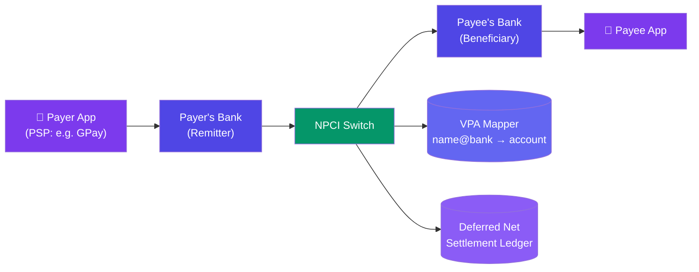
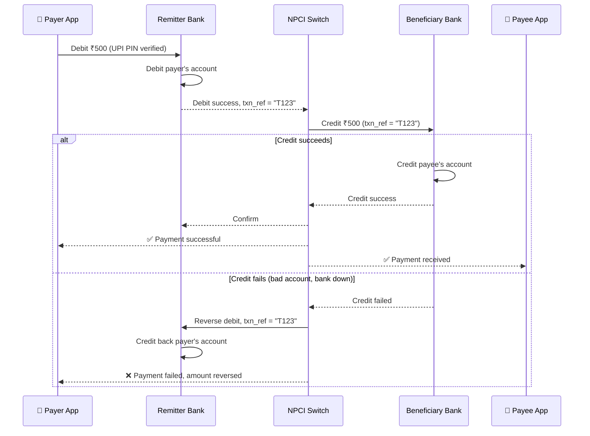

# Case Study: Design UPI (Unified Payments Interface)

> This case study assumes the idempotency/ledger fundamentals from [Design a Payment System](/system-design/11-case-studies/design-payment-system/), which models a single PSP moving money between accounts it controls (e.g. Stripe). UPI is structurally different: **no party in the flow holds both accounts** — money moves between two *independent* banks, coordinated through a shared switch (NPCI), with every leg a separate real-time interbank transfer rather than one ledger's internal debit/credit.

---

## Requirements

**Functional:**
- Resolve a human-readable Virtual Payment Address (`name@bank`) to an actual bank account — no one types account numbers
- Pay by VPA, QR code, or mobile number; collect requests (payee-initiated pull, payer approves)
- Two-factor authentication: device binding (SIM-bound registration) + UPI PIN, no OTP needed per transaction
- Real-time payment confirmation to both payer and payee within seconds
- Recurring payments (mandates) — pre-authorized, periodic debits without a PIN each time

**Non-functional:**
- Interbank transfer must be atomic across two separate banks' core banking systems — no money created or destroyed mid-failure
- 24x7 availability, including bank holidays and nights (unlike older batch-settlement rails)
- National scale: 10B+ transactions/month, thousands of participating banks
- Every transaction independently confirmed in real time, even though actual money movement between banks nets out later

---

## High-Level Design



The switch is the only party that talks to every bank — payer and payee banks never talk to each other directly. This is what lets thousands of banks interoperate without each one integrating with every other one (an O(N²) problem collapsed to O(N)).

---

## Deep Dive: VPA Resolution

A VPA (`ravi@okhdfc`) is a stable alias that decouples "who to pay" from "which account/bank" — critical since users switch banks/apps but keep the same identity, and typing raw account+IFSC codes is error-prone and irreversible if mistyped.

```javascript
// NPCI switch — VPA resolution before any money movement is attempted
async function resolveVPA(vpa) {
  const [handle, bankSuffix] = vpa.split("@");
  const psp = PSP_REGISTRY[bankSuffix]; // e.g. "okhdfc" -> HDFC's PSP handler

  const account = await psp.lookupAccount(handle);
  if (!account) throw new Error("VPA not found");

  return { accountNumber: account.number, ifsc: account.ifsc, bankId: account.bankId };
}
```

Resolution happens **before** the payer approves the transaction — the payer app shows the resolved payee's masked name (e.g. "Paying to R**i Kumar") so a mistyped VPA is caught before money moves, not after.

---

## Deep Dive: Two-Phase Interbank Debit/Credit

Unlike a single-ledger PSP (debit + credit as two rows in one atomic transaction), UPI's debit and credit happen in **two separate banks' core banking systems** — there's no shared database to wrap in one transaction. Correctness comes from a **debit-first, confirm-then-credit** protocol with the switch coordinating and a mandatory reversal path if the credit leg fails.



```javascript
// Switch-side coordination — not a database transaction, a choreographed protocol
async function processTransfer(txnRef, payerAccount, payeeAccount, amount) {
  const debit = await remitterBank.debit(payerAccount, amount, txnRef);
  if (!debit.success) return { status: "FAILED", reason: debit.error };

  const credit = await beneficiaryBank.credit(payeeAccount, amount, txnRef);
  if (!credit.success) {
    // Compensating action — the only way to undo a already-debited real bank account
    await remitterBank.reverse(payerAccount, amount, txnRef);
    return { status: "FAILED", reason: "credit_failed_reversed" };
  }

  return { status: "SUCCESS", txnRef };
}
```

The `txnRef` is what every bank and the switch use to dedupe retries — if the reversal call itself is retried (network blip), the remitter bank must recognize the same `txnRef` and not reverse twice.

---

## Deep Dive: Deferred Net Settlement

Every individual transaction confirms in real time to users, but actual money doesn't move bank-to-bank on every transaction — that would mean millions of tiny interbank wire transfers per day. Instead, the switch nets out obligations between bank pairs and settles the **net difference** periodically (e.g. every few hours) via the central bank's real settlement rail.

```
Between 2pm-4pm window:
  Bank A owes Bank B: ₹50,00,000 (from 10,000 transactions A→B)
  Bank B owes Bank A: ₹48,00,000 (from 9,500 transactions B→A)

Net settlement: Bank A transfers ₹2,00,000 to Bank B (the net difference)
— not 19,500 individual interbank transfers
```

This is the key trade-off: users get instant, final-feeling confirmation (the switch has already coordinated both debit and credit), while the banks' actual balance-sheet movement is batched and netted for efficiency. The switch's own settlement ledger must reconcile against what each bank's core banking system independently recorded, since the switch itself never holds the money.

---

## Deep Dive: Mandates (Recurring Payments)

A subscription/EMI shouldn't require the user to enter their PIN on every cycle. A **mandate** is a one-time PIN-authorized pre-approval (amount cap, frequency, validity window) that authorizes the switch to trigger debits later without re-prompting the user each time.

```sql
CREATE TABLE mandates (
  id BIGINT PRIMARY KEY,
  payer_vpa VARCHAR(64) NOT NULL,
  payee_vpa VARCHAR(64) NOT NULL,
  max_amount_paise BIGINT NOT NULL,
  frequency VARCHAR(20),        -- MONTHLY, WEEKLY, AS_PRESENTED
  valid_until DATE,
  status VARCHAR(20),           -- ACTIVE, PAUSED, REVOKED
  created_at TIMESTAMP
);
```

Each scheduled execution still goes through the full debit/credit protocol above (it's a normal transaction under the hood) — the mandate only replaces the "ask for PIN" step with "check an active, unexpired, unrevoked mandate covering this amount." The user can revoke a mandate at any time, which must take effect before the next scheduled execution, not retroactively on past debits.

---

## Bottlenecks & Trade-offs

| Bottleneck | Solution |
|-----------|----------|
| **Credit leg fails after debit already succeeded (no shared transaction)** | Mandatory compensating reversal, keyed by `txnRef`, idempotent against retries |
| **A bank's core banking system is slow/down mid-transaction** | Timeout + mark transaction as pending, reconcile via a status-check API rather than assuming failure |
| **O(N²) integration cost if every bank connected to every other bank directly** | Central switch — every bank integrates once with the switch, not with every peer bank |
| **Settling every transaction individually would flood the interbank settlement rail** | Deferred net settlement — only the net obligation between each bank pair moves periodically |
| **Mandate abuse (merchant debits more than authorized)** | Enforce `max_amount_paise` and validity window at the switch/bank level, not trusted to the merchant's own claim |

---

## Follow-up Questions

**Q: If there's no shared database between the two banks, how is this any different from just hoping both legs succeed?**
It isn't hope — it's an explicit protocol: debit first, and if credit fails, an explicit compensating reversal restores the payer's balance. This is the distributed-transaction problem (no two-phase commit across independently-owned banking systems), solved with a saga-style compensating action instead of atomicity, keyed by an idempotent `txnRef` so retries of the reversal itself are safe.

**Q: What happens if the switch itself crashes between confirming the debit and initiating the credit?**
The `txnRef` and its state (debit confirmed, credit pending) must be durably persisted by the switch before it ever calls the beneficiary bank — on recovery, the switch resumes any in-flight `txnRef` from its last known state rather than losing track of a debited-but-not-yet-credited transaction.

**Q: A user's payment shows "success" in their app, but the payee says they never got the money — how do you investigate?**
Because the switch coordinates both legs and stamps a single `txnRef`, support/reconciliation tooling looks up that reference across both banks' independent transaction logs and the switch's own settlement ledger to find exactly where the discrepancy is (e.g. beneficiary bank credited late, or a display bug in the payee app) — this is only possible because both legs are linked by the same reference, not two disconnected records.

**Q: Why use deferred net settlement instead of just moving real money per transaction like a wire transfer?**
Because the switch already coordinates confirmed debit + confirmed credit per transaction, users get the same immediate certainty as if money moved instantly — the actual interbank wire only needs to true-up the net difference periodically, which is dramatically cheaper and doesn't require the real settlement rail to handle billions of tiny transfers a day.

**Q: How does a mandate revocation interact with a debit that's already mid-flight when the user revokes?**
Revocation should only block *future* scheduled executions, checked at the moment each execution is triggered — a debit already past that check and in the debit/credit protocol completes normally, since re-validating mid-flight against a state that just changed would itself introduce a race between "debit already sent to the bank" and "mandate now revoked."

---

## In Simple Words

- VPA (`name@bank`) is a stable, human-readable alias resolved to a real account *before* money moves — so a typo is caught early, not after a transfer.
- There's no single ledger to wrap in one transaction — debit and credit happen in two independent banks, coordinated by the switch, with a mandatory reversal if the credit leg fails.
- The switch is the only thing every bank talks to, collapsing what would be an O(N²) bank-to-bank integration problem into O(N).
- Users see instant, final confirmation per transaction, but actual interbank money movement is deferred and netted — real-time UX, batched settlement underneath.
- Mandates replace "enter PIN every cycle" with one upfront authorization, but every scheduled execution still runs the full debit/credit protocol.
