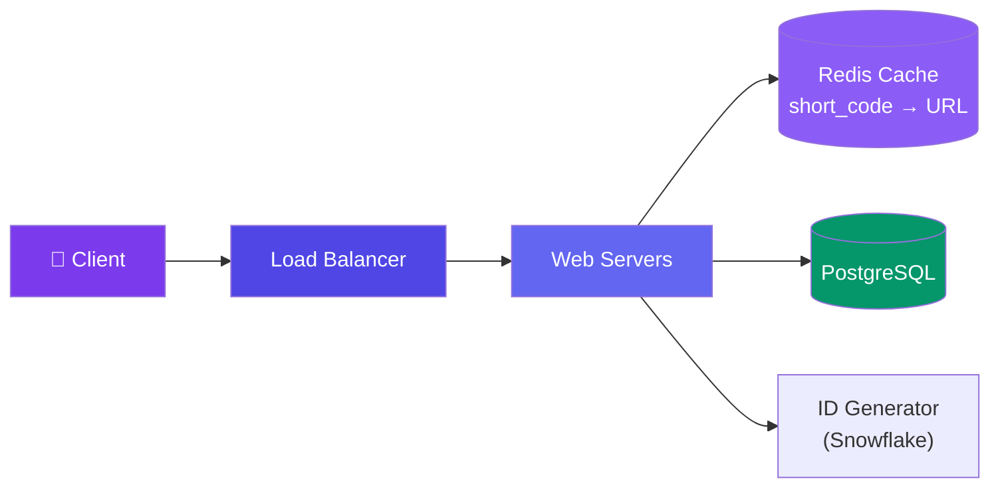

# Case Study: Design a URL Shortener

> A URL shortener like TinyURL turns long URLs into short, shareable links.

---

## Requirements

**Functional:**
- Shorten a long URL into a short code
- Redirect to the original URL when accessing the short code
- (Optional) Track click counts, custom aliases

**Non-functional:**
- High availability (redirects must always work)
- Low latency (redirects in <100ms)
- 100M new URLs/month growing

---

## Estimation

| Metric | Calculation |
|--------|-------------|
| New URLs/month | 100M |
| New URLs/second | 100M / (30 × 86,400) ≈ **40 QPS** |
| Read (redirect) QPS | 100× writes = **4,000 QPS** |
| Storage (5 years) | 100M × 500 bytes × 60 = **3 TB** |
| Bandwidth (redirects) | 4,000 × 500 bytes = **2 MB/s** |

---

## API Design

```json
POST /shorten
{ "url": "https://example.com/very/long/url" }
→ { "short_url": "https://short.ly/abc123", "expires_in_days": 365 }

GET /{short_code}
→ 301 Redirect to original URL
```

---

## Data Model

```sql
CREATE TABLE urls (
  id BIGINT PRIMARY KEY AUTO_INCREMENT,
  short_code VARCHAR(10) UNIQUE NOT NULL,
  original_url TEXT NOT NULL,
  created_at TIMESTAMP DEFAULT NOW(),
  expires_at TIMESTAMP,
  click_count BIGINT DEFAULT 0
);

CREATE INDEX idx_short_code ON urls(short_code);
```

**Storage:** PostgreSQL for ACID (idempotent inserts). Redis cache for redirects.

---

## High-Level Design



---

## Deep Dive: Short Code Generation

**Approach 1: Base62 Encoding**
- Generate a unique numeric ID (Snowflake or DB sequence)
- Convert to base62 (0-9, a-z, A-Z) → 6 characters = 62⁶ ≈ 57 billion combinations
- `12345 → base62(12345) = "dnh"`

**Approach 2: Pre-generated Keys (KGS)**
- Pre-generate a pool of short codes in a separate table
- Assign a code atomically when a shorten request comes in
- No encoding logic, very fast allocation

**Our choice:** Base62 encoding with a sequence ID. Simpler, no separate key management.

---

## Deep Dive: Redirect Flow (Cache-Aside)

1. User visits `https://short.ly/abc123`
2. App checks Redis: `GET abc123`
3. **Cache hit** → return original URL, redirect
4. **Cache miss** → query PostgreSQL by `short_code`
5. Populate cache: `SET abc123 = original_url, TTL = 3600`
6. Return redirect

**P99 latency target:** < 50ms with cache hit, < 200ms on cache miss.

---

## Bottlenecks & Trade-offs

| Bottleneck | Solution |
|-----------|----------|
| **DB write load** | Batch analytics writes, use a separate analytics DB |
| **Cache miss storm** | Gradual cache warmup, preload popular URLs |
| **ID generation** | Use Snowflake or pre-allocated ID ranges per server |
| **Malicious URLs** | Add URL validation + blocklist before shortening |

---

## Follow-up Questions

**Q: What happens when base62 encoding of the sequence ID wraps around after 57 billion codes?**
At 40 QPS that's ~45 years of runway, so it's not urgent, but the fix is to move to 7-character codes (62⁷ ≈ 3.5 trillion) before exhaustion — since codes are derived from a monotonically increasing ID, you just widen the encoding without touching existing rows.

**Q: How do you support custom vanity aliases (e.g., `/promo2026`) without conflicting with auto-generated codes?**
Vanity aliases go through the same `short_code` unique index but skip the base62 generator — check availability with a `SELECT` before insert (or a unique constraint that rejects on conflict), and reserve a separate character-length band or prefix so generated codes can never collide with a hand-picked alias.

**Q: If Redis goes down, what happens to redirects and click analytics?**
Redirects fall back to PostgreSQL directly — slower (cache-miss path already handles this) but still correct. Click counts are the bigger risk: if they're incremented synchronously in Redis, an outage silently drops counts, so click tracking should be an async event (queue or log) replayed into an analytics store rather than a direct cache increment.

**Q: How do you generate unique IDs if you have multiple ID-generator servers across regions?**
A single sequence/Snowflake node is a bottleneck and SPOF. Snowflake's structure (timestamp + machine ID + sequence) solves this by encoding a unique machine ID per node so IDs never collide across regions, at the cost of longer, less "clean" codes than a pure incrementing counter.

**Q: How do you stop someone from scanning all possible short codes to enumerate private URLs?**
Base62 IDs are sequential and guessable if the underlying counter is exposed, so add rate limiting on the redirect endpoint per-IP, and for sensitive links use a random (non-sequential) suffix or a longer random token instead of a direct base62(id) mapping.

---

## In Simple Words

- URL shortener = simple write (shorten) + very frequent read (redirect).
- Cache is critical — redirects should almost never hit the database.
- Base62 encoding gives short, user-friendly codes from numeric IDs.
