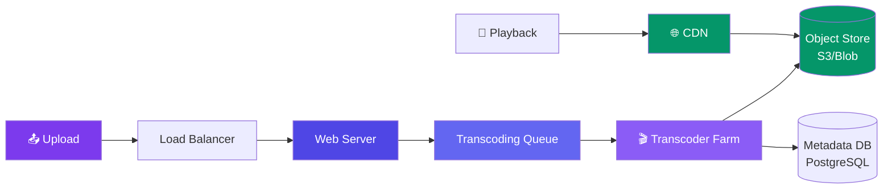

# Case Study: Design Video Streaming

> A video streaming platform like YouTube or Netflix allows users to upload, process, and watch videos.

---

## Requirements

**Functional:**
- Upload videos
- Transcode videos to multiple resolutions (240p, 480p, 720p, 1080p, 4K)
- Stream videos with adaptive bitrate
- Search videos

**Non-functional:**
- Low latency streaming (< 2s startup)
- Support 500M DAU
- 500 hours of video uploaded per minute

---

## Estimation

| Metric | Value |
|--------|-------|
| Video uploads/minute | 500 hours |
| Storage per minute | 500 hours × 1 GB/hour = **500 GB/min** |
| Storage per day | 500 GB × 60 × 24 = **720 TB/day** |
| CDN bandwidth | 100M concurrent viewers × 5 Mbps = **500 Tbps** |

---

## High-Level Design



---

## Deep Dive: Transcoding Pipeline

```javascript
// Upload flow
1. User uploads video → stored as original in blob storage
2. Upload event → message queue → transcoder workers pick it up
3. Transcode to multiple resolutions (240p, 480p, 720p, 1080p)
4. Generate thumbnails at key frames
5. Store transcoded segments + manifest file (.m3u8 for HLS)
6. Update metadata DB with processing status
```

**Why transcode?** Different devices need different resolutions. Adaptive bitrate lets the player switch quality based on network conditions.

---

## Deep Dive: Adaptive Bitrate Streaming (HLS)

```
manifest.m3u8
├── 240p.m3u8 → segment001.ts, segment002.ts, ...
├── 480p.m3u8 → segment001.ts, segment002.ts, ...
├── 720p.m3u8 → segment001.ts, segment002.ts, ...
└── 1080p.m3u8 → segment001.ts, segment002.ts, ...
```

Video is split into **segments** (2-10 seconds each). The player dynamically switches between quality levels based on bandwidth.

---

## Deep Dive: CDN Strategy

- **Popular videos** — cached at CDN edge for instant playback
- **Long-tail videos** — served from origin if less popular
- **Pre-fetching** — CDN pre-warms cache based on trending predictions

---

## Bottlenecks & Trade-offs

| Bottleneck | Solution |
|-----------|----------|
| **Storage costs** | Store hot data on fast SSDs, cold data on archival storage |
| **Transcoding delay** | Queue-based async processing, parallel transcoding |
| **CDN costs** | Cache popular content, use a tiered CDN strategy |
| **Global latency** | Regional CDN edge nodes, anycast DNS |

---

## In Simple Words

- Video streaming = upload → transcode (convert to multiple formats) → store → deliver via CDN.
- Adaptive bitrate (HLS) splits video into small segments so the player can switch quality on the fly.
- CDN is critical — without it, every viewer would hit the origin server (impossible at scale).
