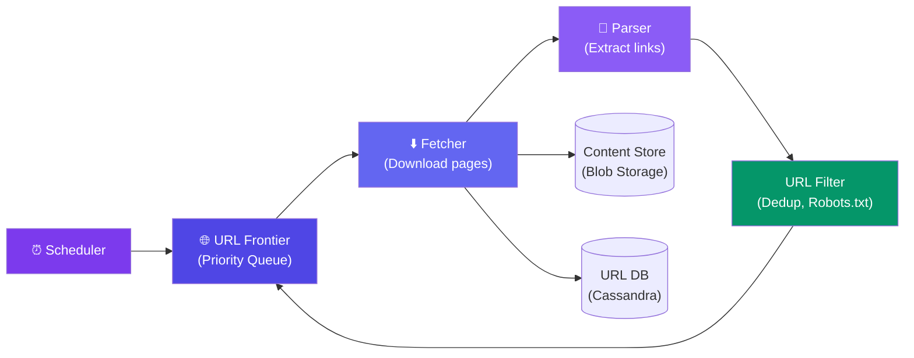

# Case Study: Design a Web Crawler

> A web crawler systematically browses the web, downloading pages for indexing (like Googlebot).

---

## Requirements

**Functional:**
- Start from seed URLs and follow links
- Download page content
- Respect `robots.txt` (politeness policy)
- Detect and avoid duplicate URLs and content
- Scale to billions of pages

**Non-functional:**
- Politeness — don't hammer a single domain
- Freshness — revisit pages to detect changes
- Support 1B+ pages crawled

---

## High-Level Design



---

## Deep Dive: URL Frontier

The frontier decides which URL to crawl next. It respects **politeness** (don't crawl a domain too fast):

```javascript
class URLFrontier {
  constructor() {
    this.queues = {}; // domain → priority queue of URLs
    this.lastCrawl = {}; // domain → last crawl timestamp
  }

  addURL(url) {
    const domain = extractDomain(url);
    // Add to domain-specific queue
    this.queues[domain].push({ url, priority: computePriority(url) });
  }

  nextURL() {
    // Pick the best domain that hasn't been crawled recently
    const eligibleDomains = Object.keys(this.queues)
      .filter(d => (Date.now() - this.lastCrawl[d]) > POLITENESS_DELAY);

    // Pick the domain with the highest priority URL
    const bestDomain = pickHighestPriority(eligibleDomains);
    const url = this.queues[bestDomain].pop();
    this.lastCrawl[bestDomain] = Date.now();
    return url;
  }
}
```

**Politeness delay:** Typically 1-10 seconds between requests to the same domain.

---

## Deep Dive: Duplicate Detection

**URL deduplication:** Use a Bloom filter (probabilistic, small memory) + exact check:

```javascript
const urlFilter = new BloomFilter(10_000_000_000, 0.01); // 0.01% false positive

function isURLVisited(url) {
  if (!urlFilter.mightContain(url)) return false; // definitely not visited
  return exactCheckInDB(url); // confirm (handles false positives)
}
```

**Content deduplication:** Hash the page content (SimHash). If hash matches an already-crawled page → skip (helps avoid near-duplicate pages).

---

## Robots.txt & Politeness

```javascript
// Before crawling a domain
const robots = await fetch("https://example.com/robots.txt");
// Parse rules:
// User-agent: *
// Disallow: /private/
// Crawl-delay: 10

const rules = parseRobotsTxt(robots);
if (rules.disallows(url)) return; // Skip — not allowed
wait(rules.crawlDelay * 1000); // Wait for politeness
```

---

## Bottlenecks & Trade-offs

| Bottleneck | Solution |
|-----------|----------|
| **Duplicate URLs** | Bloom filter for fast probabilistic check + exact DB check |
| **Politeness** | Per-domain queues with minimum delay between requests |
| **Scale** | Frontier is distributed across multiple workers via Kafka |
| **Content freshness** | Re-crawl popular / frequently changed pages more often |
| **Malicious content** | Request timeout (10s max), size limit (5 MB per page) |

---

## Follow-up Questions

**Q: How do you avoid crawling the same content reachable via different URLs (tracking params, session IDs, trailing slashes)?**
Canonicalize URLs before they hit the frontier — strip known tracking/session query params, normalize casing and trailing slashes, sort remaining query params. This is separate from the content-hash dedup (SimHash), which catches cases canonicalization misses, like mirrored content on entirely different domains.

**Q: A site changes its robots.txt mid-crawl to suddenly disallow a path you're already crawling — what happens?**
Cache robots.txt with a short TTL (not once per crawl) and re-fetch it periodically per domain. Any URLs newly disallowed get pulled from the frontier queue for that domain going forward, but pages already fetched before the change don't need to be retroactively purged.

**Q: How do you prioritize re-crawling a frequently-changing news homepage vs. a static reference page?**
Track a per-URL change frequency estimate from crawl history (e.g., how often content hash differs between visits) and use it to set re-crawl priority/interval — high-churn pages get short intervals, static pages get pushed to the back of the frontier and revisited rarely.

**Q: What stops the crawler from getting stuck in an infinite space, like a calendar page that links to "next month" forever?**
Cap crawl depth per domain and detect URL pattern explosion (e.g., near-identical URLs differing only by an incrementing param) to throttle or blacklist that pattern rather than exhausting the frontier on one infinite-generator site.

**Q: How do you handle a domain that's intermittently slow or timing out rather than fully down?**
Track per-domain error/timeout rates and back off adaptively — increase that domain's politeness delay or temporarily deprioritize it in the frontier, rather than retrying at the same rate and wasting fetcher capacity on a struggling host.

---

## In Simple Words

- Web crawler = start with seed URLs → download → extract links → repeat, respecting politeness.
- The URL frontier decides which page to crawl next — balance between freshness and politeness.
- Use Bloom filters for fast URL deduplication and SimHash for content deduplication.
