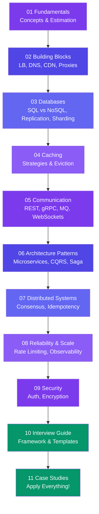

# System Design

> System design is the art of building large-scale systems. This track takes you from zero to confidently designing **URL shorteners, chat apps, video streaming, ride-sharing, and more**.

---

## Learning Path

---

## Sections at a Glance

| Section | What You'll Learn |
|---------|-------------------|
| **01 Fundamentals** | HLD vs LLD, requirements, estimation, scalability terms |
| **02 Building Blocks** | Client-server, scaling, load balancers, DNS, CDN, proxies |
| **03 Databases** | SQL vs NoSQL, replication, sharding, CAP theorem |
| **04 Caching** | Cache strategies, eviction policies, CDN caching |
| **05 Communication** | REST vs gRPC vs GraphQL, WebSockets, message queues |
| **06 Architecture Patterns** | Monolith vs microservices, serverless, CQRS, Saga |
| **07 Distributed Systems** | Consistency models, consensus, idempotency |
| **08 Reliability & Scale** | SLAs, rate limiting, circuit breakers, observability |
| **09 Security** | Auth/OAuth2, encryption, common attacks |
| **10 Interview Guide** | Step-by-step framework, mistakes to avoid, cheat sheet |
| **11 Case Studies** | URL shortener, chat, video streaming, Uber, and more |

---

## How to Use This Track

- Start with **01 Fundamentals** if you're new to system design.
- Each page ends with **Trade-offs** and **In Simple Words**.
- The **Case Studies** section ties everything together — each follows the same template.
- Jump to the **Interview Guide** for a quick revision before interviews.
