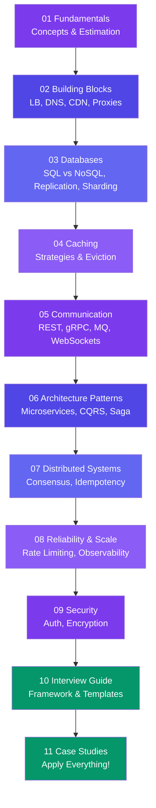

# System Design

> System design is the art of building large-scale systems. This track takes you from zero to confidently designing **URL shorteners, chat apps, video streaming, ride-sharing, and more**.

---

## Learning Path

---

## Sections at a Glance

| Section | What You'll Learn |
|---------|-------------------|
| **01 Fundamentals** | HLD vs LLD, requirements, estimation, scalability terms |
| **02 Building Blocks** | Client-server, scaling, load balancers, DNS, CDN, proxies |
| **03 Databases** | SQL vs NoSQL, replication, sharding, CAP theorem |
| **04 Caching** | Cache strategies, eviction policies, CDN caching |
| **05 Communication** | REST vs gRPC vs GraphQL, WebSockets, message queues |
| **06 Architecture Patterns** | Monolith vs microservices, serverless, CQRS, Saga |
| **07 Distributed Systems** | Consistency models, consensus, idempotency |
| **08 Reliability & Scale** | SLAs, rate limiting, circuit breakers, observability |
| **09 Security** | Auth/OAuth2, encryption, common attacks |
| **10 Interview Guide** | Step-by-step framework, mistakes to avoid, cheat sheet |
| **11 Case Studies** | URL shortener, chat, ticket booking, e-commerce orders, key-value stores, proximity search, collaborative editing, job scheduling, ad analytics, distributed locks, Twitter/X, Instagram, search engines, API gateways, and more |

---

## How to Use This Track

- Start with **01 Fundamentals** if you're new to system design.
- Each page ends with **Trade-offs** and **In Simple Words**.
- The **Case Studies** section ties everything together — each follows the same template.
- Jump to the **Interview Guide** for a quick revision before interviews.

---

## Case Study Quick Reference

A fast lookup table across all 30 case studies — use it for last-minute revision or to jog your memory on which technique solves which problem.

| Case Study | Core Challenge | Key Technique |
| --- | --- | --- |
| URL Shortener | Read-heavy redirects at scale | Base62 encoding + cache-aside |
| Rate Limiter | Fair, distributed request limiting | Token bucket in Redis |
| News Feed | Fan-out of posts to millions of followers | Hybrid fan-out (push + pull) |
| Chat System | Real-time low-latency messaging at scale | WebSockets + message queues |
| Video Streaming | Efficient delivery of huge media files | Chunked encoding + CDN + adaptive bitrate |
| Ride-Sharing | Real-time driver-rider matching by location | Geohashing + quadtrees for proximity matching |
| Notification System | Multi-channel delivery at massive scale | Async queues + fan-out workers |
| Web Crawler | Crawling the web without loops or overload | BFS frontier + URL dedup (Bloom filter) |
| Search Autocomplete | Sub-100ms prefix suggestions | Trie + precomputed top-k rankings |
| Distributed Cache | Low-latency shared cache across nodes | Consistent hashing + LRU eviction |
| File Storage | Storing/syncing large files reliably | Chunking + block-level dedup + metadata service |
| Payment System | Exactly-once, auditable money movement | Idempotency keys + two-phase commit / saga |
| Ticket Booking System | Preventing double-booking under flash-sale load | Seat-hold locking + queueing |
| E-commerce Order System | Consistent inventory across order lifecycle | Inventory reservation + order saga |
| Distributed Key-Value Store | Tunable consistency at high availability | Quorum reads/writes + vector clocks |
| Proximity Service | Fast "nearby" queries over huge location data | Geohashing + quadtrees |
| Collaborative Editor | Concurrent edits without conflicts | Operational Transformation vs CRDT |
| Distributed Job Scheduler | Reliable, non-duplicate job execution | Leader election + exactly-once triggering |
| Ad Click Aggregation | Real-time counting at massive event volume | Streaming aggregation + HyperLogLog |
| Distributed Lock Service | Safe mutual exclusion across nodes | ZooKeeper/Redlock + fencing tokens |
| Twitter/X | Retweet fan-out amplification + real-time trending | Per-retweeter celebrity threshold + Count-Min Sketch heavy-hitters |
| Instagram | Async media pipeline, ephemeral Stories, non-social-graph discovery | TTL-native storage + embedding nearest-neighbor search |
| Distributed Search Engine | Full-text search ranked by relevance at billions of documents | Sharded inverted index + BM25 scatter-gather |
| API Gateway | Uniform edge for auth/routing/aggregation across microservices | Middleware pipeline + per-dependency circuit breakers |
| UPI Payment System | Interbank transfer with no shared ledger between payer/payee banks | Switch-coordinated debit/credit + deferred net settlement |
| Short-Video Platform (TikTok) | Flaky mobile uploads + a follow-graph-free ranking feed | Parallel chunked uploads + streaming engagement ranking |
| Real-Time Chat & Voice (Discord) | Broadcasting to large channels + live voice | Cluster-wide pub/sub fan-out + WebRTC SFU |
| Property & Hotel Booking (Airbnb) | Per-listing date-range availability at search scale | 365-day availability bitmaps + geo-first search |
| Metrics & Monitoring System | Affordable long-retention time-series at high write volume | Gorilla/XOR compression + downsampling rollups |
| Distributed Message Queue (Kafka) | Durable, ordered, high-throughput event backbone | Partitioned commit log + ISR replication + zero-copy |
