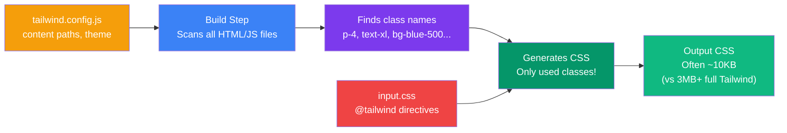

## Setup & Configuration

Setting up Tailwind CSS is straightforward. You install the package, configure which files to scan, and run the build step to generate your CSS.

> **Analogy:** Setting up Tailwind is like setting up a factory conveyor belt. You tell it what raw materials (HTML files) to scan, and it produces exactly the right parts (CSS classes) that you need.

---

### Installation Methods

**Option 1: With npm (recommended for most projects)**
```bash
npm install -D tailwindcss
npx tailwindcss init
```

**Option 2: With Vite (for React/Vue/Vite projects)**
```bash
npm install -D tailwindcss @tailwindcss/vite
```

**Option 3: CDN (for quick prototyping — not for production)**
```html
<script src="https://cdn.tailwindcss.com"></script>
```

---

### Build Flow



---

### Step-by-Step Setup

**1. Install and create config file**
```bash
npm install -D tailwindcss
npx tailwindcss init
```

This creates `tailwind.config.js`:
```javascript
/** @type {import('tailwindcss').Config} */
module.exports = {
  content: [
    "./src/**/*.{html,js,jsx,ts,tsx}",
    "./index.html",
  ],
  theme: {
    extend: {},
  },
  plugins: [],
}
```

**2. Create your input CSS file** (`src/input.css`)
```css
@tailwind base;
@tailwind components;
@tailwind utilities;
```

**3. Add the build script to `package.json`**
```json
{
  "scripts": {
    "build": "tailwindcss -i ./src/input.css -o ./dist/output.css --watch"
  }
}
```

**4. Run the build**
```bash
npm run build
```

---

### What the Config Does

```javascript
module.exports = {
  // Tell Tailwind where to look for class names
  content: [
    "./src/**/*.{html,js,jsx,ts,tsx}",
  ],

  // Extend or override the default theme
  theme: {
    extend: {
      colors: {
        brand: {
          500: '#6366f1',
          700: '#4338ca',
        },
      },
      spacing: {
        '72': '18rem',
        '84': '21rem',
      },
    },
  },

  // Add official plugins
  plugins: [
    require('@tailwindcss/forms'),
    require('@tailwindcss/typography'),
  ],

  // Enable dark mode (class strategy)
  darkMode: 'class',
};
```

---

### The `@tailwind` Directives

| Directive | What it includes |
|-----------|-----------------|
| `@tailwind base` | Normalize/reset styles (Preflight) |
| `@tailwind components` | Component classes (use `@apply` here) |
| `@tailwind utilities` | All utility classes (the main thing) |
| `@tailwind variants` | Variant classes (hover:, focus:, etc.) |

---

### What Gets Generated

```html
<!-- Your HTML uses these classes -->
<div class="p-4 bg-blue-500 text-white rounded-lg shadow-md">
  <h1 class="text-2xl font-bold">Hello</h1>
</div>
```

```css
/* ✅ Generated CSS — only what you used! */
.p-4 { padding: 1rem; }
.bg-blue-500 { background-color: #3b82f6; }
.text-white { color: #fff; }
.rounded-lg { border-radius: 0.5rem; }
.shadow-md { box-shadow: 0 4px 6px -1px rgba(0,0,0,0.1); }
.text-2xl { font-size: 1.5rem; line-height: 2rem; }
.font-bold { font-weight: 700; }

/* ❌ NOT generated:
 .p-1, .p-2, .p-3, ... .p-96
 .bg-red-500, .bg-green-500, ...
 — Only classes found in content files!
*/
```

---

### In Simple Words

- Install Tailwind via **npm**, create a **config file**, and set up a **build script**
- The `content` array tells Tailwind **which files to scan** for class names
- Tailwind **scans your files** and generates CSS for **only the classes you use**
- The final CSS is **tiny** — no unused styles in production
- The config file is where you **customize** colors, spacing, fonts, and breakpoints
