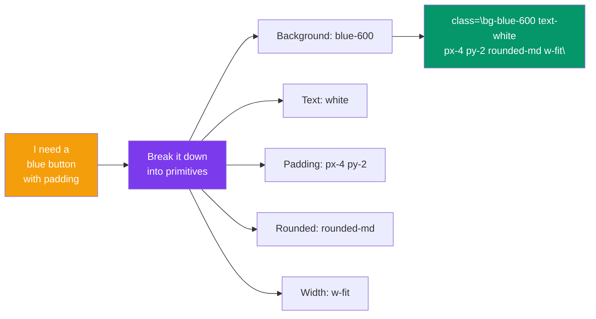

## Utility-First Workflow

The **utility-first mindset** is the key to being productive with Tailwind. Instead of writing CSS rules for each component, you **compose** designs by stacking small, single-purpose classes.

> **Analogy:** Traditional CSS is like writing a novel in one go. Utility-first is like building with LEGO bricks — each brick does one thing, and you combine them to create anything.

---

### Reading Class Names

Tailwind class names follow a predictable pattern: `property-value` or `property-value-modifier`.

```html
<div class="p-4 bg-blue-500 text-white rounded-lg">
```

| Class | Property | Value | Translation |
|-------|----------|-------|-------------|
| `p-4` | padding | 4 (1rem / 16px) | Padding on all sides |
| `bg-blue-500` | background-color | blue-500 (#3b82f6) | Blue background |
| `text-white` | text color | white (#fff) | White text |
| `rounded-lg` | border-radius | lg (0.5rem / 8px) | Large rounded corners |

---

### How to Think in Utilities



### The Mental Model

**Step 1: Look at the design and break it into atomic pieces**

```html
<!-- Design: A card with padding, shadow, rounded corners, title, and body text -->

<!-- Traditional approach: write a CSS class -->
<div class="card">...</div>

<!-- Utility approach: compose with utilities -->
<div class="p-6 bg-white rounded-xl shadow-lg">
  <h2 class="text-xl font-bold text-gray-800 mb-2">Title</h2>
  <p class="text-gray-600">Body text here</p>
</div>
```

**Step 2: Start with the outer container and work inward**

```html
<!-- 1. Container -->
<div class="max-w-md mx-auto">
  <!-- 2. Card -->
  <div class="bg-white rounded-lg shadow-md p-6">
    <!-- 3. Content inside -->
    <h3 class="text-lg font-semibold text-gray-900">Profile</h3>
    <p class="mt-2 text-gray-600">User details here</p>
    <!-- 4. Actions -->
    <button class="mt-4 px-4 py-2 bg-blue-600 text-white rounded-md">
      Edit Profile
    </button>
  </div>
</div>
```

---

### Utility vs Custom CSS — When to Use Each

```mermaid
flowchart TB
    Task[What am I building?"] --> Decision{Is this a<br/>one-time pattern?}
    Decision -->|Yes ✅| Utilities["Use utilities directly<br/>Keeps CSS clean"]
    Decision -->|No, it repeats| Component["Extract as component<br/>(React/Vue) or @apply"]
    
    Utilities --> Example["class=\"p-4 bg-blue-500 text-white rounded\""]
    Component --> Example2["<Button> component<br/>or @apply in CSS"]

    style Task fill:#3b82f6,color:#fff
    style Decision fill:#f59e0b,color:#fff
    style Utilities fill:#059669,color:#fff
    style Component fill:#7c3aed,color:#fff
```

### When to Use Utilities vs Extract

| Scenario | Approach | Example |
|----------|----------|---------|
| One-time button | Utilities | `bg-blue-500 text-white px-4 py-2 rounded` |
| Button used 20 times | Component | `<Button variant="primary">` |
| Complex form layout | Utilities | `grid grid-cols-2 gap-4` |
| Semantic CSS requirement | `@apply` | `.btn { @apply bg-blue-500 text-white px-4 py-2 rounded }` |

---

### Real Workflow: Build a Card

**Start with HTML and empty classes:**
```html
<div class="">
  
  <div class="">
    <h3 class="">Photo Title</h3>
    <p class="">Description here</p>
    <button class="">View</button>
  </div>
</div>
```

**Add utilities one by one:**
```html
<div class="max-w-sm rounded-lg overflow-hidden shadow-lg bg-white">
  
  <div class="p-6">
    <h3 class="text-xl font-bold text-gray-900 mb-2">Photo Title</h3>
    <p class="text-gray-600 mb-4">Description here</p>
    <button class="px-4 py-2 bg-blue-600 text-white rounded-md hover:bg-blue-700">
      View
    </button>
  </div>
</div>
```

---

### In Simple Words

- Tailwind classes follow a **`property-value`** naming pattern — easy to read and remember
- Think in **atomic pieces**: break a design into background, padding, text, borders
- Start **outside-in**: container → card → content → actions
- Use utilities for **one-off patterns**; extract components for **repeated patterns**
- The **utility-first workflow** is faster once you learn the class names
