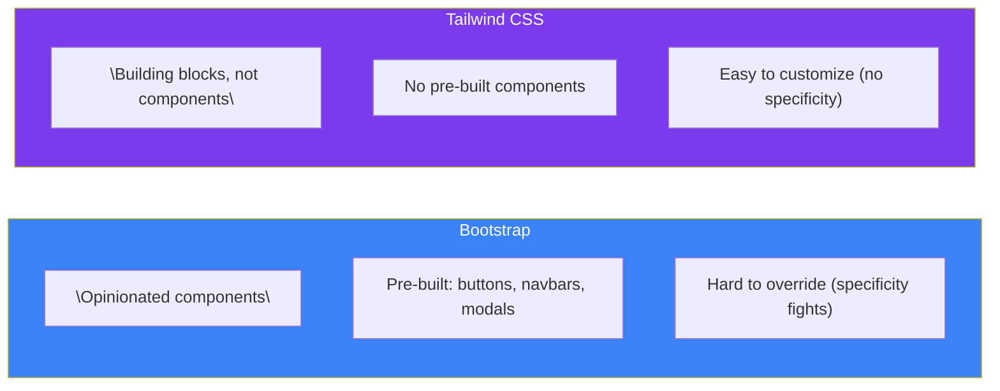

## What is Tailwind CSS?

**Tailwind CSS** is a **utility-first CSS framework** that provides thousands of small, single-purpose classes. Instead of writing custom CSS, you compose your UI by combining utility classes directly in your HTML.

> **Analogy:** Traditional CSS is like drawing a painting from scratch with individual brush strokes. Tailwind is like using pre-mixed paint colors and stencils — you still create unique art, but much faster.

---

### Utility-First vs Traditional CSS

```mermaid
flowchart TB
    subgraph Traditional["Traditional CSS"]
        HTML[HTML<br/>class=\"card\""] --> CSSFile["styles.css<br/>.card { padding: 16px; background: blue; }"]
        CSSFile --> Compiled[Browser loads CSS file]
        Compiled --> Result[Styled elements]
    end

    subgraph Utility["Tailwind CSS"]
        HTML2["HTML<br/>class=\"p-4 bg-blue-500 text-white\""] --> Build[Build Step<br/>Scans HTML → generates CSS]
        Build --> Tiny["tiny.css<br/>(only used classes)"]
        Tiny --> Result2[Styled elements<br/>All in the HTML!]
    end

    style Traditional fill:#ef4444,color:#fff
    style Utility fill:#059669,color:#fff
    style CSSFile fill:#fca5a5,color:#333
    style Tiny fill:#7c3aed,color:#fff
```

| Aspect | Traditional CSS | Tailwind (Utility-First) |
|--------|----------------|-------------------------|
| **Where styles live** | In `.css` files | In your HTML as classes |
| **Naming things** | Invent class names (BEM, etc.) | Just use utilities — no naming |
| **CSS size** | All styles loaded, even unused | Only used classes in final CSS |
| **Changes** | Edit CSS file → may break other uses | Edit HTML — changes are local |
| **Learning curve** | Learn CSS properties | Learn utility class names |
| **Reusability** | `.btn` class reused everywhere | Extract with `@apply` or components |

---

### Tailwind vs Bootstrap



### Concrete Example

**Building a card — Traditional CSS:**
```css
/* styles.css */
.card {
  padding: 16px;
  border-radius: 8px;
  background-color: #3b82f6;
  color: white;
  box-shadow: 0 4px 6px rgba(0, 0, 0, 0.1);
}
.card-title {
  font-size: 1.25rem;
  font-weight: 700;
  margin-bottom: 8px;
}
```

```html
<!-- HTML -->
<div class="card">
  <h2 class="card-title">Hello World</h2>
  <p>This is a card component.</p>
</div>
```

**Same card with Tailwind:**
```html
<!-- Everything in one place! -->
<div class="p-4 rounded-lg bg-blue-500 text-white shadow-md">
  <h2 class="text-xl font-bold mb-2">Hello World</h2>
  <p>This is a card component.</p>
</div>
```

| Class | What it does |
|-------|-------------|
| `p-4` | Padding: 1rem (16px) |
| `rounded-lg` | Border-radius: 0.5rem (8px) |
| `bg-blue-500` | Background: blue-500 shade |
| `text-white` | Text color: white |
| `shadow-md` | Box-shadow: medium size |
| `text-xl` | Font-size: 1.25rem |
| `font-bold` | Font-weight: 700 (bold) |
| `mb-2` | Margin-bottom: 0.5rem (8px) |

---

### Why Developers Choose Tailwind

| Problem | How Tailwind Solves It |
|---------|----------------------|
| **Naming CSS classes** | No naming needed — just use utilities |
| **CSS file bloat** | Purges unused CSS automatically |
| **Consistency** | Design system built-in (spacing scale, color palette) |
| **Responsive design** | Built-in breakpoints: `sm:`, `md:`, `lg:`, `xl:` |
| **Dark mode** | Add `dark:` variants anywhere |
| **Hover/Focus** | Prefix `hover:`, `focus:` to any utility |
| **Custom designs** | Fully configurable theme |

---

### In Simple Words

- Tailwind is **utility-first** — you use small CSS classes directly in HTML
- No more **naming classes** or switching between HTML and CSS files
- **No unused CSS** — only the classes you use end up in the final file
- Unlike Bootstrap, Tailwind gives **building blocks**, not pre-built components
- You get **consistency** from a built-in design system (spacing, colors, typography)
- Everything is **customizable** — colors, spacing, breakpoints, and more
