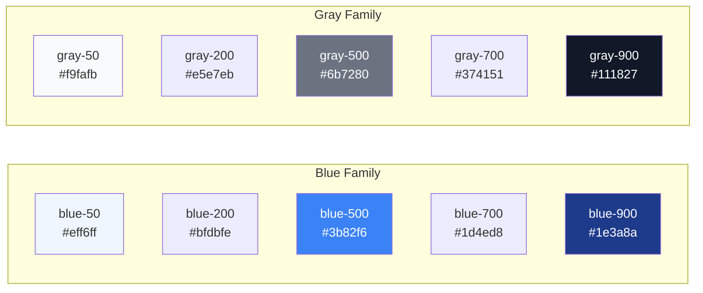

## Colors & Typography

Tailwind comes with a carefully designed **color palette** and comprehensive **typography utilities**. Every color has multiple shades (50–950), making it easy to build consistent, accessible designs.

> **Analogy:** The color palette is like a paint swatch book at a hardware store — every color comes in light, medium, and dark versions.

---

### The Color Palette

Each color family has 11 shades (50, 100, 200, ..., 900, 950):



### Color Naming Convention

```html
<!-- Format: {color}-{shade} -->
<bg class="bg-red-500">    <!-- Red: icons, errors -->
<bg class="bg-blue-500">   <!-- Blue: primary actions, links -->
<bg class="bg-green-500">  <!-- Green: success -->
<bg class="bg-yellow-500"> <!-- Yellow: warnings -->
<bg class="bg-purple-500"> <!-- Purple: premium features -->
<bg class="bg-gray-500">   <!-- Gray: neutral, text -->
```

### Common Color Utilities

```html
<!-- Background colors -->
<div class="bg-blue-500">Blue background</div>
<div class="bg-gray-100">Light gray background</div>

<!-- Text colors -->
<p class="text-gray-900">Dark text (headings)</p>
<p class="text-gray-600">Medium text (body)</p>
<p class="text-gray-400">Light text (disabled)</p>
<p class="text-red-500">Error text</p>
<p class="text-green-600">Success text</p>

<!-- Border colors -->
<div class="border border-gray-200">Light border</div>
<div class="border border-red-300">Error border</div>
```

---

### Typography Scale

Tailwind provides a **type scale** for consistent font sizes:

| Class | Size | Line-Height | Use Case |
|-------|------|-------------|----------|
| `text-xs` | 0.75rem (12px) | 1rem | Fine print, captions |
| `text-sm` | 0.875rem (14px) | 1.25rem | Labels, secondary text |
| `text-base` | 1rem (16px) | 1.5rem | Body text (default) |
| `text-lg` | 1.125rem (18px) | 1.75rem | Large body |
| `text-xl` | 1.25rem (20px) | 1.75rem | Subheadings |
| `text-2xl` | 1.5rem (24px) | 2rem | Section headings |
| `text-3xl` | 1.875rem (30px) | 2.25rem | Page headings |
| `text-4xl` | 2.25rem (36px) | 2.5rem | Hero headings |
| `text-5xl` | 3rem (48px) | 1 | Large hero |
| `text-6xl` | 3.75rem (60px) | 1 | Display |

```html
<h1 class="text-4xl font-bold tracking-tight">Page Title</h1>
<h2 class="text-2xl font-semibold">Section Title</h2>
<p class="text-base text-gray-600">Body paragraph text.</p>
<p class="text-sm text-gray-500">Caption or secondary info.</p>
```

---

### Font Weight & Style

| Class | Weight |
|-------|--------|
| `font-thin` | 100 |
| `font-light` | 300 |
| `font-normal` | 400 (default) |
| `font-medium` | 500 |
| `font-semibold` | 600 |
| `font-bold` | 700 |
| `font-extrabold` | 800 |
| `font-black` | 900 |

```html
<p class="font-light">Light weight text</p>
<p class="font-normal">Normal weight</p>
<p class="font-semibold">Semibold — most used for headings</p>
<p class="font-bold">Bold — emphasis</p>

<!-- Italic -->
<p class="italic">Italic text</p>

<!-- Letter spacing -->
<p class="tracking-tight">Tighter spacing (headings)</p>
<p class="tracking-wide">Wider spacing (uppercase labels)</p>

<!-- Line height -->
<p class="leading-tight">Tight line height (headings)</p>
<p class="leading-relaxed">Relaxed (body text)</p>
<p class="leading-loose">Loose (long-form reading)</p>
```

---

### Text Alignment & Transformation

```html
<p class="text-left">Left aligned</p>
<p class="text-center">Center aligned</p>
<p class="text-right">Right aligned</p>

<!-- Case transformation -->
<p class="uppercase">UPPERCASE</p>
<p class="lowercase">lowercase</p>
<p class="capitalize">Capitalize Each Word</p>

<!-- Text decoration -->
<p class="underline">Underlined</p>
<p class="line-through">Strikethrough</p>
<p class="no-underline">No underline (for links)</p>

<!-- Truncate -->
<p class="truncate">Long text that will be truncated with ellipsis...</p>
```

---

### Complete Typography Example

```html
<article class="max-w-2xl mx-auto px-4 py-8">
  <h1 class="text-4xl font-bold tracking-tight text-gray-900 mb-4">
    Understanding Tailwind CSS
  </h1>
  
  <p class="text-lg text-gray-600 leading-relaxed mb-6">
    Tailwind CSS is a utility-first framework that...
  </p>
  
  <h2 class="text-2xl font-semibold text-gray-800 mb-3">
    Why Use It?
  </h2>
  
  <p class="text-base text-gray-600 leading-relaxed">
    There are several compelling reasons to adopt Tailwind...
  </p>
  
  <div class="mt-8 p-4 bg-blue-50 border-l-4 border-blue-500 rounded-r-lg">
    <p class="text-sm text-blue-800 font-medium">💡 Tip</p>
    <p class="text-sm text-blue-600">Start with small components to learn.</p>
  </div>
</article>
```

---

### In Simple Words

- Tailwind has a **consistent color palette** with 11 shades per color family
- Use `bg-{color}-{shade}` for backgrounds, `text-{color}-{shade}` for text
- The **type scale** (`text-xs` to `text-6xl`) ensures consistent sizing
- Control **alignment** with `text-left/center/right` and **case** with `uppercase/lowercase`
- Combine utilities to create consistent typography without writing any CSS
