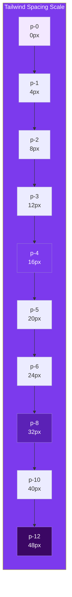

## Spacing & Sizing

Tailwind uses a **spacing scale** — a set of predefined values for padding, margin, width, height, and gaps. Instead of writing `padding: 16px`, you write `p-4`.

> **Analogy:** The spacing scale is like a set of drill bits — each number gives you a specific size. You learn which bit to use for which job.

---

### The Spacing Scale

Every number in Tailwind maps to a specific `rem` value:

| Class Suffix | Value | rem | Pixels (approx) |
|-------------|-------|-----|----------------|
| `0` | 0 | 0 | 0 |
| `0.5` | 0.125rem | 0.125 | 2px |
| `1` | 0.25rem | 0.25 | 4px |
| `2` | 0.5rem | 0.5 | 8px |
| `3` | 0.75rem | 0.75 | 12px |
| `4` | 1rem | 1 | **16px** |
| `5` | 1.25rem | 1.25 | 20px |
| `6` | 1.5rem | 1.5 | 24px |
| `8` | 2rem | 2 | 32px |
| `10` | 2.5rem | 2.5 | 40px |
| `12` | 3rem | 3 | 48px |
| `16` | 4rem | 4 | 64px |
| `20` | 5rem | 5 | 80px |
| `24` | 6rem | 6 | 96px |

---

### Padding Classes

```html
<!-- Padding on all sides -->
<div class="p-4">Padding: 16px on all sides</div>

<!-- Individual sides -->
<div class="pt-4">Padding-top</div>      <!-- pt-* -->
<div class="pr-4">Padding-right</div>     <!-- pr-* -->
<div class="pb-4">Padding-bottom</div>    <!-- pb-* -->
<div class="pl-4">Padding-left</div>      <!-- pl-* -->

<!-- Horizontal / Vertical -->
<div class="px-4">Padding-left + right</div>   <!-- px-* -->
<div class="py-2">Padding-top + bottom</div>    <!-- py-* -->
```

```html
<!-- Real example -->
<button class="px-6 py-3 bg-blue-600 text-white rounded-lg">
  Click Me  <!-- ← 24px horizontal, 12px vertical padding -->
</button>
```

---

### Margin Classes

Same pattern as padding, but with `m-` instead of `p-`:

```html
<div class="m-4">Margin on all sides</div>
<div class="mx-auto">Center horizontally</div>  <!-- ← Most common margin! -->
<div class="mt-6">Margin-top</div>
<div class="mb-4">Margin-bottom</div>
<div class="ml-2 mr-2">Left and right</div>
```

**Negative margins:**
```html
<div class="-mt-4">Negative margin-top</div>
<div class="-mx-2">Negative horizontal margin</div>
```

---

### Width & Height

```html
<!-- Fixed widths -->
<div class="w-64">Width: 16rem (256px)</div>
<div class="w-96">Width: 24rem (384px)</div>

<!-- Percentage widths -->
<div class="w-1/2">Width: 50%</div>
<div class="w-2/3">Width: 66.667%</div>
<div class="w-full">Width: 100%</div>

<!-- Viewport & content-based -->
<div class="w-screen">Width: 100vw</div>
<div class="w-fit">Width: fit-content</div>
<div class="w-auto">Width: auto (default)</div>

<!-- Min/Max widths -->
<div class="min-w-0">min-width: 0</div>
<div class="max-w-md">max-width: 28rem</div>
<div class="max-w-2xl">max-width: 42rem</div>
<div class="max-w-7xl">max-width: 80rem</div>

<!-- Heights -->
<div class="h-64">Height: 16rem</div>
<div class="h-full">Height: 100%</div>
<div class="h-screen">Height: 100vh</div>
<div class="min-h-screen">min-height: 100vh</div>
```

---

### Gap (for Flexbox & Grid)

```html
<div class="flex gap-4">
  <div>Item 1</div>
  <div>Item 2</div>
  <div>Item 3</div>
  <!-- gap: 16px between items -->
</div>

<div class="grid grid-cols-3 gap-x-4 gap-y-2">
  <!-- column-gap: 16px, row-gap: 8px -->
</div>
```

---

### Spacing Scale Visualization



---

### In Simple Words

- Tailwind uses a **consistent number scale** for all spacing — `p-4`, `m-2`, `gap-6`, etc.
- Each number maps to a specific **`rem` value** (e.g., `4` = `1rem` = 16px)
- `p-*` = padding, `m-*` = margin, `w-*` = width, `h-*` = height
- Use **`mx-auto`** to center block elements horizontally
- Use fractions like `w-1/2`, `w-2/3` for percentage-based widths
- Use **`max-w-*`** to set maximum container widths (responsive design)
