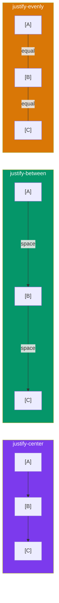

## Flexbox

Tailwind provides a complete set of **flexbox utilities** that map directly to CSS flexbox properties. If you already know CSS flexbox, you already know Tailwind flexbox — just with shorter names.

> **Analogy:** Flexbox is like a group of items on a shelf that can rearrange themselves. `flex` says "use a shelf," `justify-between` says "spread them out," and `items-center` says "line them up in the middle."

---

### Basic Flex Container

```html
<!-- Turn any container into a flexbox -->
<div class="flex">
  <div>Item 1</div>
  <div>Item 2</div>
  <div>Item 3</div>
</div>
```

| Class | CSS Equivalent | What It Does |
|-------|---------------|-------------|
| `flex` | `display: flex` | Creates a flex container (row layout) |
| `inline-flex` | `display: inline-flex` | Inline flex container |

---

### Flex Direction

```html
<div class="flex flex-row">     <!-- Default: left to right -->
<div class="flex flex-row-reverse"> <!-- Right to left -->
<div class="flex flex-col">     <!-- Top to bottom (column) -->
<div class="flex flex-col-reverse"> <!-- Bottom to top -->
```

---

### Alignment — Main Axis (Justify)

```html
<div class="flex justify-start">   <!-- Default: pack at start -->
<div class="flex justify-center">  <!-- Center horizontally -->
<div class="flex justify-end">     <!-- Pack at end -->
<div class="flex justify-between"> <!-- Space between items -->
<div class="flex justify-around">  <!-- Space around each item -->
<div class="flex justify-evenly">  <!-- Equal space everywhere -->
```



---

### Alignment — Cross Axis (Items)

```html
<div class="flex items-start">     <!-- Top of container -->
<div class="flex items-center">    <!-- Center vertically -->
<div class="flex items-end">       <!-- Bottom of container -->
<div class="flex items-stretch">   <!-- Full height (default) -->
<div class="flex items-baseline">  <!-- Align by text baseline -->
```

---

### Flex Wrap

```html
<div class="flex flex-wrap">          <!-- Wrap to next row -->
<div class="flex flex-wrap-reverse">  <!-- Wrap in reverse -->
<div class="flex flex-nowrap">        <!-- No wrapping (default) -->
```

---

### Child Element Utilities

```html
<div class="flex">
  <!-- Grow to fill available space -->
  <div class="flex-1">Takes equal space</div>
  
  <!-- Don't grow or shrink -->
  <div class="flex-none">Fixed size</div>
  
  <!-- Shrink if needed, don't grow -->
  <div class="flex-shrink">Can shrink</div>
  
  <!-- Grow if space available (but not forced) -->
  <div class="flex-grow">Can grow</div>
</div>
```

```html
<!-- Navigation bar example -->
<nav class="flex items-center justify-between px-6 py-4 bg-white shadow-sm">
  <div class="flex items-center gap-2">
    <!-- Logo area -->
    <span class="text-xl font-bold">MyApp</span>
  </div>
  
  <div class="flex items-center gap-6">
    <a href="#">Home</a>
    <a href="#">About</a>
    <a href="#">Contact</a>
  </div>
  
  <div>
    <button class="px-4 py-2 bg-blue-600 text-white rounded-lg">
      Sign In
    </button>
  </div>
</nav>
```

---

### Gap Between Flex Items

```html
<div class="flex gap-4">      <!-- 16px gap between items -->
<div class="flex gap-x-2 gap-y-4"> <!-- Different horizontal/vertical -->
<div class="flex gap-8">      <!-- 32px gap -->
```

---

### Ordering

```html
<div class="flex">
  <div class="order-3">First in HTML, but shown last</div>
  <div class="order-1">Second in HTML, but shown first</div>
  <div class="order-2">Third in HTML, shown in the middle</div>
</div>
```

---

### Complete Flex Example

```html
<!-- Card grid with flexbox -->
<div class="flex flex-wrap gap-6 justify-center">
  <div class="flex-1 min-w-[250px] max-w-sm bg-white p-6 rounded-lg shadow-md">
    <h3 class="text-lg font-bold">Card 1</h3>
    <p class="mt-2 text-gray-600">Flexible card that grows and shrinks.</p>
  </div>
  <div class="flex-1 min-w-[250px] max-w-sm bg-white p-6 rounded-lg shadow-md">
    <h3 class="text-lg font-bold">Card 2</h3>
    <p class="mt-2 text-gray-600">All cards equal height (flex-stretch).</p>
  </div>
  <div class="flex-1 min-w-[250px] max-w-sm bg-white p-6 rounded-lg shadow-md">
    <h3 class="text-lg font-bold">Card 3</h3>
    <p class="mt-2 text-gray-600">Responsive wrapping with flex-wrap.</p>
  </div>
</div>
```

---

### In Simple Words

- Use `flex` to create a flex container; `flex-col` for vertical layout
- **Main axis** alignment: `justify-start`, `justify-center`, `justify-between`
- **Cross axis** alignment: `items-start`, `items-center`, `items-end`
- `flex-wrap` lets items wrap to new rows; `flex-1` makes children grow equally
- Use `gap-*` for consistent spacing between flex items
