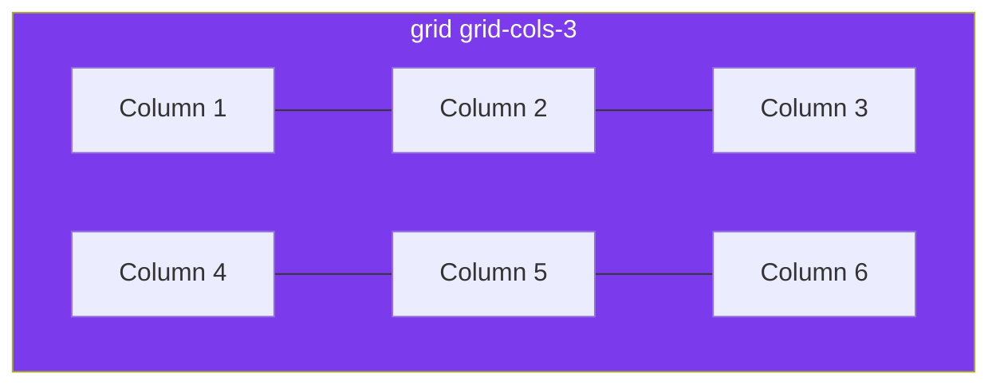
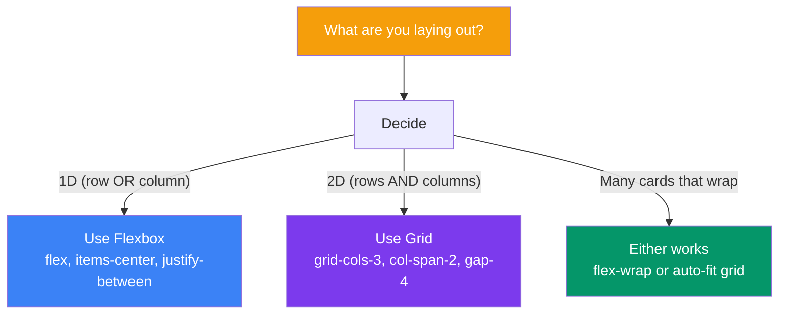

## Grid

Tailwind provides a complete set of **CSS Grid utilities** for building complex two-dimensional layouts. Grid is perfect for page-level layouts, card grids, and any design that needs both rows and columns.

> **Analogy:** If flexbox is a single shelf, grid is a whole bookshelf with rows and columns. You decide exactly where each item goes.

---

### Basic Grid

```html
<!-- 3 equal-width columns -->
<div class="grid grid-cols-3 gap-4">
  <div>Column 1</div>
  <div>Column 2</div>
  <div>Column 3</div>
</div>
```



---

### Column Counts

```html
<div class="grid grid-cols-1">  <!-- 1 column → single column layout -->
<div class="grid grid-cols-2">  <!-- 2 equal columns -->
<div class="grid grid-cols-3">  <!-- 3 equal columns -->
<div class="grid grid-cols-4">  <!-- 4 equal columns -->
<div class="grid grid-cols-6">  <!-- 6 columns -->
<div class="grid grid-cols-12"> <!-- 12 columns (like Bootstrap) -->
```

---

### Column Spans

```html
<!-- A 6-column grid where items span different widths -->
<div class="grid grid-cols-6 gap-4">
  <div class="col-span-4 bg-blue-100 p-4">Spans 4 columns</div>
  <div class="col-span-2 bg-green-100 p-4">Spans 2 columns</div>
  <div class="col-span-3 bg-purple-100 p-4">Spans 3 columns</div>
  <div class="col-span-3 bg-yellow-100 p-4">Spans 3 columns</div>
</div>

<!-- Full width item -->
<div class="col-span-full">Spans all columns</div>

<!-- Start at a specific column -->
<div class="col-start-2 col-end-5">From column 2 to 5</div>
```

---

### Row Control

```html
<!-- Explicit row count -->
<div class="grid grid-rows-3 grid-flow-col gap-4">
  <div>Row 1, Col 1</div>
  <div>Row 2, Col 1</div>
  <div>Row 3, Col 1</div>
  <div>Row 1, Col 2</div>
</div>

<!-- Row spans -->
<div class="grid grid-cols-3 gap-4">
  <div class="row-span-2 bg-blue-100 p-4">Spans 2 rows</div>
  <div class="bg-green-100 p-4">Regular</div>
  <div class="bg-green-100 p-4">Regular</div>
  <div class="bg-green-100 p-4">Regular</div>
</div>
```

---

### Grid Flow

```html
<!-- Default: fill rows then columns -->
<div class="grid grid-cols-3 gap-4">

<!-- Fill columns first (useful for vertical lists) -->
<div class="grid grid-cols-3 grid-flow-col gap-4">
```

---

### Responsive Grid

```html
<!-- Mobile: 1 col → Tablet: 2 cols → Desktop: 3 cols → Wide: 4 cols -->
<div class="grid grid-cols-1 sm:grid-cols-2 lg:grid-cols-3 xl:grid-cols-4 gap-4 md:gap-6">
  <div class="bg-white p-6 rounded-lg shadow">Card 1</div>
  <div class="bg-white p-6 rounded-lg shadow">Card 2</div>
  <div class="bg-white p-6 rounded-lg shadow">Card 3</div>
  <div class="bg-white p-6 rounded-lg shadow">Card 4</div>
</div>
```

---

### Auto-Fit Grid (Responsive Without Media Queries)

```html
<!-- Auto-fit: columns size themselves based on available space -->
<div class="grid grid-cols-[repeat(auto-fit,minmax(250px,1fr))] gap-6">
  <div class="bg-white p-6 rounded-lg shadow">Auto-sized card</div>
  <div class="bg-white p-6 rounded-lg shadow">Auto-sized card</div>
  <div class="bg-white p-6 rounded-lg shadow">Auto-sized card</div>
  <!-- More cards will wrap automatically -->
</div>
```

---

### Dashed Grid Layout (Template Areas)

```html
<div class="grid grid-cols-3 grid-rows-[auto_1fr_auto] gap-4 min-h-screen">
  <!-- Header spans all 3 columns -->
  <header class="col-span-3 bg-blue-600 text-white p-4">
    Header
  </header>
  
  <!-- Sidebar -->
  <aside class="bg-gray-100 p-4">Sidebar</aside>
  
  <!-- Main content spans 2 columns -->
  <main class="col-span-2 bg-white p-4">Main Content</main>
  
  <!-- Footer spans all 3 columns -->
  <footer class="col-span-3 bg-gray-800 text-white p-4">
    Footer
  </footer>
</div>

<!-- Visual result:
┌──────────────────────────────────────┐
│              Header                   │
├──────────┬───────────────────────────┤
│          │                           │
│ Sidebar  │       Main Content        │
│          │                           │
├──────────┴───────────────────────────┤
│              Footer                   │
└──────────────────────────────────────┘
-->
```

---

### Grid vs Flexbox — When to Use



---

### In Simple Words

- Use `grid grid-cols-*` to create a grid container with N columns
- `col-span-*` makes an item span multiple columns; `row-span-*` for rows
- Use `gap-*` for spacing; make grids **responsive** with breakpoints
- Use `auto-fit` + `minmax` for grids that automatically adjust
- Use Grid for **2D layouts**, Flexbox for **1D layouts** (row OR column)
