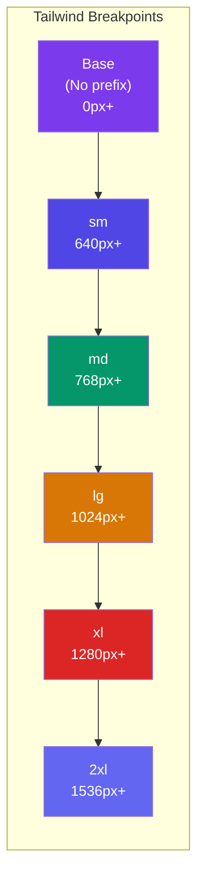
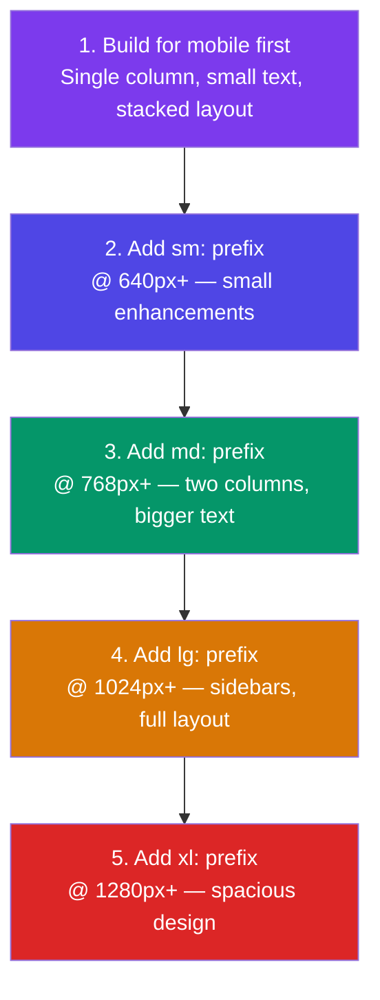

## Responsive Design

Tailwind uses a **mobile-first** approach to responsive design. You start with styles for small screens, then add `sm:`, `md:`, `lg:`, `xl:`, and `2xl:` prefixes to override them at larger breakpoints.

> **Analogy:** Mobile-first is like building a house from the foundation up. You start with what works everywhere (mobile), then add premium features (desktop) only where there's room.

---

### The Breakpoints



| Breakpoint | Min Width | Class Prefix | Target Devices |
|-----------|-----------|--------------|----------------|
| **Base** | 0px | _(no prefix)_ | All devices (default) |
| **sm** | 640px | `sm:` | Large phones, small tablets |
| **md** | 768px | `md:` | Tablets, small laptops |
| **lg** | 1024px | `lg:` | Laptops, desktops |
| **xl** | 1280px | `xl:` | Wide desktops |
| **2xl** | 1536px | `2xl:` | Ultra-wide screens |

---

### Mobile-First in Action

```html
<!-- Single column on mobile, two columns on tablet, three on desktop -->
<div class="grid grid-cols-1 md:grid-cols-2 lg:grid-cols-3">
  <div>Card 1</div>
  <div>Card 2</div>
  <div>Card 3</div>
</div>

<!-- Padding changes with screen size -->
<div class="p-4 md:p-6 lg:p-8">
  Content with responsive padding
</div>

<!-- Text size adapts -->
<h1 class="text-2xl md:text-3xl lg:text-4xl font-bold">
  Responsive Heading
</h1>
```

**How to read responsive classes:**
- `text-2xl` = default: 1.5rem (all screens)
- `md:text-3xl` = at 768px+: 1.875rem
- `lg:text-4xl` = at 1024px+: 2.25rem

---

### The Recipe: Mobile-First Workflow



---

### Common Responsive Patterns

**1. Responsive Navigation:**
```html
<nav class="flex flex-col md:flex-row md:items-center md:justify-between">
  <div class="text-xl font-bold">Logo</div>
  <!-- Hidden hamburger on mobile, horizontal links on desktop -->
  <div class="hidden md:flex md:space-x-6">
    <a href="#" class="block mt-2 md:mt-0">Home</a>
    <a href="#" class="block mt-2 md:mt-0">About</a>
    <a href="#" class="block mt-2 md:mt-0">Contact</a>
  </div>
</nav>
```

**2. Responsive Grid:**
```html
<!-- Mobile: 1 col, Tablet: 2 cols, Desktop: 3 cols -->
<div class="grid grid-cols-1 sm:grid-cols-2 lg:grid-cols-3 gap-4">
  <div class="bg-white p-4 rounded-lg shadow">Item 1</div>
  <div class="bg-white p-4 rounded-lg shadow">Item 2</div>
  <div class="bg-white p-4 rounded-lg shadow">Item 3</div>
</div>
```

**3. Responsive Text:**
```html
<h1 class="text-3xl md:text-4xl lg:text-5xl font-bold">
  Hero Title
</h1>
<p class="text-sm md:text-base lg:text-lg text-gray-600">
  Description that gets larger on bigger screens.
</p>
```

**4. Responsive Spacing:**
```html
<section class="p-4 sm:p-6 md:p-8 lg:p-12">
  <div class="max-w-7xl mx-auto">
    Content with spacing that grows with screen size
  </div>
</section>
```

---

### Show / Hide on Breakpoints

```html
<!-- Hide on mobile, show on tablet+ -->
<div class="hidden md:block">
  Desktop sidebar navigation
</div>

<!-- Show on mobile only -->
<div class="block md:hidden">
  Mobile hamburger menu
</div>

<!-- Hide below large -->

```

---

### Real Responsive Page Example

```html
<div class="min-h-screen bg-gray-50">
  <!-- Header: responsive padding and layout -->
  <header class="p-4 md:p-6 lg:p-8 bg-white shadow-sm">
    <div class="max-w-7xl mx-auto flex flex-col md:flex-row md:items-center md:justify-between">
      <h1 class="text-2xl md:text-3xl font-bold text-gray-900">My App</h1>
      <nav class="mt-4 md:mt-0 flex flex-col sm:flex-row gap-2 sm:gap-4">
        <a href="#" class="text-gray-600 hover:text-gray-900">Dashboard</a>
        <a href="#" class="text-gray-600 hover:text-gray-900">Settings</a>
        <a href="#" class="text-gray-600 hover:text-gray-900">Profile</a>
      </nav>
    </div>
  </header>

  <!-- Content: 1 col → 2 cols → 3 cols -->
  <main class="max-w-7xl mx-auto p-4 md:p-6 lg:p-8">
    <div class="grid grid-cols-1 sm:grid-cols-2 lg:grid-cols-3 gap-4 md:gap-6">
      <!-- Cards scale layout naturally -->
      <div class="bg-white p-4 md:p-6 rounded-lg shadow">Card 1</div>
      <div class="bg-white p-4 md:p-6 rounded-lg shadow">Card 2</div>
      <div class="bg-white p-4 md:p-6 rounded-lg shadow">Card 3</div>
    </div>
  </main>
</div>
```

---

### In Simple Words

- Tailwind is **mobile-first** — write base styles for small screens, then override with breakpoints
- Breakpoints: `sm` (640px), `md` (768px), `lg` (1024px), `xl` (1280px), `2xl` (1536px)
- Use `prefix:utility` to apply a class only at that breakpoint and above
- Start with the **smallest screen** layout, then add classes with breakpoints to enhance
- Use `hidden md:block` to show/hide elements at different breakpoints
- Always test on actual mobile devices — don't just resize the browser
