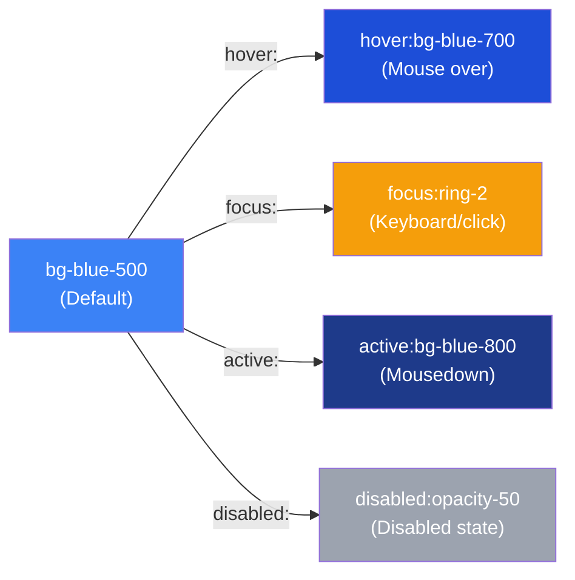
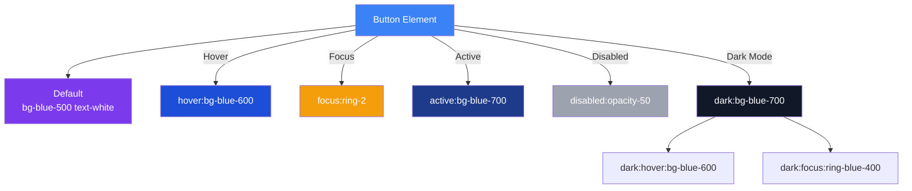

## States & Variants

Tailwind lets you apply styles conditionally using **variant prefixes**. Want a button to change color on hover? Add `hover:bg-blue-700`. Dark mode? Add `dark:bg-gray-800`. These variants are one of Tailwind's most powerful features.

> **Analogy:** Variants are like instructions for different situations — "when hovered, do this" or "when dark mode, do that." You add the condition as a prefix to any utility class.

---

### The Variant Pattern

Every variant follows the same pattern: `{condition}:{utility}`

```html
<button class="bg-blue-500 hover:bg-blue-700 focus:ring-2 active:bg-blue-800">
  Hover over me!
</button>
```



---

### Interactive State Variants

```html
<!-- Hover → mouse over the element -->
<button class="bg-blue-500 hover:bg-blue-600 text-white px-4 py-2 rounded">
  Hover me
</button>

<!-- Focus → element is focused (keyboard or click) -->
<input class="border border-gray-300 focus:border-blue-500 focus:ring-2 focus:ring-blue-200 
              rounded px-3 py-2 outline-none" />

<!-- Active → being clicked/pressed -->
<button class="bg-green-500 active:bg-green-600 transform active:scale-95">
  Click me
</button>

<!-- Combined -->
<button class="bg-blue-500 hover:bg-blue-600 focus:ring-2 active:bg-blue-700 
              disabled:opacity-50 disabled:cursor-not-allowed">
  Interactive Button
</button>
```

---

### Pseudo-Class Variants

| Variant | CSS Equivalent | When It Applies |
|---------|---------------|-----------------|
| `hover:` | `:hover` | Mouse is over the element |
| `focus:` | `:focus` | Element has focus (click/keyboard) |
| `focus-visible:` | `:focus-visible` | Focus via keyboard only (accessibility) |
| `active:` | `:active` | Element is being pressed |
| `visited:` | `:visited` | Link has been visited |
| `disabled:` | `:disabled` | Input/button is disabled |
| `checked:` | `:checked` | Checkbox/radio is checked |
| `required:` | `:required` | Form field is required |
| `invalid:` | `:invalid` | Form field has invalid value |
| `read-only:` | `:read-only` | Input is read-only |

---

### Dark Mode Variant

Tailwind makes dark mode easy with the `dark:` prefix:

```html
<div class="bg-white dark:bg-gray-900 text-gray-900 dark:text-gray-100 
            min-h-screen p-8">
  <h1 class="text-2xl font-bold">Dark Mode Example</h1>
  <p class="mt-4 text-gray-600 dark:text-gray-400">
    This text adapts to dark mode automatically.
  </p>

  <div class="mt-6 p-4 bg-gray-100 dark:bg-gray-800 rounded-lg">
    <p class="text-gray-800 dark:text-gray-200">
      Card that works in both themes
    </p>
  </div>
</div>
```

**Setup:** In `tailwind.config.js`:
```javascript
module.exports = {
  darkMode: 'class', // or 'media' (system preference)
  // ...
}
```

| Approach | How It Works |
|----------|-------------|
| `darkMode: 'class'` | Add `class="dark"` to `<html>` element to toggle |
| `darkMode: 'media'` | Automatically follows `prefers-color-scheme: dark` |

---

### Group Variant

Use `group` and `group-hover:` to style a **child element** when the **parent** is hovered:

```html
<!-- Hover anywhere on the card → the title turns blue -->
<div class="group p-4 bg-white rounded-lg shadow hover:shadow-lg transition-all">
  <h3 class="text-gray-900 group-hover:text-blue-600 transition-colors">
    Card Title (turns blue when card is hovered)
  </h3>
  <p class="text-gray-600 group-hover:text-gray-900">
    Description text
  </p>
  <div class="mt-4 opacity-0 group-hover:opacity-100 transition-opacity">
    Hidden content revealed on hover
  </div>
</div>
```

**Available group variants:** `group-hover:`, `group-focus:`, `group-active:`, `group-visited:`, `group-disabled:`

---

### Peer Variant

Use `peer` and `peer-*:` to style a **sibling element** based on another's state:

```html
<!-- Checkbox that affects the label text -->
<div class="flex items-center gap-2">
  <input type="checkbox" id="terms" class="peer" />
  <label for="terms" class="text-gray-600 peer-checked:text-green-600">
    I agree to the terms
  </label>
</div>

<!-- Input with floating validation message -->
<div class="relative">
  <input type="email" class="peer border rounded p-2 w-full" placeholder="Email" />
  <p class="mt-1 text-sm text-red-500 hidden peer-invalid:block">
    Please enter a valid email
  </p>
</div>
```

---

### Variant Composition

You can **chain** multiple variants:

```html
<button class="
  bg-blue-500 
  hover:bg-blue-600 
  dark:bg-blue-700 
  dark:hover:bg-blue-600 
  focus:ring-2 
  focus:ring-blue-500
  dark:focus:ring-blue-400
  disabled:opacity-50
  disabled:hover:bg-blue-500
">
  Fully styled button
</button>
```

---

### Variant Combinations Flow



---

### In Simple Words

- **Variants** are condition prefixes like `hover:`, `focus:`, or `dark:`
- Add any variant before any utility: `hover:bg-blue-700`, `dark:text-white`
- **Dark mode** uses `dark:` prefix — enable with `darkMode: 'class'` in config
- **Group** lets parent hover affect children: `group` + `group-hover:`
- **Peer** lets one element's state affect a sibling: `peer` + `peer-checked:`
- Variants **compose** — you can chain them: `dark:hover:bg-blue-600`
