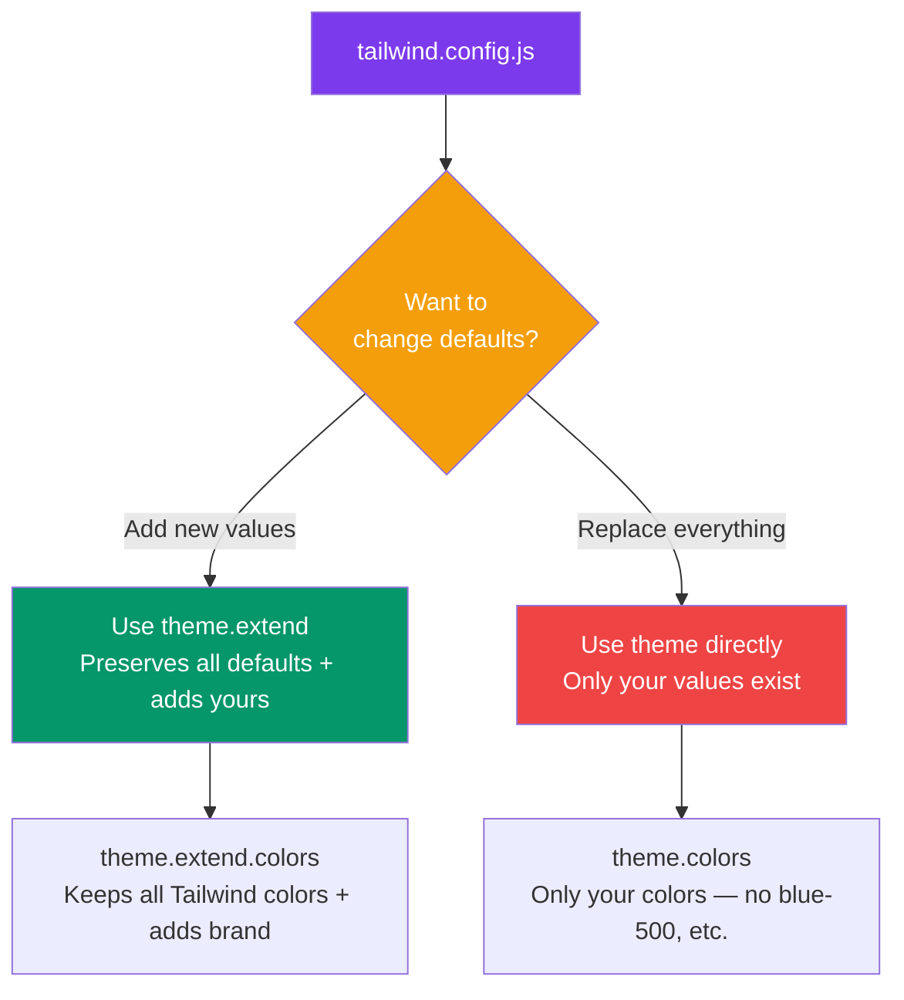
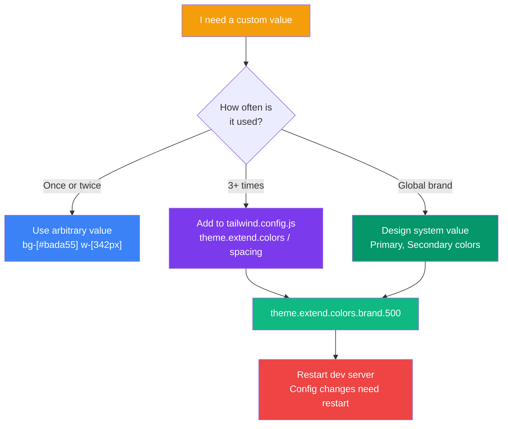

## Customizing the Theme

Tailwind's default theme is great out of the box, but real projects need **custom colors, fonts, spacing, or breakpoints**. The `tailwind.config.js` file is where you customize everything.

> **Analogy:** The default Tailwind theme is like a starter tool kit. Customizing the theme is like adding your favorite specialized tools — you keep what works and add what you need.

---

### The Config File Structure

```javascript
// tailwind.config.js
module.exports = {
  content: ['./src/**/*.{html,js}'],
  theme: {
    // Override entire defaults
    screens: { /* ... */ },
    colors: { /* ... */ },
    spacing: { /* ... */ },

    // Or extend (add to defaults, don't replace)
    extend: {
      colors: { /* ... */ },
      fontFamily: { /* ... */ },
      spacing: { /* ... */ },
    },
  },
  plugins: [],
};
```

**Key rule:** Use `theme.extend` to **add** to defaults. Use `theme` directly to **replace** defaults.

---

### Extend vs Override



**Example — extending:**
```javascript
module.exports = {
  theme: {
    extend: {
      colors: {
        brand: {
          50: '#eef2ff',
          500: '#6366f1',  // ← bg-brand-500 works!
          900: '#312e81',
        },
      },
    },
  },
};
```
Now you can use: `bg-brand-500`, `text-brand-900`, `border-brand-50` — alongside all default colors.

---

### Custom Colors

```javascript
// tailwind.config.js
theme: {
  extend: {
    colors: {
      primary: {
        50: '#f0fdf4',
        100: '#dcfce7',
        500: '#22c55e',  // Primary green
        600: '#16a34a',
        700: '#15803d',
        900: '#14532d',
      },
      accent: {
        DEFAULT: '#f59e0b',  // No number needed
        light: '#fbbf24',
        dark: '#d97706',
      },
    },
  },
}
```

```html
<!-- Usage -->
<button class="bg-primary-500 text-white px-4 py-2 rounded-lg">
  Primary Button
</button>

<div class="bg-accent text-black px-3 py-1 rounded">
  Accent badge
</div>
```

---

### Custom Spacing

```javascript
theme: {
  extend: {
    spacing: {
      '18': '4.5rem',   // 72px
      '72': '18rem',    // 288px
      '84': '21rem',    // 336px
      '96': '24rem',    // 384px
      'screen-1/2': '50vh',  // Custom named value
    },
  },
}
```

```html
<div class="w-72 mt-18 h-screen-1/2">
  Uses custom spacing
</div>
```

---

### Custom Fonts

```javascript
// tailwind.config.js
theme: {
  extend: {
    fontFamily: {
      sans: ['Inter', 'system-ui', 'sans-serif'],
      display: ['Playfair Display', 'serif'],
      mono: ['Fira Code', 'monospace'],
    },
  },
}
```

```html
<!-- Usage -->
<body class="font-sans">
  <h1 class="font-display text-4xl">Display Heading</h1>
  <code class="font-mono text-sm">console.log('hello')</code>
</body>
```

---

### Custom Breakpoints

```javascript
// Override all breakpoints
theme: {
  screens: {
    'tablet': '640px',
    'laptop': '1024px',
    'desktop': '1280px',
  },
}

// Or add new ones (with extend)
theme: {
  extend: {
    screens: {
      'xs': '480px',        // Extra small
      '3xl': '1600px',      // Extra large
      'tall': { 'raw': '(min-height: 800px)' },  // Height-based!
    },
  },
}
```

```html
<!-- Usage -->
<div class="grid grid-cols-1 xs:grid-cols-2 laptop:grid-cols-4">
  Cards that work at custom breakpoints
</div>
```

---

### Arbitrary Values

Need a one-off value without adding to the config? Use **arbitrary values** with square brackets:

```html
<!-- Any CSS value in square brackets -->
<div class="w-[342px]">Exact 342px width</div>
<div class="bg-[#bada55]">Custom hex color</div>
<div class="text-[14px]">Exact font size</div>
<div class="p-[13px]">Exact padding</div>
<div class="grid-cols-[1fr_2fr_1fr]">Custom grid template</div>
<div class="shadow-[0_0_10px_rgba(0,0,0,0.5)]">Custom shadow</div>
```

**When to use arbitrary values:**
- Design mockup specifies an exact pixel value
- One-off colors that won't repeat
- Quick prototyping before adding to config

**When to avoid:**
- Values used more than once (add to theme instead)
- It breaks the consistency of your design system

---

### Custom Theme Configuration Flow



---

### In Simple Words

- Use `theme.extend` to **add** to the default theme; `theme` directly to **replace** it
- Customize **colors, spacing, fonts, breakpoints** under `theme.extend`
- Use **arbitrary values** (`bg-[#color]`, `w-[300px]`) for one-off styles
- Always design with **consistency** — add repeated values to the config
- Avoid overriding entire defaults unless you're building a custom design system
