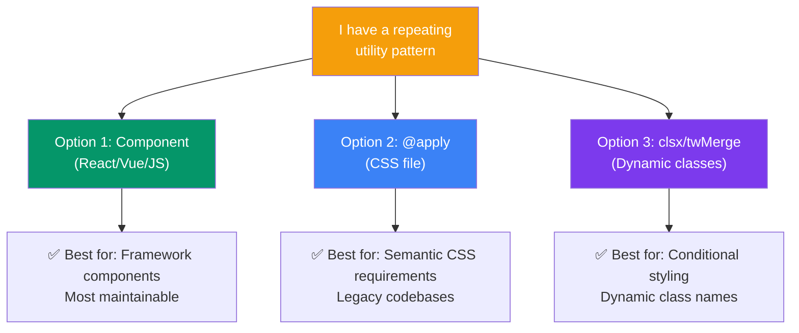

## Reusing Styles

Tailwind encourages using utilities directly in HTML, but sometimes you need to **reuse patterns** — either for semantic CSS, reducing repetition, or merging class names conditionally.

> **Analogy:** Utilities are like individual LEGO bricks. `@apply` is like pre-assembling a sub-build. Component extraction is like 3D-printing a frequently-used piece.

---

### Three Ways to Reuse



---

### Option 1: Component Extraction (Recommended)

The cleanest way to reuse styles is to **extract into framework components**:

```javascript
// React example
function Button({ variant = 'primary', children }) {
  const baseClasses = 'px-4 py-2 rounded-lg font-medium transition-colors';
  const variants = {
    primary: 'bg-blue-600 text-white hover:bg-blue-700',
    secondary: 'bg-gray-200 text-gray-800 hover:bg-gray-300',
    danger: 'bg-red-600 text-white hover:bg-red-700',
  };

  return (
    <button className={`${baseClasses} ${variants[variant]}`}>
      {children}
    </button>
  );
}

// Usage — clean and consistent
<Button variant="primary">Submit</Button>
<Button variant="secondary">Cancel</Button>
<Button variant="danger">Delete</Button>
```

```javascript
// Vue example
// <script setup>
defineProps({
  variant: { default: 'primary' }
});
// </script>

// <template>
//   <button :class="[
//     'px-4 py-2 rounded-lg font-medium',
//     variant === 'primary' ? 'bg-blue-600 text-white' : 'bg-gray-200'
//   ]">
//     <slot />
//   </button>
// </template>
```

---

### Option 2: @apply Directive

If you need semantic CSS (or can't use components), use `@apply` in your CSS file:

```css
/* input.css — after @tailwind utilities */
@layer components {
  .btn-primary {
    @apply px-6 py-3 bg-blue-600 text-white rounded-lg font-medium
           hover:bg-blue-700 focus:ring-2 focus:ring-blue-500
           transition-colors duration-200;
  }

  .card {
    @apply bg-white rounded-xl shadow-md p-6 border border-gray-100;
  }

  .badge {
    @apply inline-flex items-center px-2.5 py-0.5 rounded-full
           text-xs font-medium bg-blue-100 text-blue-800;
  }
}
```

```html
<!-- Usage — clean semantic classes -->
<button class="btn-primary">Save Changes</button>
<div class="card">Content</div>
<span class="badge">New</span>
```

---

### Option 3: Class Merging (clsx + tailwind-merge)

When you need to **merge class names conditionally**:

```bash
npm install clsx tailwind-merge
```

```javascript
import { clsx } from 'clsx';
import { twMerge } from 'tailwind-merge';

// twMerge resolves conflicting Tailwind classes
function cn(...inputs) {
  return twMerge(clsx(inputs));
}

// Usage
function Button({ variant, size, disabled, className }) {
  return (
    <button
      className={cn(
        'px-4 py-2 rounded-lg font-medium',
        'focus:ring-2 focus:ring-offset-2',
        {
          'bg-blue-600 text-white hover:bg-blue-700': variant === 'primary',
          'bg-gray-200 text-gray-800': variant === 'secondary',
          'text-sm px-3 py-1': size === 'sm',
          'text-lg px-6 py-3': size === 'lg',
          'opacity-50 cursor-not-allowed': disabled,
        },
        className  // Allow parent to override
      )}
      disabled={disabled}
    >
      Click me
    </button>
  );
}
```

**Why `twMerge`?** Without it, later classes don't always win:
```javascript
// Without twMerge: className="px-4 px-6" → both kept, last doesn't override
// With twMerge: → "px-6" wins automatically
cn('px-4', 'px-6')  // → 'px-6'
cn('text-red-500', 'text-blue-500')  // → 'text-blue-500'
```

---

### When to Use Which Approach

| Scenario | Best Approach |
|----------|--------------|
| Building UI components (React/Vue) | Component extraction |
| Working in a CMS or static HTML | `@apply` |
| Dynamic class composition | `clsx` + `twMerge` |
| Third-party integration | `@apply` in your CSS file |
| Rapid prototyping | Keep utilities inline |
| Design system library | Components + `clsx` |

---

### Common Mistakes

| Mistake | Why | Better Approach |
|---------|-----|----------------|
| `@apply` for everything | Loses the benefits of utility-first | Extract only repeated patterns (3+ times) |
| Not merging Tailwind classes | Conflicting classes break styles | Use `tailwind-merge` |
| Deeply nested `@apply` | Hard to debug | Keep `@apply` shallow (1–2 utilities deep) |
| Extracting too early | Premature abstraction | Keep utilities inline first, extract when pattern repeats |

---

### In Simple Words

- **Components** (React/Vue) are the best way to reuse Tailwind styles
- **`@apply`** lets you group utility classes into semantic CSS classes
- **`clsx`** handles conditional class names, **`tailwind-merge`** resolves conflicts
- Extract styles **only when they repeat** — avoid premature abstraction
- Keep base CSS small and utilities inline for most cases
