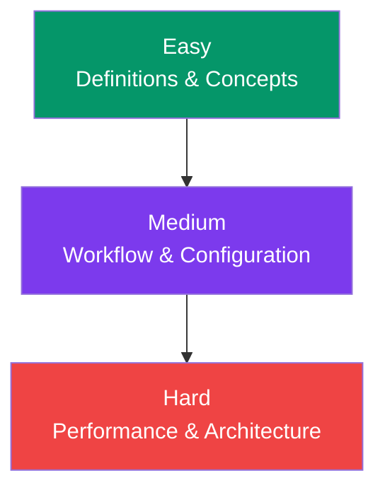

## Tailwind CSS Interview Questions

This page covers the most common Tailwind CSS interview questions — from **beginner** to **advanced**. Use these to prepare for your next interview.

---

### Quick Reference



---

### Easy Questions

**Q1: What is Tailwind CSS and how is it different from Bootstrap?**

Tailwind CSS is a **utility-first CSS framework** that provides small, composable utility classes. Bootstrap provides pre-built components (buttons, navbars, modals). Tailwind gives you building blocks; Bootstrap gives you finished pieces. With Tailwind you have full design control; with Bootstrap you get consistency but limited customization.

**Q2: What does "utility-first" mean?**

Utility-first means you build designs by combining small, single-purpose CSS classes directly in your HTML. Instead of writing custom CSS for each component, you compose styles from hundreds of utilities like `p-4`, `text-center`, `bg-blue-500`, etc.

**Q3: What is the `@tailwind` directive used for?**

`@tailwind base` imports Tailwind's base styles (reset/normalize). `@tailwind components` imports component classes. `@tailwind utilities` imports all utility classes. These are placed in your input CSS file.

**Q4: How does Tailwind handle responsive design?**

Tailwind uses a **mobile-first** approach with breakpoint prefixes: `sm:` (640px), `md:` (768px), `lg:` (1024px), `xl:` (1280px), `2xl:` (1536px). You write base styles for mobile and prefix classes with breakpoints for larger screens.

**Q5: What is the difference between `p-4`, `px-4`, and `py-4`?**

`p-4` applies padding on all four sides. `px-4` applies padding on the left and right (x-axis). `py-4` applies padding on the top and bottom (y-axis).

---

### Medium Questions

**Q6: How does Tailwind purge unused CSS?**

Tailwind scans your `content` files for class names, then generates CSS for only the classes that appear in those files. Classes are matched by **exact string** — dynamic class names (`bg-${color}-500`) are not detected unless you use the `safelist` option.

```javascript
// tailwind.config.js
module.exports = {
  content: ['./src/**/*.{html,js,jsx}'],   // Scan these files
  safelist: ['bg-red-500', 'bg-blue-500'],  // Keep these regardless
};
```

**Q7: What is the difference between `theme` and `theme.extend`?**

`theme` replaces the entire default value (e.g., `theme.colors` replaces all colors). `theme.extend` adds new values while keeping the defaults. Use `extend` unless you specifically want to override everything.

**Q8: How do you create a custom color in Tailwind?**

```javascript
// tailwind.config.js
theme: {
  extend: {
    colors: {
      primary: {
        500: '#6366f1',
        700: '#4338ca',
      },
    },
  },
}
```

Then use: `bg-primary-500`, `text-primary-500`, etc.

**Q9: What is `@apply` and when should you use it?**

`@apply` merges utility classes into a custom CSS class. Use it when you need semantic CSS class names (e.g., in a CMS), but prefer component extraction (React/Vue) when possible.

```css
.btn-primary {
  @apply px-6 py-3 bg-blue-600 text-white rounded-lg hover:bg-blue-700;
}
```

**Q10: How does dark mode work in Tailwind?**

Enable with `darkMode: 'class'` or `darkMode: 'media'` in config. Use the `dark:` prefix to apply classes only in dark mode:

```html
<div class="bg-white dark:bg-gray-900 text-black dark:text-white">
```

- `class` — you toggle dark mode by adding/removing `class="dark"` on `<html>`
- `media` — follows the system's `prefers-color-scheme` automatically

---

### Hard Questions

**Q11: How does Tailwind handle class conflicts when merging classes?**

Tailwind doesn't resolve conflicts natively — if two classes set the same property (e.g., `px-4` and `px-6`), both are applied and the CSS cascade determines which wins. Use **`tailwind-merge`** (`twMerge()`) to intelligently resolve conflicts by keeping the last class.

```javascript
import { twMerge } from 'tailwind-merge';
twMerge('px-4', 'px-6');  // → 'px-6'
```

**Q12: How would you optimize a Tailwind build for a large production app?**

1. Keep `content` paths narrow — scan only directories with Tailwind classes
2. Use the `safelist` sparingly — only for dynamically constructed class names
3. Minify the output CSS with `--minify`
4. Use `cssnano` for additional CSS compression
5. Enable JIT (default in v3+) for incremental builds
6. Extract components to reduce repeated utility strings in HTML

**Q13: What is the `important` option in Tailwind? When would you use it?**

The `important` config option adds `!important` to all Tailwind utilities. Use it when integrating Tailwind into a project with legacy CSS where you need Tailwind styles to always win the specificity battle:

```javascript
module.exports = {
  important: true,  // Adds !important to all utilities
};
```

**Q14: Explain the difference between `group` and `peer` variants.**

`group` and `group-hover:` let you style a **child** based on the **parent's** state. `peer` and `peer-*:` let you style a **sibling** based on another **sibling's** state.

```html
<!-- group: parent hover → child changes -->
<div class="group">
  <h3 class="group-hover:text-blue-600">Title changes on hover</h3>
</div>

<!-- peer: sibling state → element changes -->
<input type="checkbox" class="peer" />
<label class="peer-checked:text-green-600">Checked style</label>
```

**Q15: What strategies can you use to reduce the size of your Tailwind CSS output in production?**

1. **Automatic purging** — Tailwind v3+ purges by default based on `content` paths
2. **Narrow content paths** — scan only directories that actually use Tailwind
3. **Avoid arbitrary values** for repeated patterns — add to theme instead
4. **Extract components** — fewer unique utility combinations in HTML means fewer CSS rules
5. **Use a CDN build** — `https://cdn.tailwindcss.com` for prototyping (not production)
6. **Tree-shaking** — ensure your build tool removes unused files from scans

---

### Quick Reference

| Topic | Key Points |
|-------|------------|
| **Utility-first** | Compose designs from small single-purpose classes |
| **Responsive** | Mobile-first: `sm:`, `md:`, `lg:`, `xl:`, `2xl:` |
| **Dark mode** | `dark:` prefix with `darkMode: 'class'` config |
| **Purging** | Content paths determine which classes are generated |
| **Customization** | `theme.extend` to add, `theme` to override |
| **@apply** | Merge utilities into semantic CSS (use sparingly) |
| **States** | `hover:`, `focus:`, `active:`, `disabled:`, `group-hover:` |
| **Arbitrary values** | `bg-[#color]`, `w-[300px]` for one-off styles |

---

### In Simple Words

- Tailwind is a **utility-first CSS framework** — build with classes, not custom CSS
- Know the **breakpoints**, **dark mode**, and **state variants** — these are the most used features
- Understand **purging** and **content paths** — they're key to production performance
- The `extend` vs `override` distinction matters for **custom themes**
- Component extraction > `@apply` for most reuse scenarios
- Practice readability — use consistent class ordering and the Prettier plugin
