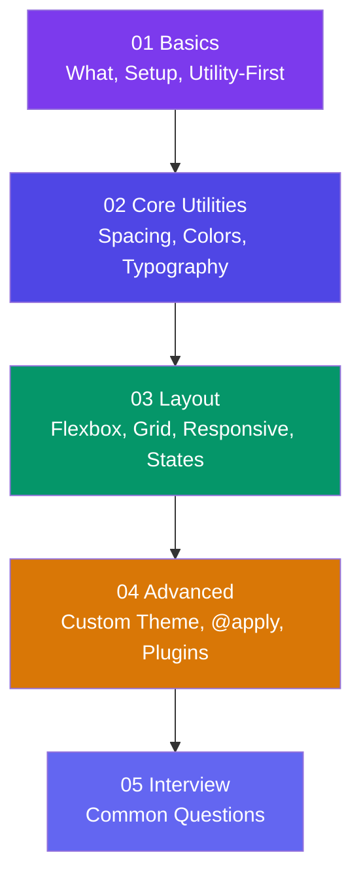

# Tailwind CSS

**Tailwind CSS** is a **utility-first CSS framework** that lets you build custom designs directly in your HTML using small, composable utility classes. Instead of writing custom CSS, you compose your UI from hundreds of pre-built classes like `flex`, `pt-4`, `text-center`, and `bg-blue-500`.

> **Analogy:** Traditional CSS is like cooking from scratch — buying every ingredient and following a recipe. Tailwind is like having a kitchen full of pre-chopped ingredients — you just grab what you need and combine them fast.

---

## Learning Path

---

## Sections

| Section | What You'll Learn |
|---------|-------------------|
| **01 Basics** | What is utility-first CSS, setting up Tailwind, the utility-first mindset |
| **02 Core Utilities** | Spacing scale, colors, typography, backgrounds, borders, shadows |
| **03 Layout** | Flexbox, Grid, responsive breakpoints, hover/focus/dark variants |
| **04 Advanced** | Customizing the theme, `@apply`, plugins, best practices |
| **05 Interview** | Common Tailwind CSS interview questions and answers |

---

## Prerequisites

- Basic **HTML** knowledge (if needed, see the [HTML & CSS track](/DSA-Notes-Problems/html-css))
- Basic **CSS** knowledge (selectors, properties, responsive design)
- A code editor (VS Code recommended)

---

## How This Track Works

- Each page starts with an **analogy** or plain-English explanation
- Concepts are followed by **small HTML snippets** with Tailwind classes and visual results
- Pages end with an **"In Simple Words"** summary
- **Mermaid diagrams** illustrate key concepts visually

Start with **[What is Tailwind CSS?](./01-basics/what-is-tailwind)** to begin!
