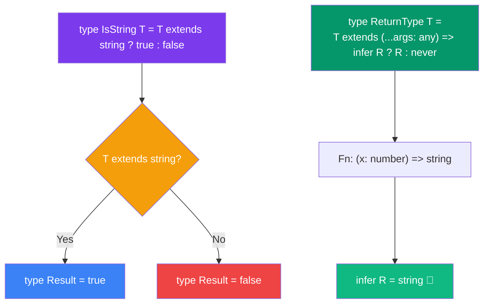

## Conditional Types in TypeScript

### What are Conditional Types?

Conditional types select one of two possible types based on a condition. They're like ternary operators (`condition ? a : b`) but at the **type level**.

### Conditional Type Resolution



> **Analogy:** Conditional types are like a compiler telling you: "If the input is a string, label it true; if it's anything else, label it false." The `infer` keyword is like saying "tell me what type is inside this other type."

### Basic Syntax

```typescript
type IsString<T> = T extends string ? true : false;

type A = IsString<"hello">;  // true
type B = IsString<42>;       // false
type C = IsString<string>;   // true
type D = IsString<number>;   // false
```

### Filtering with Conditional Types

```typescript
// Extract only string types from a union
type ExtractString<T> = T extends string ? T : never;

type StringsOnly = ExtractString<string | number | boolean | "hello">;
// Result: string | "hello"

// Remove null/undefined
type NonNullable<T> = T extends null | undefined ? never : T;
```

### The `infer` Keyword

```typescript
// Extract the return type of a function
type ReturnType<T> = T extends (...args: any[]) => infer R ? R : never;

type Fn = (x: number) => string;
type Result = ReturnType<Fn>;  // string

// Extract array element type
type ElementType<T> = T extends (infer U)[] ? U : never;

type Items = ElementType<string[]>;  // string
```

### Real Project Example

```typescript
// Extract API response data types
type ApiResponse<T> = 
  T extends { data: infer D } ? D : 
  T extends { error: infer E } ? E : 
  never;

type SuccessResponse = { data: { id: number; name: string } };
type UserData = ApiResponse<SuccessResponse>;  // { id: number; name: string }

// Type-safe event payload extraction
type EventPayload<T> = 
  T extends { type: "user_created"; payload: infer P } ? P :
  T extends { type: "user_deleted"; payload: infer P } ? P :
  never;
```

### Interview Questions

**Easy:** What is a conditional type?

**Medium:** How does the `infer` keyword work?

**Hard:** Create a conditional type that extracts the resolved value type from a Promise.
