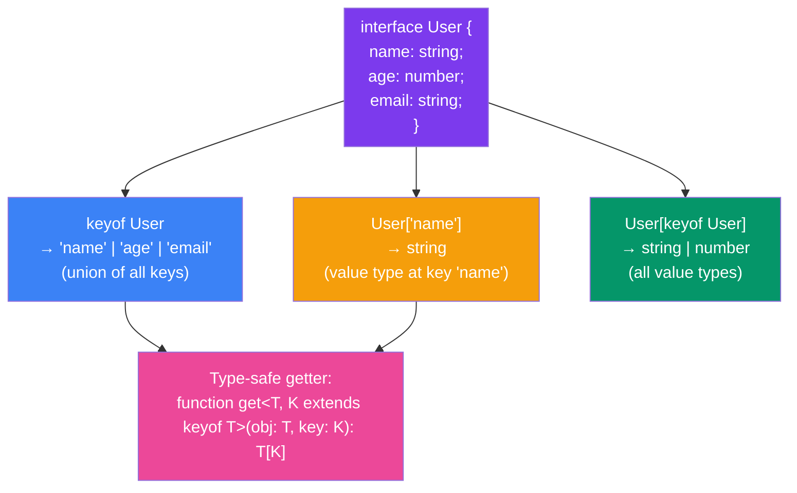

## Indexed Access Types in TypeScript

### What are Indexed Access Types?

Indexed access types allow you to **look up** a property type by its key, just like accessing an object property at runtime — but at the **type level**.

### keyof + Indexed Access



> **Analogy:** Think of `keyof` as asking a house "what rooms do you have?" — it returns a list. Indexed access (`User['name']`) is like saying "show me what's in the name room" — it returns the contents. Together they give you type-safe property access.

### Basic Syntax

```typescript
interface User {
  name: string;
  age: number;
  email: string;
}

type NameType = User["name"];   // string
type AgeType = User["age"];     // number

// Access multiple keys (union)
type NameOrAge = User["name" | "age"];
// string | number

// Access all values
type UserValue = User[keyof User];
// string | number
```

### Nested Indexed Access

```typescript
interface Address {
  street: string;
  city: string;
  zipCode: string;
}

interface Employee {
  id: number;
  name: string;
  address: Address;
  department: {
    id: number;
    name: string;
    location: {
      floor: number;
      building: string;
    };
  };
}

type DeptName = Employee["department"]["name"];
// string

type Building = Employee["department"]["location"]["building"];
// string
```

### Real Project Example

```typescript
// Type-safe event system
interface Events {
  userCreated: { id: string; name: string; email: string };
  userUpdated: { id: string; changes: Partial<User> };
  userDeleted: { id: string };
  error: { message: string; code: number };
}

// Look up event payloads by event name
type EventPayload<K extends keyof Events> = Events[K];

// Create event emitter
function emit<K extends keyof Events>(
  event: K,
  payload: EventPayload<K>
): void {
  console.log(`Event: ${event}`, payload);
}

emit("userCreated", { id: "1", name: "Alice", email: "alice@test.com" });
emit("error", { message: "Not found", code: 404 });
```

### Interview Questions

**Easy:** How do indexed access types work?

**Medium:** How can you access multiple property types at once?

**Hard:** Create a type-safe event emitter using indexed access types.
