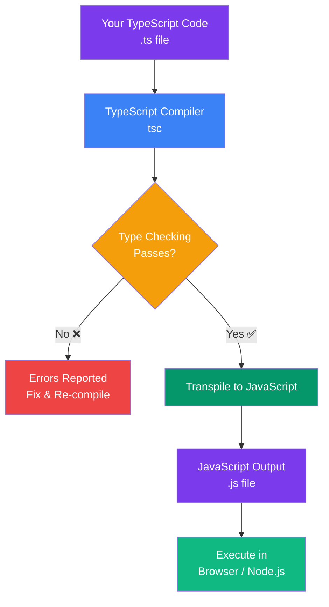
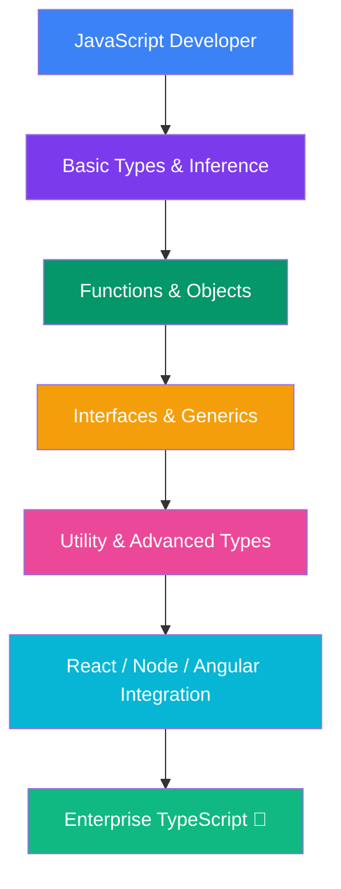

## Introduction to TypeScript

### What is TypeScript?

**TypeScript** is a superset of JavaScript developed by Microsoft that adds **static type checking** to the language. It compiles down to plain JavaScript that runs anywhere JavaScript runs — browsers, Node.js, Deno, and more.

> **Analogy:** JavaScript is like writing a shopping list on a napkin — flexible but easy to make mistakes. TypeScript is like using a structured shopping app — it tells you when you've typed "mil" instead of "milk" before you go to the store.

### Key Facts

| Fact | Detail |
|------|--------|
| **Creator** | Anders Hejlsberg (also created C#) |
| **First Release** | October 2012 |
| **Current Version** | TypeScript 5.x (2024+) |
| **Paradigm** | Multi-paradigm: OOP, Functional, Generic |
| **Compilation** | `tsc` compiles `.ts` to `.js` |
| **License** | Apache 2.0 |

### Why TypeScript Was Created

JavaScript was never designed for large-scale applications. As web apps grew from simple scripts to complex enterprise systems (Slack, VS Code, Figma), JavaScript's lack of a type system became a major pain point:

1. **Runtime errors** — Most bugs appear only at runtime
2. **Poor tooling** — No autocomplete, refactoring, or go-to-definition
3. **Documentation gaps** — Functions don't declare what they expect or return
4. **Team scalability** — Large codebases become unmaintainable

TypeScript solves these by catching errors **at compile time**, before your code ever runs.

---

### Problems TypeScript Solves

| Problem | JavaScript | TypeScript |
|---------|-----------|------------|
| Undefined is not a function | Detected at runtime | Detected at compile time |
| Wrong argument types | Silent failure | Compiler error |
| Refactoring a function signature | Manual search & replace | Compiler shows all call sites |
| Missing properties on objects | `undefined` at runtime | Compiler error |
| Team code reviews | Miss subtle type bugs | Compiler catches them |

---

### TypeScript vs JavaScript

```typescript
// JavaScript — no type checking
function greet(name) {
  return "Hello, " + name.toUpperCase();
}
greet(42); // Runtime Error: name.toUpperCase is not a function

// TypeScript — catches the bug at compile time
function greet(name: string): string {
  return "Hello, " + name.toUpperCase();
}
greet(42); // ❌ Error: Argument of type 'number' is not assignable to parameter of type 'string'
```

---

### The Type System Flow



TypeScript adds a **compile-time type checking layer** between your code and runtime execution.

---

### Real-World Usage

**Who uses TypeScript?**

| Company | Usage |
|---------|-------|
| **Microsoft** | VS Code, Teams, Azure SDK |
| **Google** | Angular, Firebase |
| **Airbnb** | Full-stack web apps |
| **Slack** | Desktop and mobile apps |
| **Asana** | Web application |
| **Shopify** | Storefront and admin |
| **Vercel** | Next.js framework |

---

---

### Common Mistakes

| Mistake | Why It's Wrong | Fix |
|---------|---------------|-----|
| Using `any` everywhere | Disables type checking entirely | Use specific types or `unknown` |
| Not configuring `tsconfig.json` | Misses strict checks | Use `strict: true` |
| Overusing type assertions | Forces the compiler to trust you | Use proper type guards |
| Ignoring compiler errors with `// @ts-ignore` | Silences real bugs | Fix the underlying type issue |

---

### Best Practices

1. **Enable `strict: true`** in `tsconfig.json` from the start
2. **Prefer `interface` over `type`** for object shapes (they extend better)
3. **Avoid `any`** — use `unknown` when you don't know the type
4. **Use `const` assertions** (`as const`) for literal types
5. **Export types** from a central `types.ts` file
6. **Use branded types** for domain primitives (e.g., `UserId` instead of `string`)
7. **Run `tsc --noEmit`** in CI to catch type errors

---

### Interview Questions

**Easy:** What is the difference between TypeScript and JavaScript?

**Medium:** Explain how TypeScript's compilation process works. What does `tsc` do?

**Hard:** How does TypeScript enable better refactoring in large codebases compared to JavaScript?

---

### Learning Path


