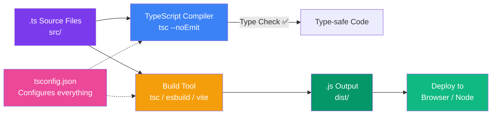

## Setting Up TypeScript

### Installation

TypeScript can be installed globally or as a project dependency.

```bash
# Install globally (not recommended for projects)
npm install -g typescript

# Install as a project dependency (recommended)
npm install --save-dev typescript

# Verify the installation
npx tsc --version
# Output: Version 5.x.x
```

> **Recommendation:** Always install TypeScript as a `devDependency` per project. This ensures every developer uses the same version.

---

### Project Initialization

Create a `tsconfig.json` file to configure the TypeScript compiler:

```bash
# Generate a default tsconfig.json
npx tsc --init
```

This creates a `tsconfig.json` with sensible defaults. For a new project, start with this configuration:

```json
{
  "compilerOptions": {
    "target": "ES2022",
    "module": "ESNext",
    "moduleResolution": "bundler",
    "strict": true,
    "esModuleInterop": true,
    "skipLibCheck": true,
    "forceConsistentCasingInFileNames": true,
    "outDir": "./dist",
    "rootDir": "./src"
  },
  "include": ["src/**/*.ts"],
  "exclude": ["node_modules", "dist"]
}
```

---

### tsconfig.json Deep Dive

Every option in `tsconfig.json` controls how TypeScript behaves:

#### Core Options

| Option | Purpose | Recommended |
|--------|---------|-------------|
| `target` | Which JS version to compile to | `ES2022` or `ESNext` |
| `module` | Module system for output | `ESNext`, `CommonJS`, or `NodeNext` |
| `strict` | Enable all strict type checks | `true` |
| `outDir` | Output directory for compiled JS | `./dist` |
| `rootDir` | Source directory | `./src` |

#### Strict Mode Flags

When `strict: true` is enabled, these individual checks are turned on:

| Flag | What It Does |
|------|-------------|
| `noImplicitAny` | Error when TypeScript can't infer a type |
| `strictNullChecks` | `null` and `undefined` are only assignable to `unknown`, `any`, and their respective types |
| `strictFunctionTypes` | Enables stricter checking of function types |
| `strictBindCallApply` | Checks arguments to `bind`, `call`, `apply` |
| `strictPropertyInitialization` | Class properties must be initialized in constructor |
| `noImplicitThis` | Error when `this` has an implicit `any` type |
| `alwaysStrict` | Always emit `"use strict"` |

---

### Project Structure

A typical TypeScript project structure:

```
my-project/
├── src/
│   ├── index.ts          # Entry point
│   ├── types/
│   │   └── index.ts      # Shared type definitions
│   ├── utils/
│   │   ├── helpers.ts
│   │   └── validation.ts
│   └── services/
│       └── api.ts
├── dist/                  # Compiled output (gitignored)
├── tests/
│   └── index.test.ts
├── tsconfig.json
├── package.json
└── .gitignore
```

---

### Compiling TypeScript

```bash
# Compile once
npx tsc

# Compile in watch mode (recompiles on changes)
npx tsc --watch

# Check types without emitting files
npx tsc --noEmit

# Compile a single file
npx tsc src/index.ts --outDir dist

# Compile with a specific config file
npx tsc --project tsconfig.json
```

---

### Build Scripts in package.json

```json
{
  "scripts": {
    "build": "tsc",
    "watch": "tsc --watch",
    "typecheck": "tsc --noEmit",
    "clean": "rm -rf dist"
  }
}
```

---

### ESLint + TypeScript

```bash
npm install --save-dev eslint @typescript-eslint/parser @typescript-eslint/eslint-plugin
```

```json
// .eslintrc.json
{
  "parser": "@typescript-eslint/parser",
  "plugins": ["@typescript-eslint"],
  "extends": [
    "eslint:recommended",
    "plugin:@typescript-eslint/recommended"
  ],
  "rules": {
    "@typescript-eslint/no-explicit-any": "warn",
    "@typescript-eslint/explicit-function-return-type": "off"
  }
}
```

---

### Project Architecture: TypeScript Compilation



> **Flow:** Write `.ts` in `src/` → `tsc` checks types (in CI: `--noEmit`) → build tool emits `.js` to `dist/` → deploy. The `tsconfig.json` file is the control panel that tells everything how to behave.

### TypeScript with Bundlers

**Vite:**
```bash
npm create vite@latest my-app -- --template react-ts
```

**Webpack:**
```bash
npm install --save-dev ts-loader
```

```javascript
// webpack.config.js
module.exports = {
  entry: './src/index.ts',
  module: {
    rules: [
      { test: /\.tsx?$/, use: 'ts-loader', exclude: /node_modules/ }
    ]
  },
  resolve: { extensions: ['.tsx', '.ts', '.js'] }
};
```

---

### VS Code Integration

VS Code has built-in TypeScript support. Key features:

| Feature | Shortcut |
|---------|----------|
| Go to Definition | `F12` |
| Find References | `Shift + F12` |
| Rename Symbol | `F2` |
| Quick Fix | `Ctrl + .` |
| Type Hints | Hover over variable |
| Auto Import | Type and select from suggestions |

Enable these in `settings.json`:

```json
{
  "typescript.updateImportsOnFileMove.enabled": "always",
  "typescript.suggest.autoImports": true,
  "typescript.preferences.importModuleSpecifier": "relative"
}
```

---

### Common Mistakes

| Mistake | Fix |
|---------|-----|
| Installing TypeScript globally | Use `npm install --save-dev typescript` per project |
| Not using `strict: true` | Enables critical type safety checks |
| Ignoring `tsconfig.json` errors | Fix configuration before coding |
| Mixing module systems | Match `module` to your bundler's requirements |

---

### Best Practices

1. **Always use `strict: true`** in tsconfig.json
2. **Add `build`, `watch`, and `typecheck` scripts** to package.json
3. **Run `tsc --noEmit` in CI** to prevent type errors from reaching production
4. **Keep `rootDir` and `outDir` separate** so compiled JS doesn't pollute source
5. **Use `.gitignore`** to exclude `dist/` and `node_modules/`

---

### Interview Questions

**Easy:** How do you create a new TypeScript project from scratch?

**Medium:** What does `strict: true` enable in tsconfig.json?

**Hard:** Explain the difference between `target`, `module`, and `moduleResolution` in tsconfig.json and when you'd use each.
