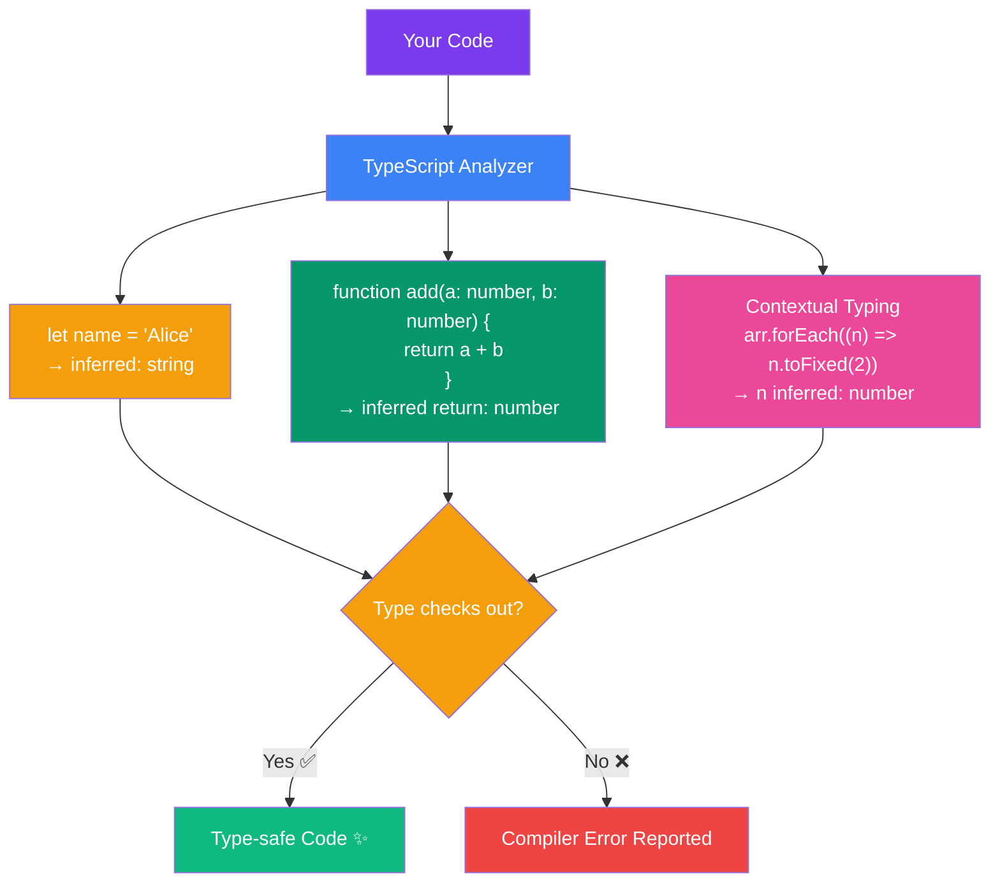

## Type Inference in TypeScript

### What is Type Inference?

Type inference is TypeScript's ability to automatically determine the type of a variable, function return value, or expression without explicit annotations. The compiler analyzes how values are used and assigns types accordingly.



---

### How Inference Works

```typescript
// TypeScript infers the type from the value:
let name = "Alice";           // inferred as: string
let age = 25;                 // inferred as: number
let isActive = true;          // inferred as: boolean
let items = [];               // inferred as: any[] (be careful!)
```

> **Analogy:** Type inference is like a smart assistant who watches you place items in boxes and remembers what belongs where — you don't need to label every box.

---

### Variable Inference

```typescript
// TypeScript looks at the initial value
let count = 0;                // number
count = 10;                   // OK
// count = "hello";           // ❌ Error: Type 'string' is not assignable to type 'number'

// Const declarations infer literal types
const STATUS = "active";      // "active" (literal type, not string)
const PORT = 3000;            // 3000 (literal type, not number)

// Let declarations infer wider types
let status = "active";        // string (wider — can be reassigned)
status = "inactive";          // OK
```

---

### Function Return Type Inference

```typescript
// TypeScript infers the return type from the function body
function add(a: number, b: number) {
  return a + b;              // inferred return type: number
}

function greet(name: string) {
  return `Hello, ${name}!`;  // inferred return type: string
}

function getValue(flag: boolean) {
  if (flag) {
    return "active";         // string
  }
  return null;               // null
}                            // inferred return type: string | null
```

---

### Contextual Typing

TypeScript can infer types from the **context** in which a value is used:

```typescript
// Event handler — context knows the parameter type
document.addEventListener("click", function (event) {
  console.log(event.clientX);  // event is inferred as MouseEvent
});

// Array methods — context from the callback
const numbers = [1, 2, 3];
numbers.forEach((num) => {
  console.log(num.toFixed(2)); // num is inferred as number
});

// Object literal — context from the type
interface Config {
  url: string;
  timeout: number;
  retries?: number;
}

const config: Config = {
  url: "https://api.example.com",
  timeout: 5000,             // TypeScript checks types against Config
  // typo: true              // ❌ Error: 'typo' does not exist in type 'Config'
};
```

---

### Best Common Type

When inferring types from multiple values, TypeScript finds the **best common type**:

```typescript
// Array with multiple types — infers the best common supertype
const arr = [1, 2, 3];             // number[]
const mixed = [1, "hello", true];  // (string | number | boolean)[]

// With objects — finds common properties
const obj1 = { x: 10, y: 20 };
const obj2 = { x: 5, z: 30 };
const combined = [obj1, obj2];      // { x: number; y?: number; z?: number }[]
```

---

### Type Widening and Narrowing

**Widening** — Types automatically widen to accommodate more values:

```typescript
// Literal types widen
const x = 10;                // type: 10 (literal)
let y = x;                   // type: number (widened)
y = 20;                      // OK
// y = "hello";              // ❌ Error

// String literals widen
const direction = "left";     // type: "left"
let dir = direction;          // type: string (widened)
```

**Narrowing** — Types become more specific based on control flow:

```typescript
function process(value: string | number) {
  // value is string | number here
  
  if (typeof value === "string") {
    // value is string here (narrowed)
    return value.toUpperCase();
  }
  
  // value is number here (narrowed)
  return value.toFixed(2);
}
```

---

### When to Add Explicit Annotations

```typescript
// 1. Function parameters (required — cannot be inferred)
function greet(name: string): void {
  console.log(`Hello, ${name}`);
}

// 2. Complex object shapes
interface User {
  id: string;
  name: string;
  email: string;
}
const user: User = { id: "1", name: "Alice", email: "alice@example.com" };

// 3. When inference gives a too-wide type
const items: string[] = [];  // Without annotation, would be any[]

// 4. Function return types (optional but good practice)
function fetchUser(id: string): Promise<User> {
  return api.get(`/users/${id}`);
}
```

---

### Real Project Example

```typescript
// API response handling with inference
interface ApiResponse<T> {
  data: T;
  status: number;
  message: string;
}

async function fetchData<T>(url: string): Promise<ApiResponse<T>> {
  const response = await fetch(url);
  return response.json();
}

// TypeScript infers the generic type from usage
const userResponse = await fetchData<User>("/api/users/1");
// userResponse.data is inferred as User

// Contextual typing in React hooks
const [count, setCount] = useState(0);        // count: number
const [name, setName] = useState("");          // name: string
const [user, setUser] = useState<User | null>(null); // user: User | null
```

---

### Common Mistakes

| Mistake | Why It's Wrong | Fix |
|---------|---------------|-----|
| Relying on inference for empty arrays | Infers `any[]` | Add type annotation: `const arr: number[] = []` |
| Assuming const narrows everywhere | `const` objects still have mutable properties | Use `as const` assertion |
| Forgetting parameter types | Parameters can't be inferred | Always annotate function parameters |
| Trusting inference across function calls | Return type might surprise you | Explicitly annotate complex return types |

---

### Interview Questions

**Easy:** What is type inference? Give an example.

**Medium:** Explain contextual typing with an example using event handlers.

**Hard:** How does TypeScript determine the "best common type" in an array with multiple types?
